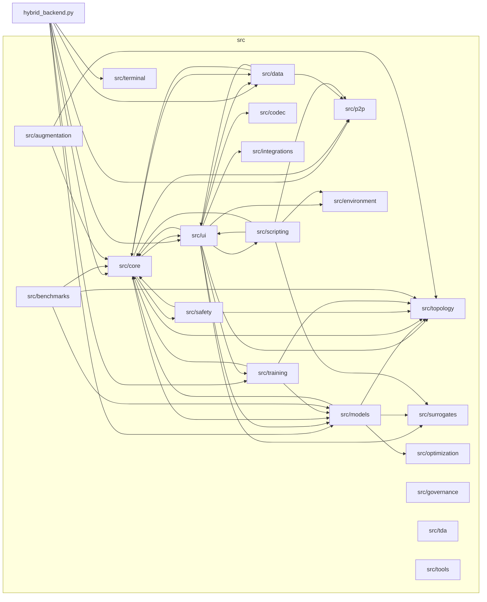
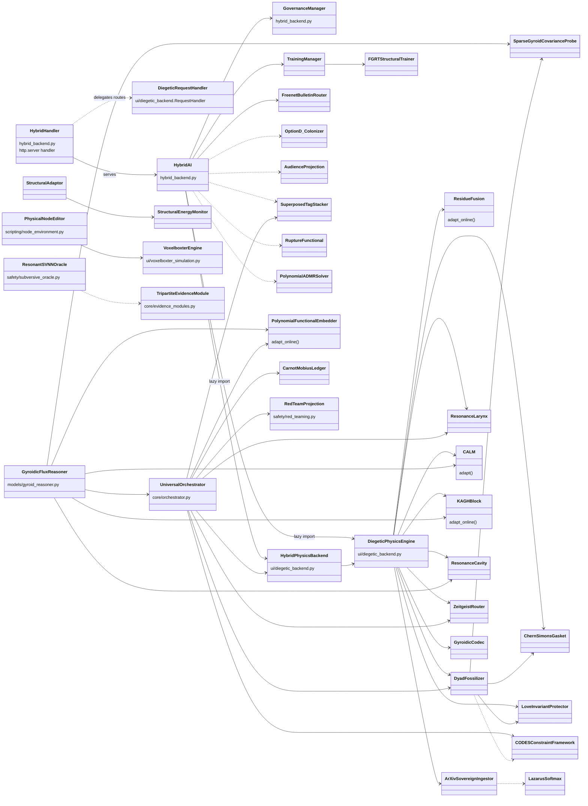

# PYTHONPATH Rule
When running Python scripts in this repository, always ensure that `$env:PYTHONPATH="."` is set in PowerShell so that the `src` module can be resolved.
Example: `$env:PYTHONPATH="."; .venv\scripts\python.exe tests\test_unicorn_synthesis.py`

# Project Map
- `docs/`: Theoretical documentation, architectural specifications, and stepping stairs landings.
  - `STEPPING_STAIRS_NAVIGATIONAL_TREE.md`: Master stepping stairs navigation map.
  - `UNIVERSAL_ORCHESTRATOR_REHYBRIDIZATION.md`: Master blueprint mapping isolated systems into `hybrid_backend.py` and `src/core/orchestrator.py`.
  - `stepping_stairs_tier_0_vestibule/`: Tier 0 Vestibule landing.
    - `00_entrance_to_lower_level/`: Subterranean gateway portal.
    - `01_architecture_core/`: Core architecture, system constitution, and module inventory.
    - `02_math_physics_topology/`: Mathematical details (FGRT, Atiyah-Singer index, manifolds, ADMR).
    - `stepping_stairs_tier_1_mezzanine/`: Tier 1 Mezzanine landing.
      - `03_philosophy_lore/`: Non-dual dynamics, archetypes, and TADC lore.
      - `04_components_and_mechanics/`: Scripting systems, garden attractors, and prime resonance ladders.
      - `stepping_stairs_tier_2_crypt/`: Tier 2 Crypt landing.
        - `05_implementation_and_guides/`: Command guides, Codes v40, and implementation integrity.
        - `06_reports_and_inspirations/`: Breakthrough reports, visual artifacts, and inspirations.
        - `extended coherence research/`: RP4 cosmology and BAO zero-parameter validations.
        - `summaries/`: Historical audit logs and component summaries.
- `src/`: Implementation of the Gyroidic Sparse Covariance Flux Reasoner.
  - `hybrid_backend.py`: The unified runtime runner and HTTP/WebSocket server.
  - `core/`: The reasoning engine core (orchestrator, invariants, FGRT primitives, ADMR, evidence modules, energy monitor).
  - `topology/`: Advanced geometry systems (PyOpenCL gyroid covariance, hyper-rings, Moebius bundles).
  - `scripting/`: Physical scripting node graph (`node_environment.py`).
  - `models/`: Neural and symbolic reasoning heads (gyroid reasoner, polynomial embeddings, resonance cavity).
  - `surrogates/`: CALM and KAGH fast meta-learning surrogates.
  - `safety/`: Red teaming, trust inheritance, and subversive oracle probes.
  - `training/`: Enhanced temporal training, FGRT structural trainer, and EBM adaptors.
  - `ui/`: Diegetic backend, Voxelboxter simulation, and conversational GUI interfaces.
  - `data/`: Sovereign knowledge ingestion (ArXiv, bulletin boards, Wikipedia, financial feeds).
  - `codec/`: Gyroidic codec and vision surgery.
  - `p2p/`: Bonfire nomadic ring consensus and Freenet client.
- `tests/`: Comprehensive unit, integration, and stress test suites.
- `.agents/`: Operational rules and integrity guidelines.

# Living Interaction Map (Mermaid)
> LIVING DOCUMENT: the AI assistant is permitted and expected to GROW these diagrams.
> When you discover or add a real import / ownership / call edge between modules or classes,
> add it here. Only record edges verified in code (rg on `from src.` imports). Do not invent edges.
> Entry point: `hybrid_backend.py` (run with `$env:PYTHONPATH="."`). All library code lives in `src/`.
> Last grown: 2026-10-16.

## 1. Module-to-Module Interaction (package level)

## 2. Module-to-Module Interaction (file level, key hubs)

```mermaid
flowchart TD
    HB["hybrid_backend.py"]
    DB["ui/diegetic_backend.py"]
    ORCH["core/orchestrator.py"]
    GR["models/gyroid_reasoner.py"]
    KI["data/knowledge_ingestor.py"]
    KDF["core/knowledge_dyad_fossilizer.py"]
    HJ["core/honest_jitter.py"]
    INV["core/invariants.py"]
    FT["core/failure_token.py"]
    ADMR["core/admr_solver.py"]
    AUD["core/audience_mapping.py"]
    STS["core/superposed_tag_stacker.py"]
    UDP["terminal/udp_server_colonizer.py"]
    TM["training/training_manager.py"]
    ETT["training/enhanced_temporal_training.py"]
    FBR["data/freenet_bulletin_router.py"]
    FGC["data/freenet_ghost_caller.py"]
    CALMF["surrogates/calm_predictor.py"]
    KAGH["surrogates/kagh_networks.py"]
    GC["topology/gyroid_covariance.py"]
    CSG["core/chern_simons_gasket.py"]
    LIP["core/love_invariant_protector.py"]
    CODES["core/codes_constraint_framework.py"]
    GLUE["core/gluing_operator.py"]
    DH["models/diegetic_heads.py"]
    PE["models/polynomial_embeddings.py"]
    RC["models/resonance_cavity.py"]
    CODEC["codec/gyroidic_codec.py"]
    P2P["p2p/bonfire_consensus.py & freenet_ws_client.py"]
    NODE["scripting/node_environment.py"]
    VBSIM["ui/voxelboxter_simulation.py"]
    VBCLI["ui/voxelboxter_client.py"]
    EVM["core/evidence_modules.py"]
    SUBOR["safety/subversive_oracle.py"]
    REDT["safety/red_teaming.py"]
    EM["core/energy_monitor.py"]
    FGRTT["training/fgrt_trainer.py"]
    STRTR["training/trainer.py"]
    CLEAN["environment/cleanroom_mechanics.py"]

    HB --> INV & AUD & STS & UDP & FT & ADMR & ETT & TM & FBR & FGC & P2P
    HB --> DB
    DB --> KDF & KI & CALMF & KAGH & GC & CSG & LIP & DH & RC & CODEC & GLUE & AUD & HJ & INV
    ORCH --> DB & KDF & CODES & DH & PE & RC & STS & INV & LIP & HJ & FBR & P2P & REDT
    GR --> ORCH & CALMF & KAGH & GC & CSG & LIP & PE & RC & HJ
    KI --> GLUE & HJ
    KDF --> HJ & GC & LIP & CSG & CODES
    NODE --> VBSIM & CLEAN & P2P & CALMF & LIP
    VBCLI --> ORCH & SUBOR & REDT & VBSIM & NODE
    STRTR --> EM & INV
    TM --> FGRTT
    FGRTT --> CORE & MODELS
```

## 3. Class-to-Class Interaction

## Growth Log
- 2026-10-15: Seeded from imports of `hybrid_backend.py`, `ui/diegetic_backend.py`, `core/orchestrator.py`, `models/gyroid_reasoner.py`, `data/knowledge_ingestor.py`, `core/knowledge_dyad_fossilizer.py`.
- 2026-10-16: Expanded with verified edges across `src/scripting/*` (`node_environment.py`), `src/safety/*` (`red_teaming.py`, `subversive_oracle.py`), `src/training/*` (`fgrt_trainer.py`, `trainer.py`), `src/core/energy_monitor.py`, `src/ui/voxelboxter_simulation.py`, and `src/environment/cleanroom_mechanics.py`. Identified isolated system islands and formulated rehybridization vectors in `docs/UNIVERSAL_ORCHESTRATOR_REHYBRIDIZATION.md`.
- 2026-10-19: Audited codebase reachability across all 204 non-init modules in `src/`. Confirmed 190 modules (93.1%) reachable from primary orchestrators; identified 14 files (6.9%) unreachable from entry runners (`hybrid_backend.py`, `orchestrator.py`, `diegetic_backend.py`) and 26 files (12.7%) lacking bi-directional integration with `src/core/` (secondary ingestion tools, standalone evaluation benchmarks, unlinked UI servers, and CLI diagnostic probes). Documented false breakthrough history and shape compatibility resolutions.
