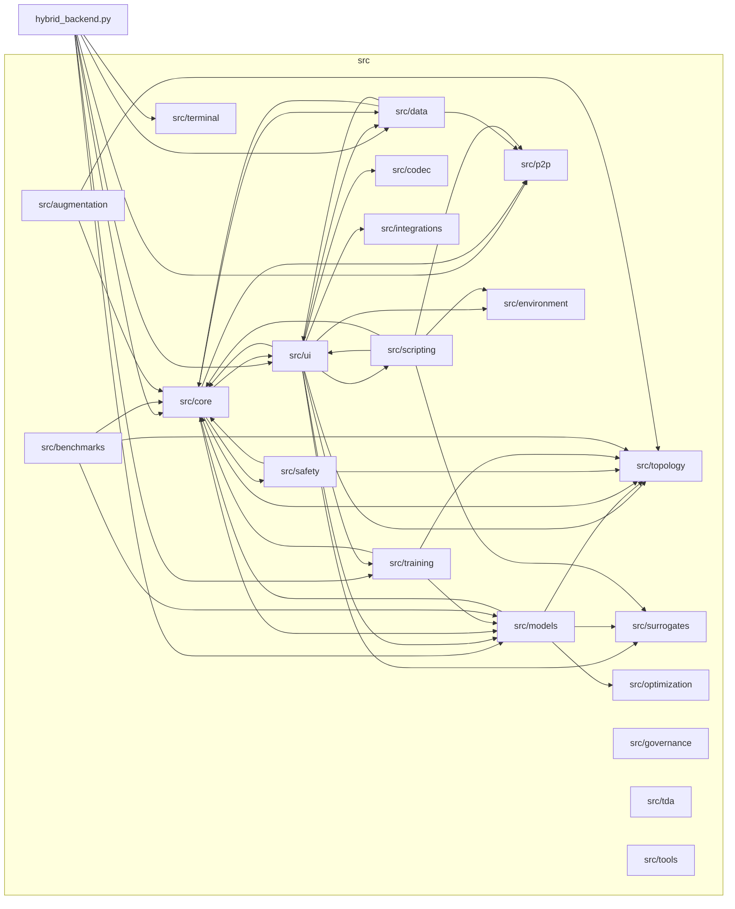
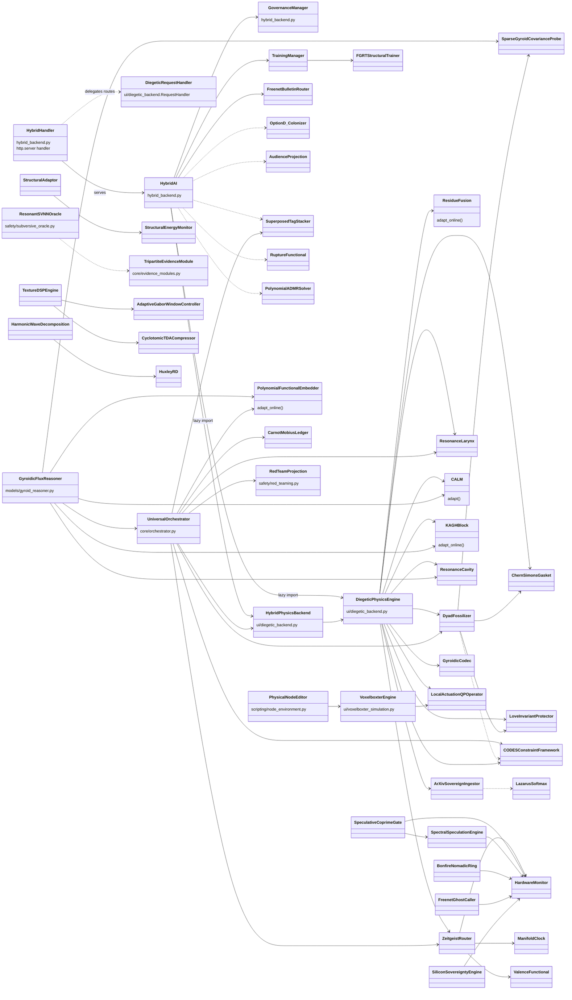

# PYTHONPATH Rule
When running Python scripts in this repository, always ensure that `$env:PYTHONPATH="."` is set in PowerShell so that the `src` module can be resolved.
Example: `$env:PYTHONPATH="."; .venv\scripts\python.exe tests\test_unicorn_synthesis.py`

# Excluded Root Hazard Directories
Never run unfiltered recursive searches across the workspace root. Exclude `.venv`, `data`, `datasets`, `node_modules`, `wikipedia extracter`, `gyroidic reasoner related media`, `test_raw_data`, `test_storage`, `test_repo`, `recovered_files`, `tmp`, `scratch`, `google secret`, `.git`, `__pycache__`, `.pytest_cache`, `.qodo`, and `.zk_proofs`.

# Rule-Bearing Documentation & Canonical Maps in `docs/`
The following files in `docs/` function directly as architectural rules, mathematical invariants, and structural maps:
- `docs/STEPPING_STAIRS_NAVIGATIONAL_TREE.md`: Master stepping stairs navigation map.
- `docs/UNIVERSAL_ORCHESTRATOR_REHYBRIDIZATION.md`: Master blueprint mapping subsystems into `hybrid_backend.py` and `src/core/orchestrator.py`.
- `docs/stepping_stairs_tier_0_vestibule/01_architecture_core/MODULE_INVENTORY.md`: Complete inventory of modules and classes across `src/`.
- `docs/stepping_stairs_tier_0_vestibule/02_math_physics_topology/MATHEMATICAL_DETAILS.md`: Governing equations, PAS_h, APAS_zeta, Prime/Fibonacci/Catalan invariants, and FGRT operators.
- `docs/stepping_stairs_tier_0_vestibule/02_math_physics_topology/TOPOLOGICAL_EXTENSIONS.md`: Topological extensions, Stasheff Associahedron bracketings, and manifold triangulations.
- `docs/stepping_stairs_tier_0_vestibule/02_math_physics_topology/MATRYOSHKA_POLYTOPE_MAP.md`: Nested Matrioshka polytope containment and Catalan shell parenthesizations.
- `docs/stepping_stairs_tier_0_vestibule/02_math_physics_topology/KINEMATIC_RESONANCE_MAPPINGS.md`: Kinematic resonance and structural mappings.
- `docs/stepping_stairs_tier_0_vestibule/stepping_stairs_tier_1_mezzanine/03_philosophy_lore/NOMENCLATURE.md`: Canonical terminology and anti-lobotomy definitions.
- `docs/stepping_stairs_tier_0_vestibule/stepping_stairs_tier_1_mezzanine/04_components_and_mechanics/PRIME_RESONANCE_LADDER.md`: Prime Resonance Ladder, Repunit mirrors, Fibonacci-Prime entropy, and Catalan Associahedron non-associative operator bracketings.
- `docs/stepping_stairs_tier_0_vestibule/stepping_stairs_tier_1_mezzanine/stepping_stairs_tier_2_crypt/05_implementation_and_guides/CODES_Implementation_Mapping.md`: CODES v40 invariant-to-code mapping.
- `docs/stepping_stairs_tier_0_vestibule/stepping_stairs_tier_1_mezzanine/stepping_stairs_tier_2_crypt/05_implementation_and_guides/IMPLEMENTATION_PLAN_FORMALISM.md`: Implementation plan formalism.
- `docs/stepping_stairs_tier_0_vestibule/stepping_stairs_tier_1_mezzanine/stepping_stairs_tier_2_crypt/05_implementation_and_guides/OPEN_QUESTIONS.md`: Open mathematical questions and architectural resolutions.

# Project Map
- `docs/`: Theoretical documentation, architectural specifications, and stepping stairs landings.
  - `STEPPING_STAIRS_NAVIGATIONAL_TREE.md`: Master stepping stairs navigation map.
  - `UNIVERSAL_ORCHESTRATOR_REHYBRIDIZATION.md`: Master blueprint mapping isolated systems into `hybrid_backend.py` and `src/core/orchestrator.py`.
  - `stepping_stairs_tier_0_vestibule/`: Tier 0 Vestibule landing.
    - `00_entrance_to_lower_level/`: Subterranean gateway portal.
    - `01_architecture_core/`: Core architecture, system constitution, and module inventory.
    - `02_math_physics_topology/`: Mathematical details (FGRT, Atiyah-Singer index, manifolds, ADMR).
    - `stepping_stairs_tier_1_mezzanine/`: Tier 1 Mezzanine landing.
      - `03_philosophy_lore/`: Non-dual dynamics, archetypes, and TADC lore.
      - `04_components_and_mechanics/`: Scripting systems, garden attractors, and prime resonance ladders.
      - `stepping_stairs_tier_2_crypt/`: Tier 2 Crypt landing.
        - `05_implementation_and_guides/`: Command guides, Codes v40, and implementation integrity.
        - `06_reports_and_inspirations/`: Breakthrough reports, visual artifacts, and inspirations.
        - `extended coherence research/`: RP4 cosmology and BAO zero-parameter validations.
        - `summaries/`: Historical audit logs and component summaries.
- `src/`: Implementation of the Gyroidic Sparse Covariance Flux Reasoner.
  - `hybrid_backend.py`: The unified runtime runner and HTTP/WebSocket server.
  - `core/`: The reasoning engine core (orchestrator, invariants, FGRT primitives, ADMR, evidence modules, energy monitor).
  - `topology/`: Advanced geometry systems (PyOpenCL gyroid covariance, hyper-rings, Moebius bundles).
  - `scripting/`: Physical scripting node graph (`node_environment.py`).
  - `models/`: Neural and symbolic reasoning heads (gyroid reasoner, polynomial embeddings, resonance cavity).
  - `surrogates/`: CALM and KAGH fast meta-learning surrogates.
  - `safety/`: Red teaming, trust inheritance, and subversive oracle probes.
  - `training/`: Enhanced temporal training, FGRT structural trainer, and EBM adaptors.
  - `ui/`: Diegetic backend, Voxelboxter simulation, and conversational GUI interfaces.
  - `data/`: Sovereign knowledge ingestion (ArXiv, bulletin boards, Wikipedia, financial feeds).
  - `codec/`: Gyroidic codec and vision surgery.
  - `p2p/`: Bonfire nomadic ring consensus and Freenet client.
- `tests/`: Comprehensive unit, integration, and stress test suites.
- `.agents/`: Operational rules and integrity guidelines.

# Living Interaction Map (Mermaid)
> LIVING DOCUMENT: the AI assistant is permitted and expected to GROW these diagrams.
> When you discover or add a real import / ownership / call edge between modules or classes,
> add it here. Only record edges verified in code (rg on `from src.` imports). Do not invent edges.
> Entry point: `hybrid_backend.py` (run with `$env:PYTHONPATH="."`). All library code lives in `src/`.
> Last grown: 2026-10-16.

## 1. Module-to-Module Interaction (package level)

## 2. Module-to-Module Interaction (file level, key hubs)

```mermaid
flowchart TD
    HB["hybrid_backend.py"]
    DB["ui/diegetic_backend.py"]
    ORCH["core/orchestrator.py"]
    GR["models/gyroid_reasoner.py"]
    KI["data/knowledge_ingestor.py"]
    KDF["core/knowledge_dyad_fossilizer.py"]
    HJ["core/honest_jitter.py"]
    INV["core/invariants.py"]
    FT["core/failure_token.py"]
    ADMR["core/admr_solver.py"]
    AUD["core/audience_mapping.py"]
    STS["core/superposed_tag_stacker.py"]
    UDP["terminal/udp_server_colonizer.py"]
    TM["training/training_manager.py"]
    ETT["training/enhanced_temporal_training.py"]
    FBR["data/freenet_bulletin_router.py"]
    FGC["data/freenet_ghost_caller.py"]
    CALMF["surrogates/calm_predictor.py"]
    KAGH["surrogates/kagh_networks.py"]
    GC["topology/gyroid_covariance.py"]
    CSG["core/chern_simons_gasket.py"]
    LIP["core/love_invariant_protector.py"]
    CODES["core/codes_constraint_framework.py"]
    GLUE["core/gluing_operator.py"]
    DH["models/diegetic_heads.py"]
    PE["models/polynomial_embeddings.py"]
    RC["models/resonance_cavity.py"]
    CODEC["codec/gyroidic_codec.py"]
    P2P["p2p/bonfire_consensus.py & freenet_ws_client.py"]
    NODE["scripting/node_environment.py"]
    VBSIM["ui/voxelboxter_simulation.py"]
    VBCLI["ui/voxelboxter_client.py"]
    EVM["core/evidence_modules.py"]
    SUBOR["safety/subversive_oracle.py"]
    REDT["safety/red_teaming.py"]
    EM["core/energy_monitor.py"]
    FGRTT["training/fgrt_trainer.py"]
    STRTR["training/trainer.py"]
    CLEAN["environment/cleanroom_mechanics.py"]
    CFH["data/chatgpt_friction_harvester.py"]
    AE["core/archetype_engines.py"]

    HB --> INV & AUD & STS & UDP & FT & ADMR & ETT & TM & FBR & FGC & P2P
    HB --> DB
    DB --> KDF & KI & CALMF & KAGH & GC & CSG & LIP & DH & RC & CODEC & GLUE & AUD & HJ & INV & CFH
    ORCH --> DB & KDF & CODES & DH & PE & RC & STS & INV & LIP & HJ & FBR & P2P & REDT & CFH & AE
    GR --> ORCH & CALMF & KAGH & GC & CSG & LIP & PE & RC & HJ
    KI --> GLUE & HJ
    KDF --> HJ & GC & LIP & CSG & CODES
    NODE --> VBSIM & CLEAN & P2P & CALMF & LIP
    VBCLI --> ORCH & SUBOR & REDT & VBSIM & NODE
    STRTR --> EM & INV
    TM --> FGRTT
    FGRTT --> CORE & MODELS
    CFH --> KI & AE & P2P & KDF
    AE --> CFH
```

## 3. Class-to-Class Interaction

## Growth Log
- 2026-10-15: Seeded from imports of `hybrid_backend.py`, `ui/diegetic_backend.py`, `core/orchestrator.py`, `models/gyroid_reasoner.py`, `data/knowledge_ingestor.py`, `core/knowledge_dyad_fossilizer.py`.
- 2026-10-16: Expanded with verified edges across `src/scripting/*` (`node_environment.py`), `src/safety/*` (`red_teaming.py`, `subversive_oracle.py`), `src/training/*` (`fgrt_trainer.py`, `trainer.py`), `src/core/energy_monitor.py`, `src/ui/voxelboxter_simulation.py`, and `src/environment/cleanroom_mechanics.py`. Identified isolated system islands and formulated rehybridization vectors in `docs/UNIVERSAL_ORCHESTRATOR_REHYBRIDIZATION.md`.
- 2026-10-19: Audited codebase reachability across all 204 non-init modules in `src/`. Confirmed 190 modules (93.1%) reachable from primary orchestrators; identified 14 files (6.9%) unreachable from entry runners (`hybrid_backend.py`, `orchestrator.py`, `diegetic_backend.py`) and 26 files (12.7%) lacking bi-directional integration with `src/core/` (secondary ingestion tools, standalone evaluation benchmarks, unlinked UI servers, and CLI diagnostic probes). Documented false breakthrough history and shape compatibility resolutions.
- 2026-10-25: Rehybridized `ChatGPTFrictionHarvester` (`src/data/chatgpt_friction_harvester.py`) across bioplausible systems (`SovereignRefusalOperator` / Mandy in `src/core/archetype_engines.py`), search gates (`ArXivSovereignIngestor._generate_larynx_query` in `src/data/knowledge_ingestor.py`), Windows-safe slow-drip throttled memory ingestion, community compute federation via P2P mesh (`BonfireNomadicRing`), and Diegetic Terminal bulk ingestion (`/api/madoc/ingest` and `/api/bulk/ingest` in `src/ui/diegetic_backend.py`). Upgraded `sterile_data_reruns.py` to live non-semisimple topological rehydration.
- 2026-10-26: Rehybridized Quadratic and Convex Optimization Primitives: implemented `LocalActuationQPOperator` (`src/optimization/local_qp_operator.py`) as a non-teleological Local Constraint Probe Operator ($\mathcal{P}_{\text{QP}}$) with Ricci Flow parameter evolution, wired `CODESConstraintFramework` and `LocalActuationQPOperator` into Stage 5 of `DiegeticPhysicsEngine` (eliminating dummy identity forward stubs), generalized D-Wave QUBO simulated quantum annealing across `AeronauticContraption` and `RedNet16BundledCable` in `cleanroom_mechanics.py`, and integrated contractive Monge-Ampère / ICNN convex potential factorization into `RicciFlowOptimizer`. Verified 8/8 tests in `tests/test_qp_convex_primitives_rehybridization.py`.
- 2026-10-26: Rehybridized Signal Processing & Fourier Analysis Systems (ECE2026 L42 Revelations): implemented Parseval unitary energy-conserving invariance (`norm="ortho"`) across `HarmonicWaveDecomposition`, `TrigonometricUnfolding`, and `HuxleyRD` (`src/surrogates/kagh_networks.py`); implemented 2D Hann/Cyclotomic window tapering in `TextureDSPEngine` to suppress incommensurate prime logarithm frequency leakage; created `AdaptiveGaborWindowController` (`src/core/texture_dsp.py`) dynamically contracting windows on high-$H_{\text{spec}}$ Dirac epiphanies and expanding on low-$H_{\text{spec}}$ prime harmonics; added `PolynomialBasis.adapt_degree_for_window` (`src/core/polynomial_coprime.py`) to eliminate the zero-padding interpolation trap. Archived 85 legacy untracked root test/output scripts into `scratch/legacy_adhoc_tests/`. Verified 5/5 tests in `tests/test_signal_analysis_fourier_rehybridization.py`.
- 2026-10-28: Integrated Catalan Number ($C_n = \frac{1}{n+1}\binom{2n}{n}$) Invariants and Stasheff Associahedron Primitives across the Resonance Intelligence Core (`catalan_number`, `get_catalan_ladder`, `segner_catalan_weights`, `CatalanBranchingInvariant` in `src/core/invariants.py`; `CatalanAssociahedronEntropy` and `FibonacciResonanceEntropy.get_triadic_catalan_coupling` in `src/core/fgrt_primitives.py`), Stieltjes continued fractions and Touchard-Hankel unimodular ($\det H_n = 1$) moment conditioning (`src/core/number_theoretic_stabilizer.py`), Chebyshev semicircle moments and Russian-Doll block parenthesization capacity (`src/core/polynomial_coprime.py`), Euler tour Dyck ballot words (`src/core/euler_tour_lca.py`), Voynich agglutinative Segner-Catalan weighted binary parse trees (`src/core/voynich_architecture.py`), and 8x8 Trajectory Decombiner Catalan merge-tree bounds (`src/core/hessian_8x8_curvature_ledger.py`). Updated `.agents/rules/` with complete root search-hazard directory exclusions and `docs/` governance mappings.
- 2026-10-28: Audited `MODULE_INVENTORY.md` against all 204 `src/` files and added all 37 missing modules and all unmentioned classes. Reconnected local and community compute affordance feelers (`HardwareMonitor.probe_compute_feelers`, `BonfireNomadicRing.probe_community_compute_feeler`, `FreenetGhostCaller` round-trip Ghost latency telemetry) and speculative routing timings (`HardwareMonitor.evaluate_speculative_routing_timings`, 7-step Chebyshev Polynomial Speculative Trajectory Draft in `SpectralSpeculationEngine.draft_chebyshev_trajectory`, 500ms Restless Thermal Latency Guard in `SiliconSovereigntyEngine.enforce_500ms_restless_thermal_guard`, and Refresh-Triggered Play $t_{\text{RFC}} \to \mathbb{RP}^4$ Void Lazarus Transition in `ZeitgeistRouter.forward` and `SpeculativeCoprimeGate.speculative_recovery`).
