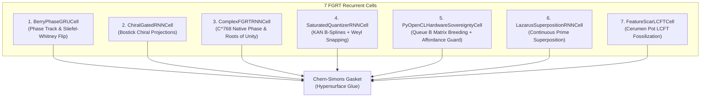

# FGRT Recurrent Neural Network Cell Implementations

> Authoritative architectural specification of the 7 topological recurrent cell models in the Fiberalized Gyroidic Recurrent Topology (FGRT).  
> **Source**: [`src/core/fgrt_rnn_cells.py`](file:///d:/programming/python/Gyroidic%20Sparse%20Covariance%20Flux%20Reasoner/src/core/fgrt_rnn_cells.py) (246 lines)  
> **Theoretical Foundation**: [FGRT_FORMALIZATION.md](file:///d:/programming/python/Gyroidic%20Sparse%20Covariance%20Flux%20Reasoner/docs/stepping_stairs_tier_0_vestibule/02_math_physics_topology/FGRT_FORMALIZATION.md)  
> **Status**: Fully Implemented & Verified

---

## 1. Overview & Recurrent Cell Taxonomy

Standard recurrent networks update a hidden state $h_t = f(W_x x_t + W_h h_{t-1})$ over an assumed Euclidean flat space. FGRT recurrent cells replace this with manifold traversal over a non-orientable Klein-Gyroid slip-space ($\mathcal{G} \cup \mathcal{K}$), tracking:
1. **Geometric Berry Phase Accumulation** ($\gamma_t$).
2. **First Stiefel-Whitney Class Obstruction** ($w_1(E) \in H^1(M; \mathbb{Z}_2)$).
3. **Logarithmic Conformal Field Theory (LCFT) Scars** fossilized in non-decaying memory tensors.
4. **Thermodynamic Affordance Protection** via [`HardwareMonitor`](file:///d:/programming/python/Gyroidic%20Sparse%20Covariance%20Flux%20Reasoner/src/core/hardware_monitor.py).



---

## 2. Detailed Cell Specifications

### Cell 1: `BerryPhaseGRUCell` (Berry-Phase Modulated GRU)
**Class**: [`BerryPhaseGRUCell`](file:///d:/programming/python/Gyroidic%20Sparse%20Covariance%20Flux%20Reasoner/src/core/fgrt_rnn_cells.py#L15)  
**Concept**: Minimal topological integration augmenting standard GRU gating with Geometric Berry Phase tracking.

- **State Representation**: Coupled tuple $(h_t, \gamma_t)$ where $h_t \in \mathbb{R}^D$ and $\gamma_t \in \mathbb{R}^1$ represents the accumulated holonomy.
- **Contorsion Twist**: Evaluates local Riemannian twist:
  $$\Delta\gamma_t = \tanh\left(W_{\text{contorsion}} [x_t, h_{t-1}]\right), \quad \gamma_t = \gamma_{t-1} + \Delta\gamma_t$$
- **Stiefel-Whitney Parity Flip**: When crossing a non-orientable Klein boundary ($\cos(\gamma_t) < 0$):
  $$h_{t-1} \longleftarrow h_{t-1} \cdot \left(1 - 2 \cdot \mathbb{I}_{[\cos(\gamma_t) < 0]}\right)$$
  Inverts state orientation and backpropagates through the orientation jump.
- **GRU Step**: $h_t = \text{GRUCell}(x_t, h_{t-1}^{\text{flipped}})$.

---

### Cell 2: `ChiralGatedRNNCell` (Chiral Gated Recurrent Cell)
**Class**: [`ChiralGatedRNNCell`](file:///d:/programming/python/Gyroidic%20Sparse%20Covariance%20Flux%20Reasoner/src/core/fgrt_rnn_cells.py#L46)  
**Concept**: Replaces scalar forget gates with Bostick chiral projection manifolds.

- **Chiral Vectors**: Maintains $K$ learnable chiral direction vectors $\{\chi_k\}_{k=1}^K \subset \mathbb{R}^D$.
- **Chiral Projection Gate**:
  $$\text{proj}_k = \langle h_{t-1}, \chi_k \rangle, \quad \Gamma_\chi = \sigma\left(\frac{1}{K}\sum_{k=1}^K \text{proj}_k\right)$$
- **Orientation-Dependent Retention**:
  $$h_t = (1 - \Gamma_\chi) \odot h_{t-1} + \Gamma_\chi \odot \tanh\left(W_x x_t + W_h h_{t-1}\right)$$
  Information is retained permanently unless its chiral orientation destructively interferes with the incoming data manifold.

---

### Cell 3: `ComplexFGRTRNNCell` (Complex-Valued Native Phase Cell)
**Class**: [`ComplexFGRTRNNCell`](file:///d:/programming/python/Gyroidic%20Sparse%20Covariance%20Flux%20Reasoner/src/core/fgrt_rnn_cells.py#L72)  
**Concept**: Operates natively in $\mathbb{C}^D$ to eliminate conditional branching during orientation flips.

- **State Representation**: $h_t \in \mathbb{C}^D$, implemented as paired real/imaginary dimensions $[B, 2D]$.
- **Gyroidic Connection**: Computes affine projection followed by cyclotomic phase advancement:
  $$\text{magnitude} = \sqrt{\text{Re}(u)^2 + \text{Im}(u)^2 + \epsilon}, \quad \theta = \text{atan2}(\text{Im}(u), \text{Re}(u)) + \frac{\pi}{4}$$
- **Atiyah-Singer Index Flip**: Traversal through $e^{i\pi} = -1$ executes smooth, analytic phase reversal without discrete if/else conditionals.

---

### Cell 4: `SaturatedQuantizerRNNCell` (B-Spline Saturated Quantizer Core)
**Class**: [`SaturatedQuantizerRNNCell`](file:///d:/programming/python/Gyroidic%20Sparse%20Covariance%20Flux%20Reasoner/src/core/fgrt_rnn_cells.py#L106)  
**Concept**: Combines Kolmogorov-Arnold B-splines with discrete Weyl-vertex quantization to prevent representation collapse ("diffusion toxin").

- **KAN Spline Transition**: Pushes $[x_t, h_{t-1}]$ through [`KANLayer`](file:///d:/programming/python/Gyroidic%20Sparse%20Covariance%20Flux%20Reasoner/src/surrogates/kagh_networks.py#L79) using true Cox-de Boor B-splines ($k=3$).
- **Speculative Ghost Drafting**: Evaluates surrogate admissibility via [`KAGHBlock`](file:///d:/programming/python/Gyroidic%20Sparse%20Covariance%20Flux%20Reasoner/src/surrogates/kagh_networks.py#L537).
- **Weyl Snapping**: Quantizes outputs to discrete steps with Straight-Through Estimator (STE):
  $$h_t^{\text{quant}} = \frac{\text{round}(h_t \cdot L)}{L}, \quad h_t \longleftarrow h_t + \left(h_t^{\text{quant}} - h_t\right)_{\text{detached}}$$

---

### Cell 5: `PyOpenCLHardwareSovereigntyCell` (Queue B Hardware Sovereignty)
**Class**: [`PyOpenCLHardwareSovereigntyCell`](file:///d:/programming/python/Gyroidic%20Sparse%20Covariance%20Flux%20Reasoner/src/core/fgrt_rnn_cells.py#L142)  
**Concept**: Offloads temporal matrix mixing to the asynchronous GPU breeding queue of the Silicon Sovereignty Engine.

- **Hardware Dispatch**: Dispatches $h_{t-1}$ and $W_x x_t$ to [`SiliconSovereigntyEngine.matrix_mix_breeding`](file:///d:/programming/python/Gyroidic%20Sparse%20Covariance%20Flux%20Reasoner/src/core/pyopencl_sovereignty.py) on Queue B (Non-Ergodic / Soliton channel).
- **Thermodynamic Affordance Protection**:
  ```python
  from src.core.hardware_monitor import HardwareMonitor
  if not HardwareMonitor.get_instance().has_compute_affordance():
      # VETO: Fallback to local CPU linear mixing to avoid thermal runaway
      mixed = (1.0 - alpha) * h_prev + alpha * x_proj
  ```
- **Honest Jitter Scars**: Natural timing jitter and scar injection when activations exceed saturation thresholds ($> 0.88$).

---

### Cell 6: `LazarusSuperpositionRNNCell` (Continuous Dark Matter Superposition)
**Class**: [`LazarusSuperpositionRNNCell`](file:///d:/programming/python/Gyroidic%20Sparse%20Covariance%20Flux%20Reasoner/src/core/fgrt_rnn_cells.py#L186)  
**Concept**: Continuous superposition without non-linear activations in the recurrent path, using incommensurate prime frequencies.

- **Authoritative Prime Ladder**: Anchored to [`PrimeResonanceLadder`](file:///d:/programming/python/Gyroidic%20Sparse%20Covariance%20Flux%20Reasoner/src/core/fgrt_primitives.py#L217):
  $$f_t = 2\pi \ln(p_t) \quad \text{where } p_t \text{ is the } (t \bmod N)\text{-th prime}$$
- **Linear Superposition**:
  $$h_t = h_{t-1} + \sin(f_t) \odot \left(W_x x_t\right)$$
  Information is never destroyed or compressed; non-linear decoding occurs solely at sequence readout.

---

### Cell 7: `FeatureScarLCFTCell` (Logarithmic CFT Memory Scarring — Recommended)
**Class**: [`FeatureScarLCFTCell`](file:///d:/programming/python/Gyroidic%20Sparse%20Covariance%20Flux%20Reasoner/src/core/fgrt_rnn_cells.py#L211)  
**Concept**: The definitive FGRT memory cell implementing LCFT non-decaying scars and Cerumen Pot fossilization.

- **State Representation**: Coupled pair $(h_t, \mathcal{C}_t)$ where $\mathcal{C}_t \in \mathbb{R}^D$ is the **Cerumen Pot**.
- **KAN State Proposal**:
  $$u_t = \tanh\left(\text{KANLayer}([x_t, h_{t-1}])\right)$$
- **Atiyah-Singer Index Evaluation**:
  $$\text{ind}(\mathcal{D}) = \left|W_{\text{anomaly}} u_t\right|$$
- **Good Bug Fossilization**: When $\text{ind}(\mathcal{D}) > 0.8$, a topological rupture occurs:
  $$\mathcal{C}_t = \mathcal{C}_{t-1} + \mathbb{I}_{[\text{ind}(\mathcal{D}) > 0.8]} \odot u_t$$
- **Chern-Simons Gasket Bypass**:
  $$h_t = u_t \odot (1 - \text{mask}_{\text{scar}}) + \mathcal{C}_t \odot \text{mask}_{\text{scar}}$$
  Future trajectories are compelled to route around historical scars, cementing structural memory without catastrophic forgetting.

---

## 3. Comparison & Selection Matrix

| Cell Name | State Type | Non-Linearity | Best Used For |
|---|---|---|---|
| `BerryPhaseGRUCell` | $(h, \gamma)$ | Tanh / GRU | Lightweight baseline with topological orientation flips |
| `ChiralGatedRNNCell` | $h$ | Chiral $\sigma(\langle h, \chi \rangle)$ | Bostick attractor fields and directional exploration |
| `ComplexFGRTRNNCell` | $h \in \mathbb{C}^D$ | Complex rotation | Cyclotomic polynomials and smooth index inversion |
| `SaturatedQuantizerRNNCell` | $h$ | KAN B-Spline + Rounding | Preventing diffusion toxin model collapse |
| `PyOpenCLHardwareSovereigntyCell` | $h$ | OpenCL matrix-mix | GPU acceleration under positive compute affordance |
| `LazarusSuperpositionRNNCell` | $h$ | Linear sine wave | Harmonic superposition and uncompressed memory |
| `FeatureScarLCFTCell` | $(h, \mathcal{C})$ | KAN B-Spline + Cerumen | Full LCFT topological scarring and structural memory |

---

## 4. Cross-Module References

- [`fgrt_primitives.py`](file:///d:/programming/python/Gyroidic%20Sparse%20Covariance%20Flux%20Reasoner/src/core/fgrt_primitives.py): Math primitives for Gyroid, Berry phase, and prime ladders.
- [`fgrt_trainer.py`](file:///d:/programming/python/Gyroidic%20Sparse%20Covariance%20Flux%20Reasoner/src/training/fgrt_trainer.py): Ricci flow optimizer and Bouligand-Willmore structural training.
- [`hardware_monitor.py`](file:///d:/programming/python/Gyroidic%20Sparse%20Covariance%20Flux%20Reasoner/src/core/hardware_monitor.py): Compute affordance and thermal runaway backpressure.
- [`carnot_mobius_ledger.py`](file:///d:/programming/python/Gyroidic%20Sparse%20Covariance%20Flux%20Reasoner/src/core/carnot_mobius_ledger.py): Thermodynamic waste heat calculations.
