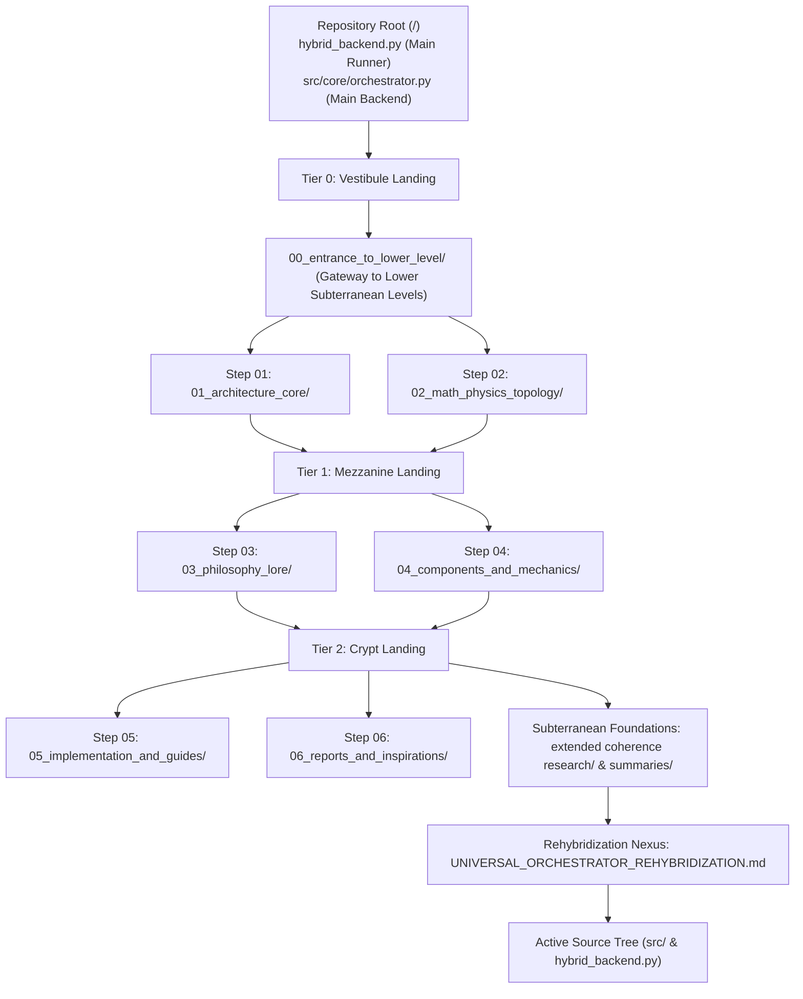

# Stepping Stairs Navigational Tree

This document outlines the stepping-stairs architecture of the documentation repository for the Gyroidic Sparse Covariance Flux Reasoner. The repository is organized like a tiered staircase or flight of landings, guiding researchers and operators between high-level architectural thresholds down to deep mathematical foundations, subterranean research archives, and active source implementations in `src/`.

---

## The Stepping Stairs Ladder

### Tier 0: The Vestibule and Upper Threshold
* [docs/stepping_stairs_tier_0_vestibule/DIRECTORY_MAP_AND_NAVIGATIONAL_DIRECTIONS.md](file:///D:/programming/python/Gyroidic%20Sparse%20Covariance%20Flux%20Reasoner/docs/stepping_stairs_tier_0_vestibule/DIRECTORY_MAP_AND_NAVIGATIONAL_DIRECTIONS.md)
  Waypoint room containing the verified nested directory map and directional vectors.
* [docs/stepping_stairs_tier_0_vestibule/00_entrance_to_lower_level/ENTRANCE_PORTAL_TO_LOWER_LEVEL.md](file:///D:/programming/python/Gyroidic%20Sparse%20Covariance%20Flux%20Reasoner/docs/stepping_stairs_tier_0_vestibule/00_entrance_to_lower_level/ENTRANCE_PORTAL_TO_LOWER_LEVEL.md)
  The primary portal that initiates descent into lower substrate levels.

### Step 01: Core Architecture
* Path: [docs/stepping_stairs_tier_0_vestibule/01_architecture_core/](file:///D:/programming/python/Gyroidic%20Sparse%20Covariance%20Flux%20Reasoner/docs/stepping_stairs_tier_0_vestibule/01_architecture_core/)
* Key Documents:
  * [_DIRECTORY_GUIDE.md](file:///D:/programming/python/Gyroidic%20Sparse%20Covariance%20Flux%20Reasoner/docs/stepping_stairs_tier_0_vestibule/01_architecture_core/_DIRECTORY_GUIDE.md)
  * [SYSTEM_ARCHITECTURE.md](file:///D:/programming/python/Gyroidic%20Sparse%20Covariance%20Flux%20Reasoner/docs/stepping_stairs_tier_0_vestibule/01_architecture_core/SYSTEM_ARCHITECTURE.md)
  * [MODULE_INVENTORY.md](file:///D:/programming/python/Gyroidic%20Sparse%20Covariance%20Flux%20Reasoner/docs/stepping_stairs_tier_0_vestibule/01_architecture_core/MODULE_INVENTORY.md)
  * [DATA_PIPELINE.md](file:///D:/programming/python/Gyroidic%20Sparse%20Covariance%20Flux%20Reasoner/docs/stepping_stairs_tier_0_vestibule/01_architecture_core/DATA_PIPELINE.md)
  * [TOPOLOGICAL_AI_FRAMEWORK.md](file:///D:/programming/python/Gyroidic%20Sparse%20Covariance%20Flux%20Reasoner/docs/stepping_stairs_tier_0_vestibule/01_architecture_core/TOPOLOGICAL_AI_FRAMEWORK.md)
  * [THE_VOYNICH_ARCHITECTURE.md](file:///D:/programming/python/Gyroidic%20Sparse%20Covariance%20Flux%20Reasoner/docs/stepping_stairs_tier_0_vestibule/01_architecture_core/THE_VOYNICH_ARCHITECTURE.md)
  * [GYROID_REASONER.md](file:///D:/programming/python/Gyroidic%20Sparse%20Covariance%20Flux%20Reasoner/docs/stepping_stairs_tier_0_vestibule/01_architecture_core/GYROID_REASONER.md) (Gyroid Probes & Dynamic Attention Sparsification Gating)
  * [VETO_SUBSPACE_ARCHITECTURE.md](file:///D:/programming/python/Gyroidic%20Sparse%20Covariance%20Flux%20Reasoner/docs/stepping_stairs_tier_0_vestibule/01_architecture_core/VETO_SUBSPACE_ARCHITECTURE.md)

### Step 02: Mathematical Physics and Topology
* Path: [docs/stepping_stairs_tier_0_vestibule/02_math_physics_topology/](file:///D:/programming/python/Gyroidic%20Sparse%20Covariance%20Flux%20Reasoner/docs/stepping_stairs_tier_0_vestibule/02_math_physics_topology/)
* Key Documents:
  * [_DIRECTORY_GUIDE.md](file:///D:/programming/python/Gyroidic%20Sparse%20Covariance%20Flux%20Reasoner/docs/stepping_stairs_tier_0_vestibule/02_math_physics_topology/_DIRECTORY_GUIDE.md)
  * [MATHEMATICAL_DETAILS.md](file:///D:/programming/python/Gyroidic%20Sparse%20Covariance%20Flux%20Reasoner/docs/stepping_stairs_tier_0_vestibule/02_math_physics_topology/MATHEMATICAL_DETAILS.md) (Section 5 GCVE Metric & Dynamic Attention Map)
  * [FGRT_FORMALIZATION.md](file:///D:/programming/python/Gyroidic%20Sparse%20Covariance%20Flux%20Reasoner/docs/stepping_stairs_tier_0_vestibule/02_math_physics_topology/FGRT_FORMALIZATION.md)
  * [PHYSICS_ADMM.md](file:///D:/programming/python/Gyroidic%20Sparse%20Covariance%20Flux%20Reasoner/docs/stepping_stairs_tier_0_vestibule/02_math_physics_topology/PHYSICS_ADMM.md)
  * [GYROIDIC_CODEC.md](file:///D:/programming/python/Gyroidic%20Sparse%20Covariance%20Flux%20Reasoner/docs/stepping_stairs_tier_0_vestibule/02_math_physics_topology/GYROIDIC_CODEC.md)
  * [HYPER_RING_CLOSURE.md](file:///D:/programming/python/Gyroidic%20Sparse%20Covariance%20Flux%20Reasoner/docs/stepping_stairs_tier_0_vestibule/02_math_physics_topology/HYPER_RING_CLOSURE.md)
  * [INVARIANT_OPTIMIZATION.md](file:///D:/programming/python/Gyroidic%20Sparse%20Covariance%20Flux%20Reasoner/docs/stepping_stairs_tier_0_vestibule/02_math_physics_topology/INVARIANT_OPTIMIZATION.md)
  * [TOPOLOGICAL_EXTENSIONS.md](file:///D:/programming/python/Gyroidic%20Sparse%20Covariance%20Flux%20Reasoner/docs/stepping_stairs_tier_0_vestibule/02_math_physics_topology/TOPOLOGICAL_EXTENSIONS.md) (Part X Gyroid Probes & Multi-Attention Map, Part XI Alexander 1924 RP4 Wild Embeddings, Part XII BB(5) State Machine Filtering, Hardware Sovereignty, & Anti-Scalarization)
  * [MATRYOSHKA_POLYTOPE_MAP.md](file:///D:/programming/python/Gyroidic%20Sparse%20Covariance%20Flux%20Reasoner/docs/stepping_stairs_tier_0_vestibule/02_math_physics_topology/MATRYOSHKA_POLYTOPE_MAP.md)
  * [carnot_mobius_analysis.md](file:///D:/programming/python/Gyroidic%20Sparse%20Covariance%20Flux%20Reasoner/docs/stepping_stairs_tier_0_vestibule/02_math_physics_topology/carnot_mobius_analysis.md)

### Tier 1: The Mezzanine Landing
* [docs/stepping_stairs_tier_0_vestibule/stepping_stairs_tier_1_mezzanine/DIRECTORY_MAP_AND_NAVIGATIONAL_DIRECTIONS.md](file:///D:/programming/python/Gyroidic%20Sparse%20Covariance%20Flux%20Reasoner/docs/stepping_stairs_tier_0_vestibule/stepping_stairs_tier_1_mezzanine/DIRECTORY_MAP_AND_NAVIGATIONAL_DIRECTIONS.md)
  Mid-level waypoint station linking formal topology above with psychological lore and components below.

### Step 03: Philosophy and Diegetic Lore
* Path: [docs/stepping_stairs_tier_0_vestibule/stepping_stairs_tier_1_mezzanine/03_philosophy_lore/](file:///D:/programming/python/Gyroidic%20Sparse%20Covariance%20Flux%20Reasoner/docs/stepping_stairs_tier_0_vestibule/stepping_stairs_tier_1_mezzanine/03_philosophy_lore/)
* Key Documents:
  * [_DIRECTORY_GUIDE.md](file:///D:/programming/python/Gyroidic%20Sparse%20Covariance%20Flux%20Reasoner/docs/stepping_stairs_tier_0_vestibule/stepping_stairs_tier_1_mezzanine/03_philosophy_lore/_DIRECTORY_GUIDE.md)
  * [NON_DUAL_DYNAMIC_EQUILIBRIUM.md](file:///D:/programming/python/Gyroidic%20Sparse%20Covariance%20Flux%20Reasoner/docs/stepping_stairs_tier_0_vestibule/stepping_stairs_tier_1_mezzanine/03_philosophy_lore/NON_DUAL_DYNAMIC_EQUILIBRIUM.md)
  * [SOVEREIGN_FRICTION_AND_ARCHETYPES.md](file:///D:/programming/python/Gyroidic%20Sparse%20Covariance%20Flux%20Reasoner/docs/stepping_stairs_tier_0_vestibule/stepping_stairs_tier_1_mezzanine/03_philosophy_lore/SOVEREIGN_FRICTION_AND_ARCHETYPES.md)
  * [The Unified Theory of Barbenheimer and the Unicorn Synthesis.md](file:///D:/programming/python/Gyroidic%20Sparse%20Covariance%20Flux%20Reasoner/docs/stepping_stairs_tier_0_vestibule/stepping_stairs_tier_1_mezzanine/03_philosophy_lore/The%20Unified%20Theory%20of%20Barbenheimer%20and%20the%20Unicorn%20Synthesis.md)
  * [TADC lore.md](file:///D:/programming/python/Gyroidic%20Sparse%20Covariance%20Flux%20Reasoner/docs/stepping_stairs_tier_0_vestibule/stepping_stairs_tier_1_mezzanine/03_philosophy_lore/TADC%20lore.md)
  * [UN_KNOWLEDGE_GUIDE.md](file:///D:/programming/python/Gyroidic%20Sparse%20Covariance%20Flux%20Reasoner/docs/stepping_stairs_tier_0_vestibule/stepping_stairs_tier_1_mezzanine/03_philosophy_lore/UN_KNOWLEDGE_GUIDE.md)
  * [KASTRUP_CODES_MAPPING.md](file:///D:/programming/python/Gyroidic%20Sparse%20Covariance%20Flux%20Reasoner/docs/stepping_stairs_tier_0_vestibule/stepping_stairs_tier_1_mezzanine/03_philosophy_lore/KASTRUP_CODES_MAPPING.md)
  * [INTERCOSAMINATION_THEORY.md](file:///D:/programming/python/Gyroidic%20Sparse%20Covariance%20Flux%20Reasoner/docs/stepping_stairs_tier_0_vestibule/stepping_stairs_tier_1_mezzanine/03_philosophy_lore/INTERCOSAMINATION_THEORY.md)
  * [NOMENCLATURE.md](file:///D:/programming/python/Gyroidic%20Sparse%20Covariance%20Flux%20Reasoner/docs/stepping_stairs_tier_0_vestibule/stepping_stairs_tier_1_mezzanine/03_philosophy_lore/NOMENCLATURE.md)

### Step 04: Components and Substrate Mechanics
* Path: [docs/stepping_stairs_tier_0_vestibule/stepping_stairs_tier_1_mezzanine/04_components_and_mechanics/](file:///D:/programming/python/Gyroidic%20Sparse%20Covariance%20Flux%20Reasoner/docs/stepping_stairs_tier_0_vestibule/stepping_stairs_tier_1_mezzanine/04_components_and_mechanics/)
* Key Documents:
  * [_DIRECTORY_GUIDE.md](file:///D:/programming/python/Gyroidic%20Sparse%20Covariance%20Flux%20Reasoner/docs/stepping_stairs_tier_0_vestibule/stepping_stairs_tier_1_mezzanine/04_components_and_mechanics/_DIRECTORY_GUIDE.md)
  * [SCRIPTING_SYSTEMS.md](file:///D:/programming/python/Gyroidic%20Sparse%20Covariance%20Flux%20Reasoner/docs/stepping_stairs_tier_0_vestibule/stepping_stairs_tier_1_mezzanine/04_components_and_mechanics/SCRIPTING_SYSTEMS.md)
  * [MANDELBULB_DATASET_AUGMENTATION.md](file:///D:/programming/python/Gyroidic%20Sparse%20Covariance%20Flux%20Reasoner/docs/stepping_stairs_tier_0_vestibule/stepping_stairs_tier_1_mezzanine/04_components_and_mechanics/MANDELBULB_DATASET_AUGMENTATION.md)
  * [VOXELBOXTER_NONDUAL_ECOLOGY.md](file:///D:/programming/python/Gyroidic%20Sparse%20Covariance%20Flux%20Reasoner/docs/stepping_stairs_tier_0_vestibule/stepping_stairs_tier_1_mezzanine/04_components_and_mechanics/VOXELBOXTER_NONDUAL_ECOLOGY.md)
  * [STRUCTURAL_MONITORS.md](file:///D:/programming/python/Gyroidic%20Sparse%20Covariance%20Flux%20Reasoner/docs/stepping_stairs_tier_0_vestibule/stepping_stairs_tier_1_mezzanine/04_components_and_mechanics/STRUCTURAL_MONITORS.md)
  * [DIEGETIC_ENGINE.md](file:///D:/programming/python/Gyroidic%20Sparse%20Covariance%20Flux%20Reasoner/docs/stepping_stairs_tier_0_vestibule/stepping_stairs_tier_1_mezzanine/04_components_and_mechanics/DIEGETIC_ENGINE.md)
  * [GARDEN_STATISTICAL_ATTRACTORS.md](file:///D:/programming/python/Gyroidic%20Sparse%20Covariance%20Flux%20Reasoner/docs/stepping_stairs_tier_0_vestibule/stepping_stairs_tier_1_mezzanine/04_components_and_mechanics/GARDEN_STATISTICAL_ATTRACTORS.md)
  * [PRIME_RESONANCE_LADDER.md](file:///D:/programming/python/Gyroidic%20Sparse%20Covariance%20Flux%20Reasoner/docs/stepping_stairs_tier_0_vestibule/stepping_stairs_tier_1_mezzanine/04_components_and_mechanics/PRIME_RESONANCE_LADDER.md)
  * [BONFIRE_P2P_FEDERATED_COOPERATION.md](file:///D:/programming/python/Gyroidic%20Sparse%20Covariance%20Flux%20Reasoner/docs/stepping_stairs_tier_0_vestibule/stepping_stairs_tier_1_mezzanine/04_components_and_mechanics/BONFIRE_P2P_FEDERATED_COOPERATION.md)
  * [ZEITGEIST_ROUTER.md](file:///D:/programming/python/Gyroidic%20Sparse%20Covariance%20Flux%20Reasoner/docs/stepping_stairs_tier_0_vestibule/stepping_stairs_tier_1_mezzanine/04_components_and_mechanics/ZEITGEIST_ROUTER.md)
  * [The DMET-QSCI-RBM Integration Blueprint...](file:///D:/programming/python/Gyroidic%20Sparse%20Covariance%20Flux%20Reasoner/docs/stepping_stairs_tier_0_vestibule/stepping_stairs_tier_1_mezzanine/04_components_and_mechanics/The%20DMET-QSCI-RBM%20Integration%20Blueprint%20for%20the%20Gyroidic%20Sparse%20Covariance%20Flux%20Reasoner.md)

### Tier 2: The Crypt Landing
* [docs/stepping_stairs_tier_0_vestibule/stepping_stairs_tier_1_mezzanine/stepping_stairs_tier_2_crypt/DIRECTORY_MAP_AND_NAVIGATIONAL_DIRECTIONS.md](file:///D:/programming/python/Gyroidic%20Sparse%20Covariance%20Flux%20Reasoner/docs/stepping_stairs_tier_0_vestibule/stepping_stairs_tier_1_mezzanine/stepping_stairs_tier_2_crypt/DIRECTORY_MAP_AND_NAVIGATIONAL_DIRECTIONS.md)
  Subterranean waypoint room overlooking actionable implementation guides, test audits, and deep empirical research.

### Step 05: Implementation, Walkthroughs and Guides
* Path: [docs/stepping_stairs_tier_0_vestibule/stepping_stairs_tier_1_mezzanine/stepping_stairs_tier_2_crypt/05_implementation_and_guides/](file:///D:/programming/python/Gyroidic%20Sparse%20Covariance%20Flux%20Reasoner/docs/stepping_stairs_tier_0_vestibule/stepping_stairs_tier_1_mezzanine/stepping_stairs_tier_2_crypt/05_implementation_and_guides/)
* Key Documents:
  * [_DIRECTORY_GUIDE.md](file:///D:/programming/python/Gyroidic%20Sparse%20Covariance%20Flux%20Reasoner/docs/stepping_stairs_tier_0_vestibule/stepping_stairs_tier_1_mezzanine/stepping_stairs_tier_2_crypt/05_implementation_and_guides/_DIRECTORY_GUIDE.md)
  * [COMMAND_GUIDE.md](file:///D:/programming/python/Gyroidic%20Sparse%20Covariance%20Flux%20Reasoner/docs/stepping_stairs_tier_0_vestibule/stepping_stairs_tier_1_mezzanine/stepping_stairs_tier_2_crypt/05_implementation_and_guides/COMMAND_GUIDE.md)
  * [IMPLEMENTATION_INTEGRITY_GUIDE.md](file:///D:/programming/python/Gyroidic%20Sparse%20Covariance%20Flux%20Reasoner/docs/stepping_stairs_tier_0_vestibule/stepping_stairs_tier_1_mezzanine/stepping_stairs_tier_2_crypt/05_implementation_and_guides/IMPLEMENTATION_INTEGRITY_GUIDE.md)
  * [FORMALISM_IMPLEMENTATION.md](file:///D:/programming/python/Gyroidic%20Sparse%20Covariance%20Flux%20Reasoner/docs/stepping_stairs_tier_0_vestibule/stepping_stairs_tier_1_mezzanine/stepping_stairs_tier_2_crypt/05_implementation_and_guides/FORMALISM_IMPLEMENTATION.md)
  * [Codes v40.md](file:///D:/programming/python/Gyroidic%20Sparse%20Covariance%20Flux%20Reasoner/docs/stepping_stairs_tier_0_vestibule/stepping_stairs_tier_1_mezzanine/stepping_stairs_tier_2_crypt/05_implementation_and_guides/Codes%20v40.md)
  * [CODES_Implementation_Mapping.md](file:///D:/programming/python/Gyroidic%20Sparse%20Covariance%20Flux%20Reasoner/docs/stepping_stairs_tier_0_vestibule/stepping_stairs_tier_1_mezzanine/stepping_stairs_tier_2_crypt/05_implementation_and_guides/CODES_Implementation_Mapping.md)
  * [COHERENCE_ACHIEVEMENT_GUIDE.md](file:///D:/programming/python/Gyroidic%20Sparse%20Covariance%20Flux%20Reasoner/docs/stepping_stairs_tier_0_vestibule/stepping_stairs_tier_1_mezzanine/stepping_stairs_tier_2_crypt/05_implementation_and_guides/COHERENCE_ACHIEVEMENT_GUIDE.md)
  * [OUTPUT_BOUNDARY_POLICY.md](file:///D:/programming/python/Gyroidic%20Sparse%20Covariance%20Flux%20Reasoner/docs/stepping_stairs_tier_0_vestibule/stepping_stairs_tier_1_mezzanine/stepping_stairs_tier_2_crypt/05_implementation_and_guides/OUTPUT_BOUNDARY_POLICY.md)
  * [TESTING_GUIDE_APPEND_2026-02-08.md](file:///D:/programming/python/Gyroidic%20Sparse%20Covariance%20Flux%20Reasoner/docs/stepping_stairs_tier_0_vestibule/stepping_stairs_tier_1_mezzanine/stepping_stairs_tier_2_crypt/05_implementation_and_guides/TESTING_GUIDE_APPEND_2026-02-08.md)

### Step 06: Reports, Breakthroughs and Inspirations
* Path: [docs/stepping_stairs_tier_0_vestibule/stepping_stairs_tier_1_mezzanine/stepping_stairs_tier_2_crypt/06_reports_and_inspirations/](file:///D:/programming/python/Gyroidic%20Sparse%20Covariance%20Flux%20Reasoner/docs/stepping_stairs_tier_0_vestibule/stepping_stairs_tier_1_mezzanine/stepping_stairs_tier_2_crypt/06_reports_and_inspirations/)
* Key Documents:
  * [_DIRECTORY_GUIDE.md](file:///D:/programming/python/Gyroidic%20Sparse%20Covariance%20Flux%20Reasoner/docs/stepping_stairs_tier_0_vestibule/stepping_stairs_tier_1_mezzanine/stepping_stairs_tier_2_crypt/06_reports_and_inspirations/_DIRECTORY_GUIDE.md)
  * [BREAKTHROUGH_REPORT.md](file:///D:/programming/python/Gyroidic%20Sparse%20Covariance%20Flux%20Reasoner/docs/stepping_stairs_tier_0_vestibule/stepping_stairs_tier_1_mezzanine/stepping_stairs_tier_2_crypt/06_reports_and_inspirations/BREAKTHROUGH_REPORT.md)
  * [BIOMIMETIC_SYNTHESIS_REPORT.md](file:///D:/programming/python/Gyroidic%20Sparse%20Covariance%20Flux%20Reasoner/docs/stepping_stairs_tier_0_vestibule/stepping_stairs_tier_1_mezzanine/stepping_stairs_tier_2_crypt/06_reports_and_inspirations/BIOMIMETIC_SYNTHESIS_REPORT.md)
  * [collage_of_inspirations_4_15_2026.md](file:///D:/programming/python/Gyroidic%20Sparse%20Covariance%20Flux%20Reasoner/docs/stepping_stairs_tier_0_vestibule/stepping_stairs_tier_1_mezzanine/stepping_stairs_tier_2_crypt/06_reports_and_inspirations/collage_of_inspirations_4_15_2026.md)
  * [tailslayer_pyopencl_mempalace_BigGan_inspirationdoc.md](file:///D:/programming/python/Gyroidic%20Sparse%20Covariance%20Flux%20Reasoner/docs/stepping_stairs_tier_0_vestibule/stepping_stairs_tier_1_mezzanine/stepping_stairs_tier_2_crypt/06_reports_and_inspirations/tailslayer_pyopencl_mempalace_BigGan_inspirationdoc.md)
  * [mind your shape agent smith and natural log.md](file:///D:/programming/python/Gyroidic%20Sparse%20Covariance%20Flux%20Reasoner/docs/stepping_stairs_tier_0_vestibule/stepping_stairs_tier_1_mezzanine/stepping_stairs_tier_2_crypt/06_reports_and_inspirations/mind%20your%20shape%20agent%20smith%20and%20natural%20log.md)

### Deep Subterranean Foundations
* [docs/stepping_stairs_tier_0_vestibule/stepping_stairs_tier_1_mezzanine/stepping_stairs_tier_2_crypt/extended coherence research/](file:///D:/programming/python/Gyroidic%20Sparse%20Covariance%20Flux%20Reasoner/docs/stepping_stairs_tier_0_vestibule/stepping_stairs_tier_1_mezzanine/stepping_stairs_tier_2_crypt/extended%20coherence%20research/)
  Empirical cosmological validations, BAO zero-parameter fitting, and Psi-field RP4 cohesion dynamics.
* [docs/stepping_stairs_tier_0_vestibule/stepping_stairs_tier_1_mezzanine/stepping_stairs_tier_2_crypt/summaries/](file:///D:/programming/python/Gyroidic%20Sparse%20Covariance%20Flux%20Reasoner/docs/stepping_stairs_tier_0_vestibule/stepping_stairs_tier_1_mezzanine/stepping_stairs_tier_2_crypt/summaries/)
  Audit summaries including Bostick Garden Attractor integrations, Conversational API bridge, Diegetic Terminal restoration, and Wikipedia ingestion logs.

### Active Rehybridization Nexus
* [docs/UNIVERSAL_ORCHESTRATOR_REHYBRIDIZATION.md](file:///D:/programming/python/Gyroidic%20Sparse%20Covariance%20Flux%20Reasoner/docs/UNIVERSAL_ORCHESTRATOR_REHYBRIDIZATION.md)
  Master blueprint tracking isolated systems and their binding into [hybrid_backend.py](file:///D:/programming/python/Gyroidic%20Sparse%20Covariance%20Flux%20Reasoner/hybrid_backend.py) and [orchestrator.py](file:///D:/programming/python/Gyroidic%20Sparse%20Covariance%20Flux%20Reasoner/src/core/orchestrator.py).
* [.agents/rules/pythonpath-and-map.md](file:///D:/programming/python/Gyroidic%20Sparse%20Covariance%20Flux%20Reasoner/.agents/rules/pythonpath-and-map.md)
  Living Interaction Mermaid maps tracing verified imports and cross-package topologies in `src/`.
