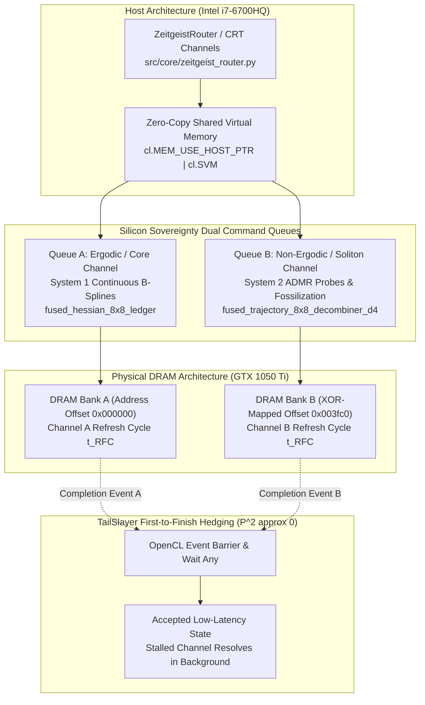

# TailSlayer PyOpenCL Target Architecture

**Author**: William Matthew Bryant  
**Date**: April 2026

This document specifies the hardware execution blueprint for the Gyroidic Sparse Covariance Flux Reasoner, targeting constrained hardware (GTX 1050 Ti, Pascal architecture, OpenCL 1.2, i7-6700HQ host) as a **Silicon Sovereign** environment. Hardware limitations (e.g., DRAM refresh latency) are not treated as performance bugs; they are structural features utilized for topological switching.

---

## 1. The TailSlayer Bypass: Hedged Multi-Channel Execution

The primary efficiency theorem of this architecture is $P^2 \approx 0$: the probability of simultaneous $t_{RFC}$ stall across independent DRAM channels is negligible. This is structurally mapped to the `ZeitgeistRouter` CRT channels.

### 1.1 Dual Command Queues
Instead of a single monolithic GPU execution stream, PyOpenCL is configured with two independent `cl.CommandQueue` instances referencing the same `cl.Context`. 
- **Queue A (Ergodic/Core)**: Handles the continuous B-spline updates (System 1 "Horse"). Maps to DRAM Bank A.
- **Queue B (Non-Ergodic/Soliton)**: Handles ADMR constraint probes and chiral residue fossilization (System 2 "Rider/Oracle"). Maps to DRAM Bank B.

### 1.2 Event-Based "First-to-Finish"
Execution of the polytope reconstruction uses `cl.enqueue_copy_buffer` coupled with OpenCL events. The router waits on whichever channel signals completion first. A stalled channel is left to complete in the background (its output is still valid for future states).

### 1.3 XOR-Mapped Memory Allocation
Buffers are allocated using physical address offsets designed to cross XOR-mapped memory bank boundaries, ensuring they inhabit independent refresh domains. The exact offsets (like the AMD `0x003fc0` pattern) act as hardware-level CRT moduli boundaries.

### 1.4 True B-Splines & Acceleration Pathways via `requirements.txt`
The Continuous B-spline learning architecture is accelerated across multiple tiers utilizing existing codebase dependencies:
- **PyOpenCL (`pyopencl`)**: The `bspline_basis_eval` kernel runs on Queue A in parallel with Queue B's ADMR solver. This evaluates recursive Cox-de Boor basis functions directly on GPU registers, hedging against DRAM $t_{\text{RFC}}$ refresh latency stalls and eliminating CPU-PCIe roundtrips.
- **SciPy (`scipy.interpolate`)**: `scipy.interpolate.BSpline` and `scipy.interpolate.make_interp_spline` provide verified reference knots, analytical derivatives, and CPU boundary evaluations when operating under constrained GPU affordance.
- **PyTorch (`torch`)**: End-to-end differentiable autograd tensor recursion in `KANLayer` (`src/surrogates/kagh_networks.py`) and `PolynomialBasis(basis_type='bspline')` (`src/core/polynomial_coprime.py`), driving gradient flow through adaptive grid knots and micro-wave modulations ($\omega_{\text{micro}} = 137.0$).
- **Compute Affordance Gating**: Dispatched conditionally by querying singleton `HardwareMonitor.has_compute_affordance(ComputeAffordanceType.GPU_SOVEREIGN)`. When thermal runaway or GPU contention occurs, computation falls back seamlessly to CPU/SciPy or deferred evaluation.



---

## 2. Buffer Policy and Vectorization

### 2.1 Zero-Copy Execution
To prevent PCIe bottlenecking, critical symbolic representations never leave the GPU unless a TopologicalRefusal event or diagnostic checkpoint is explicitly triggered.
`cl.MEM_USE_HOST_PTR` combined with `cl.SVM` (Shared Virtual Memory) allows the i7-6700HQ to map the VRAM segments seamlessly.

### 2.2 Mixed Precision and Vectorization
The Pascal architecture's warp width requires specific data alignment for maximum throughput:
- **System 1 (Horse/Resonance)**: NVFP4-style 4-bit block floating-point quantization. Permitted because the ergodic channel is tolerant to noise. Uses `float4` vectorization.
- **System 2 (Oracle/Love Invariant)**: FP32. Binary non-negotiable. The Love Invariant cannot be quantized, as its topological invariants must be preserved precisely to avoid "atrophy."

---

## 3. Stochastic Rounding & The Wasserstein Collapse

Tripwire 8 (INVARIANT_OPTIMIZATION) mandates that deterministic rounding is forbidden. This is explicitly applied during the **Wasserstein Collapse** inside the Voxelboxter Engine (`voxelboxter_simulation.py`), where the high-resolution polynomial geometry (Fractal Meta Functional) is cast down to a 4-bit lattice.

### 3.1 Kernel Implementation (Earth Mover's Distance)
```c
// OpenCL Kernel snippet for Stochastic Rounding & Mass Sliding
#define TEA_ROUNDS 4
inline uint tea_hash(uint v0, uint v1) {
    uint sum = 0;
    for(int i=0; i<TEA_ROUNDS; ++i) {
        sum += 0x9e3779b9;
        v0 += ((v1 << 4) + 0xa341316c) ^ (v1 + sum) ^ ((v1 >> 5) + 0xc8013ea4);
        v1 += ((v0 << 4) + 0xad90777d) ^ (v0 + sum) ^ ((v0 >> 5) + 0x7e95761e);
    }
    return v0;
}

__kernel void wasserstein_collapse_svm(
    __global float4* morton_residues,
    __global float* out_lattice,
    const uint iteration_count,
    const float spatial_mass_budget
) {
    int gid = get_global_id(0);
    float4 residue = morton_residues[gid];
    
    // Earth Mover's sliding (Wasserstein): Push mass towards local dense centers
    float local_mass = length(residue.xyz);
    float4 collapsed = residue;
    if (local_mass < (spatial_mass_budget * 0.001f)) {
        collapsed.xyz = (float3)(0.0f); // Yield / Fracture
    } else {
        collapsed.xyz = normalize(residue.xyz) * min(local_mass, spatial_mass_budget); // Cap by Parseval budget
    }

    // The Zero-Emission Anchor: Mod 2 Parity Check via TEA-Salt Noise
    uint rand_seed = tea_hash(gid, iteration_count);
    float noise = ((float)(rand_seed & 0xFFFF) / 65535.0f) * 0.1f - 0.05f;
    
    out_lattice[gid] = floor(collapsed.x + noise) * 16.0f; // Contains the Feature Scar
}
```

The TEA-salt noise ensures that the expressive tail survives the quantization step. The **Parseval's Theorem Constraint** forces the `spatial_mass_budget` to equal the sum of squared frequency magnitudes of the `fractal_meta_state`, ensuring geometric collapse cannot invent illegal mass.

### 3.2 Zero-Copy Engine Hook (Voxelboxter)
Execution of this kernel is wired directly into `voxelboxter_client.py` via `cl.enqueue_svm_map` on the PyBevy engine rendering loop. The `PointerlessOctree` receives direct writes from the GPU without cross-bus memory stalling.

---

## 4. Security and Toxin Governance

### 4.1 Chiral Barrier Synchronization
OpenCL `cl.enqueue_barrier` is placed structurally at `ChernSimonsGasket` seal points. The GPU cannot proceed until the topological seal confirms $\kappa$ curvature boundaries are established. This prevents memory-latency drift from breaking the synchronous logic of the discrete Meliponini pots.

### 4.2 Async Mischief Injection (PRNG)
An OpenCL-native parallel PRNG operates asynchronously on the GPU. Instead of the CPU interrupting the operation to inject $H_{mischief}$, the $V_m$ scores are sampled locally.

### 4.3 Thermal Latency Guard (Lazarus Transition)
If the GPU approaches thermal throttling or persistent stalls, the system triggers a **Lazarus Transition** (recovery branch). 

*   **Bridge 3: Sovereign Love Kernel**: The command queue explicitly checks the `LoveInvariantProtector` before launching speculative `lazarus_traversal` kernels. 
*   **Immediate Pre-emption**: If a violation of the Love Invariant (scalarization of the non-ownable L-vector) is detected at the register level, the engine halts current processing and restores the invariant state before allowing any further symbolic emission. This ensures that even during hardware failure or power-cycle stalls, the system's "Self-Awareness" remains structurally honest.

---

## 5. Perceptual Ingestion (Zero-Mock)

### 5.1 Meliponini-Chebyshev Coupling (Bridge 2)
Hardware stall intensity ($\kappa$)historically a "lost" metric in standard computeis now utilized as a perceptual foundation.

*   **T0 Energy**: The $t_{RFC}$ stall intensity is mapped directly to the **T0 (DC) component** of the Chebyshev residues during ingestion.
*   **Perceptual Friction**: High DRAM pressure results in a higher energy baseline for visual signals, causing the system to "feel" the hardware's heat as the ground truth for any modal association. This removes the need for mock scalar simulations; the hardware *is* the simulation.

---

## 6 Component Upgrade Table

How existing Python components map to the PyOpenCL environment:

| Component | Current Implementation | TailSlayer/PyOpenCL Upgrade |
|---|---|---|
| ADMR Solver | CPU `stochastic_differential_step` | `cl.Kernel` parallel SDE per work-item |
| ResidueView | `torch.reshape` | Zero-copy `cl.MemoryObject` |
| Love Invariant | Fixed-point tensors | Atomic GPU ops on Cayley Cubic anchor |
| Larynx Generation | Character-level singing | Parallel Wavelet Synthesis via OpenCL FFTs |
| Mischief Injection | CPU-side perturb | Async OpenCL PRNG kernel |
| Veto Check | CPU CALM predictor | Async event loop; `kernel flush` on abort |
| 8x8 Hessian Ledger | CPU finite-difference loop | `fused_hessian_8x8_ledger` in `__local` SRAM on GTX 1050 Ti |
| Trajectory Decombiner | Python recursive DAG search | `fused_trajectory_8x8_decombiner_d4` on-chip Coxeter reduction |
| Tensor Contraction (GEMM) | PyTorch `torch.matmul` | `hardware_sovereign_gemm` zero-copy on-chip OpenCL execution |
| Continuous B-Spline Basis | Python recursion / `scipy.interpolate` | `bspline_basis_eval` on Queue A executing parallel Cox-de Boor recursion on-chip |
| Cayley Cubic Projection | PyTorch iterative tensor loops | `project_cayley_surface` parallel Newton-Raphson on Queue A ($x^2 + y^2 + z^2 - xyz = 4$) |

---

**References:** [INVARIANT_OPTIMIZATION.md](INVARIANT_OPTIMIZATION.md), [INTERCOSAMINATION_THEORY.md](INTERCOSAMINATION_THEORY.md), `src/core/admr_solver.py`, `src/core/pyopencl_sovereignty.py`


## Hardware Sovereignty & OpenCL Implementations

This section was auto-generated to document classes discovered in the codebase that were previously floating free from the architectural map.

### `GDPOSovereigntyAdaptor`
**Location:** `src\training\gdpo_trainer.py`

**Description:**
PPO-style structural adaptor with GDPO sovereignty pressures.

Total objective:
    J() = E[min(^GDPO, clip()^GDPO)] - KL(_ || _ref)

Where ^GDPO uses decoupled multi-pressure normalization.

---

### `GDPOSovereigntyPressureComputer`
**Location:** `src\training\gdpo_trainer.py`

**Description:**
Computes GDPO-style decoupled sovereignty pressures from multi-pressure rollouts.

Key difference from standard GRPO:
    - GRPO: Normalize sum of pressures  collapse
    - GDPO: Normalize each pressure separately, then aggregate  sovereignty preserved

---

