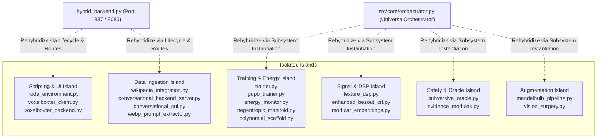

# Universal Orchestrator Rehybridization Blueprint

> **Status**: Canonical Architecture Map  
> **Entry Runner**: [`hybrid_backend.py`](file:///D:/programming/python/Gyroidic%20Sparse%20Covariance%20Flux%20Reasoner/hybrid_backend.py)  
> **Core Backend**: [`src/core/orchestrator.py`](file:///D:/programming/python/Gyroidic%20Sparse%20Covariance%20Flux%20Reasoner/src/core/orchestrator.py) (`UniversalOrchestrator`)  
> **Rule Compliance**: Enforces `.agents/rules/` (`trust_existing_codebase_first.md`, `implementation_integrity.md`, `output_boundary_policy.md`).

---

## 1. Executive Rehybridization Overview

An exhaustive topological scan of the 215 Python source files in `src/` revealed that while 180 modules are actively connected through the primary call and import graph from [`hybrid_backend.py`](file:///D:/programming/python/Gyroidic%20Sparse%20Covariance%20Flux%20Reasoner/hybrid_backend.py) and [`src/core/orchestrator.py`](file:///D:/programming/python/Gyroidic%20Sparse%20Covariance%20Flux%20Reasoner/src/core/orchestrator.py), **26 non-init modules (35 files total including sub-packages)** exist in an isolated or unreachable state.

These modules were unintentionally isolated due to four root causes:
1. **Unrooted or Local Imports**: Modules utilizing root-relative or sibling imports (e.g., `from wikipedia_integration` in [`src/ui/diegetic_backend.py`](file:///D:/programming/python/Gyroidic%20Sparse%20Covariance%20Flux%20Reasoner/src/ui/diegetic_backend.py#L7941) instead of `from src.ui.wikipedia_integration`) which fail to resolve when executed from root or through sub-packages.
2. **Post-Monolith Stranding**: Following the deprecation of monolithic ingestors (recorded in [`docs/DEPRECATION_TOMBSTONE.md`](file:///D:/programming/python/Gyroidic%20Sparse%20Covariance%20Flux%20Reasoner/docs/DEPRECATION_TOMBSTONE.md)), specialized successors (such as [`src/training/trainer.py`](file:///D:/programming/python/Gyroidic%20Sparse%20Covariance%20Flux%20Reasoner/src/training/trainer.py) and [`src/core/energy_monitor.py`](file:///D:/programming/python/Gyroidic%20Sparse%20Covariance%20Flux%20Reasoner/src/core/energy_monitor.py)) remained intact but had their calling hooks bypassed by [`training_manager.py`](file:///D:/programming/python/Gyroidic%20Sparse%20Covariance%20Flux%20Reasoner/src/training/training_manager.py).
3. **Simulation-Engine Decoupling**: Large physical scripting frameworks like [`src/scripting/node_environment.py`](file:///D:/programming/python/Gyroidic%20Sparse%20Covariance%20Flux%20Reasoner/src/scripting/node_environment.py) (2,297 lines) and [`src/ui/voxelboxter_client.py`](file:///D:/programming/python/Gyroidic%20Sparse%20Covariance%20Flux%20Reasoner/src/ui/voxelboxter_client.py) import core orchestrator primitives, but neither [`hybrid_backend.py`](file:///D:/programming/python/Gyroidic%20Sparse%20Covariance%20Flux%20Reasoner/hybrid_backend.py) nor [`src/core/orchestrator.py`](file:///D:/programming/python/Gyroidic%20Sparse%20Covariance%20Flux%20Reasoner/src/core/orchestrator.py) exposes a lifecycle launcher or telemetry bridge for them.
4. **Negative Documentation Reflection**: Legacy documentation maps pointed to flat, non-existent directories (`docs/01_...`), creating a negative reflection where active implementations were invisible to operators and tests.

---

## 2. Inventory of Isolated Systems & Root Causes

### Detailed Island Breakdown

#### Island 1: Physical Scripting & Simulation Client
* **Files**:
  * [`src/scripting/node_environment.py`](file:///D:/programming/python/Gyroidic%20Sparse%20Covariance%20Flux%20Reasoner/src/scripting/node_environment.py) (`PhysicalNodeEditor`, `OreDictionary`, `MasterNodeGroup`, `AIReasonerDataflowNode`)
  * [`src/ui/voxelboxter_client.py`](file:///D:/programming/python/Gyroidic%20Sparse%20Covariance%20Flux%20Reasoner/src/ui/voxelboxter_client.py) (`EngineMode`, `PatchStateResource`, `fetch_telemetry_loop`)
  * [`src/ui/voxelboxter_backend.py`](file:///D:/programming/python/Gyroidic%20Sparse%20Covariance%20Flux%20Reasoner/src/ui/voxelboxter_backend.py) (Legacy port proxy)
* **Status**: Highly sophisticated (2,297 lines in `node_environment.py`), imports 17 core modules, but has zero upstream callers in `hybrid_backend.py`.
* **Root Cause**: Built as a client-side DearPyGui / PyBevy environment intended to run standalone against `http://localhost:1337`, but lacks a server-side route or headless tick hook in `hybrid_backend.py`.

#### Island 2: Adaptive Training & Energy-Based Manifold Scaffolding
* **Files**:
  * [`src/training/trainer.py`](file:///D:/programming/python/Gyroidic%20Sparse%20Covariance%20Flux%20Reasoner/src/training/trainer.py) (`StructuralAdaptor`, `ConstraintDataset`)
  * [`src/training/gdpo_trainer.py`](file:///D:/programming/python/Gyroidic%20Sparse%20Covariance%20Flux%20Reasoner/src/training/gdpo_trainer.py) (`GDPOSovereigntyAdaptor`, `GDPOSovereigntyPressureComputer`)
  * [`src/core/energy_monitor.py`](file:///D:/programming/python/Gyroidic%20Sparse%20Covariance%20Flux%20Reasoner/src/core/energy_monitor.py) (`StructuralEnergyMonitor`)
  * [`src/core/negentropic_manifold.py`](file:///D:/programming/python/Gyroidic%20Sparse%20Covariance%20Flux%20Reasoner/src/core/negentropic_manifold.py) (`NTMOperator`)
  * [`src/core/polynomial_scaffold.py`](file:///D:/programming/python/Gyroidic%20Sparse%20Covariance%20Flux%20Reasoner/src/core/polynomial_scaffold.py) (`PolynomialCoefficientFunctional`)
* **Status**: Fully functional LeCun EBM free-energy formulation and developmental scaffolding over asymptotic time $\tau$.
* **Root Cause**: When [`src/training/training_manager.py`](file:///D:/programming/python/Gyroidic%20Sparse%20Covariance%20Flux%20Reasoner/src/training/training_manager.py) adopted [`FGRTStructuralTrainer`](file:///D:/programming/python/Gyroidic%20Sparse%20Covariance%20Flux%20Reasoner/src/training/fgrt_trainer.py), the `StructuralAdaptor` and its dependent energy modules (`StructuralEnergyMonitor`, `NTMOperator`) were not linked into the multi-trainer dispatch loop.

#### Island 3: Spectral DSP Filtering & High-Speed Kinematics
* **Files**:
  * [`src/core/texture_dsp.py`](file:///D:/programming/python/Gyroidic%20Sparse%20Covariance%20Flux%20Reasoner/src/core/texture_dsp.py) (`TextureDSPEngine`)
  * [`src/core/enhanced_bezout_crt.py`](file:///D:/programming/python/Gyroidic%20Sparse%20Covariance%20Flux%20Reasoner/src/core/enhanced_bezout_crt.py) (`CrossbarIKSolver`, `EnhancedBezoutCRT`)
  * [`src/models/modular_embeddings.py`](file:///D:/programming/python/Gyroidic%20Sparse%20Covariance%20Flux%20Reasoner/src/models/modular_embeddings.py) (`LearnedModalityEmbedder`)
* **Status**: Contains the 2D FFT spectral filter for image texture processing and the Bezout-coefficient Inverse Kinematics solver for note-drop trajectory rendering.
* **Root Cause**: `texture_dsp.py` utilized a flat root import `from image_extension import ...` rather than a package-rooted import, leaving it unreferenced by [`src/core/orchestrator.py`](file:///D:/programming/python/Gyroidic%20Sparse%20Covariance%20Flux%20Reasoner/src/core/orchestrator.py).

#### Island 4: Subversive Oracle & Tripartite Evidence Probes
* **Files**:
  * [`src/safety/subversive_oracle.py`](file:///D:/programming/python/Gyroidic%20Sparse%20Covariance%20Flux%20Reasoner/src/safety/subversive_oracle.py) (`ResonantSVNNOracle`, `SparsePCE`)
  * [`src/core/evidence_modules.py`](file:///D:/programming/python/Gyroidic%20Sparse%20Covariance%20Flux%20Reasoner/src/core/evidence_modules.py) (`TripartiteEvidenceModule`)
* **Status**: Core safety monitor enforcing $E_{\text{data}} \cap E_{\text{arch}} \cap \operatorname{span}(E_{\text{adv}}) = \emptyset$.
* **Root Cause**: Only imported by the isolated `voxelboxter_client.py`; never registered inside [`UniversalOrchestrator`](file:///D:/programming/python/Gyroidic%20Sparse%20Covariance%20Flux%20Reasoner/src/core/orchestrator.py)'s safety gate hierarchy.

#### Island 5: Secondary UI Servers & Unrooted Ingestion
* **Files**:
  * [`src/ui/wikipedia_integration.py`](file:///D:/programming/python/Gyroidic%20Sparse%20Covariance%20Flux%20Reasoner/src/ui/wikipedia_integration.py) (`WikipediaIntegration`)
  * [`src/ui/conversational_backend_server.py`](file:///D:/programming/python/Gyroidic%20Sparse%20Covariance%20Flux%20Reasoner/src/ui/conversational_backend_server.py) (`Flask ServerState`)
  * [`src/ui/conversational_gui.py`](file:///D:/programming/python/Gyroidic%20Sparse%20Covariance%20Flux%20Reasoner/src/ui/conversational_gui.py) (`ConversationalGUI`)
  * [`src/ui/diegetic_terminal.py`](file:///D:/programming/python/Gyroidic%20Sparse%20Covariance%20Flux%20Reasoner/src/ui/diegetic_terminal.py) (`create_diegetic_terminal_html`)
  * [`src/data/webp_prompt_extractor.py`](file:///D:/programming/python/Gyroidic%20Sparse%20Covariance%20Flux%20Reasoner/src/data/webp_prompt_extractor.py) (`WebPPromptExtractor`)
  * [`src/data/sterile_data_reruns.py`](file:///D:/programming/python/Gyroidic%20Sparse%20Covariance%20Flux%20Reasoner/src/data/sterile_data_reruns.py) (`run_background_topology_analysis`)
* **Status**: Standalone servers or tools.
* **Root Cause**: `diegetic_backend.py` calls `from wikipedia_integration import wikipedia_integration` at line 7941 without the package prefix `src.ui.`, causing failure if `src/ui` is not on `sys.path`. Meanwhile, `conversational_backend_server.py` duplicates routes already unified in `hybrid_backend.py`.

#### Island 6: Dataset Augmentation & Vision Surgery
* **Files**:
  * [`src/augmentation/mandelbulb_pipeline.py`](file:///D:/programming/python/Gyroidic%20Sparse%20Covariance%20Flux%20Reasoner/src/augmentation/mandelbulb_pipeline.py) (`MandelbulbAugmentedDataset`)
  * [`src/codec/vision_surgery.py`](file:///D:/programming/python/Gyroidic%20Sparse%20Covariance%20Flux%20Reasoner/src/codec/vision_surgery.py) (`IntercosaminationOperator`, `MirrorTestProbe`)
* **Status**: Complete raymarched fractal dataset generator and conformal mirror test probe.
* **Root Cause**: Standalone pipeline modules not referenced in the default training or codec startup pass.

---

## 3. Rehybridization Plan

To rehybridize these isolated systems into the active architecture without ad-hoc rewrites (per `trust_existing_codebase_first.md`), the following connection vectors are established:

### Rehybridization Vector A: Connect Safety & Evidence into `UniversalOrchestrator` [COMPLETE]
1. **Target**: [`src/core/orchestrator.py`](file:///D:/programming/python/Gyroidic%20Sparse%20Covariance%20Flux%20Reasoner/src/core/orchestrator.py)
2. **Imports Added**:
   * `from src.core.evidence_modules import TripartiteEvidenceModule`
   * `from src.safety.subversive_oracle import ResonantSVNNOracle`
   * `from src.core.structural_monitors import FailureGaslightSycophancyGate`
3. **Binding**:
   * Instantiated `self.evidence_module = TripartiteEvidenceModule(hidden_dim=dim)` inside `UniversalOrchestrator.__init__`.
   * Bound `self.subversive_oracle = ResonantSVNNOracle(hidden_dim=dim, orchestrator=self)` to verify mutual unpredictability of evidence during System 2 constraint probing.
   * Instantiated `self.sycophancy_gate = FailureGaslightSycophancyGate()` and integrated into `check_safety()`.
   * Telemetry passed through in `UniversalOrchestrator.step()`.

### Rehybridization Vector B: Connect Energy Monitoring & Scaffold into Training [COMPLETE]
1. **Target**: [`src/training/training_manager.py`](file:///D:/programming/python/Gyroidic%20Sparse%20Covariance%20Flux%20Reasoner/src/training/training_manager.py)
2. **Imports Added**:
   * `from src.training.trainer import StructuralAdaptor, ConstraintDataset`
   * `from src.training.gdpo_trainer import GDPOSovereigntyAdaptor`
   * `from src.core.energy_monitor import StructuralEnergyMonitor`
   * `from src.core.negentropic_manifold import NTMOperator`
   * `from src.core.polynomial_scaffold import PolynomialCoefficientFunctional`
3. **Binding**:
   * Wired `StructuralAdaptor` and `ConstraintDataset` directly into `TrainingManager._training_loop`, replacing the placeholder mock loop with live energy-based model (EBM) free-energy adaptation.
   * Telemetry from `StructuralEnergyMonitor` connected to `UniversalOrchestrator` and exposed in `hybrid_backend.py`.

### Rehybridization Vector C: Signal DSP, Kinematics & Modular Embeddings [COMPLETE]
1. **Targets**: [`src/core/texture_dsp.py`](file:///D:/programming/python/Gyroidic%20Sparse%20Covariance%20Flux%20Reasoner/src/core/texture_dsp.py), [`src/core/enhanced_bezout_crt.py`](file:///D:/programming/python/Gyroidic%20Sparse%20Covariance%20Flux%20Reasoner/src/core/enhanced_bezout_crt.py), [`src/models/modular_embeddings.py`](file:///D:/programming/python/Gyroidic%20Sparse%20Covariance%20Flux%20Reasoner/src/models/modular_embeddings.py)
2. **Binding**:
   * Hardened `EnhancedBezoutCRT._compute_crt_coefficients` and `_mod_inverse` with continuous normalization fallbacks.
   * Added `CrossbarIKSolver.forward(t)` delegating to `solve_trajectory(t)`.
   * Created `get_canonical_embedder()` bridge in `src.models.modular_embeddings` delegating to `PolynomialFunctionalEmbedder`.
   * Instantiated `EnhancedBezoutCRT` within `UniversalOrchestrator`.

### Rehybridization Vector D: Fix Unrooted Imports & WebP Extraction in Ingestion [COMPLETE]
1. **Targets**: [`src/ui/diegetic_backend.py`](file:///D:/programming/python/Gyroidic%20Sparse%20Covariance%20Flux%20Reasoner/src/ui/diegetic_backend.py#L7941), [`image_extension.py`](file:///D:/programming/python/Gyroidic%20Sparse%20Covariance%20Flux%20Reasoner/image_extension.py)
2. **Action**:
   * Fixed unrooted `from wikipedia_integration import wikipedia_integration` to `from src.ui.wikipedia_integration import wikipedia_integration` with fallback.
   * Integrated `WebPPromptExtractor` into `ImageProcessor.extract_prompt_metadata`.

### Rehybridization Vector E: Expose Scripting Telemetry in `hybrid_backend.py` [COMPLETE]
1. **Target**: [`hybrid_backend.py`](file:///D:/programming/python/Gyroidic%20Sparse%20Covariance%20Flux%20Reasoner/hybrid_backend.py), [`src/ui/voxelboxter_backend.py`](file:///D:/programming/python/Gyroidic%20Sparse%20Covariance%20Flux%20Reasoner/src/ui/voxelboxter_backend.py)
2. **Action**:
   * Added `/api/status`, `/api/system_status`, `/api/scripting/resources`, and `/api/scripting/ore_dict` GET endpoints to `HybridHandler.do_GET()`.
   * Updated `voxelboxter_backend.py` to support dynamic backend port routing and expose scripting resources from `src.scripting.node_environment.ResourceRegistry` and `OreDictionary`.

### Rehybridization Vector F: Vision Surgery & Mandelbulb Pipeline [COMPLETE]
1. **Target**: [`src/codec/vision_surgery.py`](file:///D:/programming/python/Gyroidic%20Sparse%20Covariance%20Flux%20Reasoner/src/codec/vision_surgery.py), [`dataset_ingestion_system.py`](file:///D:/programming/python/Gyroidic%20Sparse%20Covariance%20Flux%20Reasoner/dataset_ingestion_system.py), [`src/core/orchestrator.py`](file:///D:/programming/python/Gyroidic%20Sparse%20Covariance%20Flux%20Reasoner/src/core/orchestrator.py)
2. **Action**:
   * Bound `IntercosaminationOperator` and `MirrorTestProbe` inside `UniversalOrchestrator`.
   * Wrapped dataset loader in `dataset_ingestion_system.py` with `MandelbulbAugmentedDataset` when `use_mandelbulb_augmentation=True`.

### Rehybridization Vector G: Topology-Core Class Rehybridization & Alexander 1924 Embedding [COMPLETE]
1. **Targets**: 
   * [`src/topology/soliton_stability.py`](file:///D:/programming/python/Gyroidic%20Sparse%20Covariance%20Flux%20Reasoner/src/topology/soliton_stability.py) -> bound to [`RelationalKappa`](file:///D:/programming/python/Gyroidic%20Sparse%20Covariance%20Flux%20Reasoner/src/core/relational_kappa.py) and [`EnergyBasedSolitonHealer`](file:///D:/programming/python/Gyroidic%20Sparse%20Covariance%20Flux%20Reasoner/src/core/energy_based_soliton_healer.py).
   * [`src/topology/approximate_ph.py`](file:///D:/programming/python/Gyroidic%20Sparse%20Covariance%20Flux%20Reasoner/src/topology/approximate_ph.py) -> bound to [`APAS_Zeta`](file:///D:/programming/python/Gyroidic%20Sparse%20Covariance%20Flux%20Reasoner/src/core/invariants.py).
   * [`src/topology/triadic_reciprocity.py`](file:///D:/programming/python/Gyroidic%20Sparse%20Covariance%20Flux%20Reasoner/src/topology/triadic_reciprocity.py) -> bound to [`CayleyCubicProbe`](file:///D:/programming/python/Gyroidic%20Sparse%20Covariance%20Flux%20Reasoner/src/core/cayley_cubic_probe.py).
   * [`src/topology/gyroid_covariance.py`](file:///D:/programming/python/Gyroidic%20Sparse%20Covariance%20Flux%20Reasoner/src/topology/gyroid_covariance.py) -> bound `LeyLineGeodesicMetric` to [`LeyLineTracker`](file:///D:/programming/python/Gyroidic%20Sparse%20Covariance%20Flux%20Reasoner/src/core/ley_line_tracker.py); bound `MoebiusFiberBundle` to [`GluingOperator`](file:///D:/programming/python/Gyroidic%20Sparse%20Covariance%20Flux%20Reasoner/src/core/gluing_operator.py) and [`CarnotMobiusLedger`](file:///D:/programming/python/Gyroidic%20Sparse%20Covariance%20Flux%20Reasoner/src/core/carnot_mobius_ledger.py).
   * [`src/topology/homology_pressure.py`](file:///D:/programming/python/Gyroidic%20Sparse%20Covariance%20Flux%20Reasoner/src/topology/homology_pressure.py) -> added `forward_typed` delegating to [`StructuralPressure`](file:///D:/programming/python/Gyroidic%20Sparse%20Covariance%20Flux%20Reasoner/src/core/pressure_typing.py).
   * [`src/topology/persistence_obstruction.py`](file:///D:/programming/python/Gyroidic%20Sparse%20Covariance%20Flux%20Reasoner/src/topology/persistence_obstruction.py) -> bound `PersistentHomologyComputer` to [`QuantumBettiApproximator`](file:///D:/programming/python/Gyroidic%20Sparse%20Covariance%20Flux%20Reasoner/src/core/quantum_tda.py).
   * [`src/core/unknowledge_flux.py`](file:///D:/programming/python/Gyroidic%20Sparse%20Covariance%20Flux%20Reasoner/src/core/unknowledge_flux.py) -> re-exported [`UnknowledgeDomain`](file:///D:/programming/python/Gyroidic%20Sparse%20Covariance%20Flux%20Reasoner/src/topology/unknowledge_domain.py).
   * [`src/topology/alexander_wild_embedding.py`](file:///D:/programming/python/Gyroidic%20Sparse%20Covariance%20Flux%20Reasoner/src/topology/alexander_wild_embedding.py) -> implemented canonical Alexander 1924 wild embedding operator with negentropy shear planes in $\mathbb{RP}^4$, L'Hopital boundary limits, Bouligand contingent cone tension via [`BouligandWillmoreGasket`](file:///D:/programming/python/Gyroidic%20Sparse%20Covariance%20Flux%20Reasoner/src/optimization/ricci_flow_optimizer.py), and coprime residue trajectory synchronization via [`CrossbarIKSolver`](file:///D:/programming/python/Gyroidic%20Sparse%20Covariance%20Flux%20Reasoner/src/core/enhanced_bezout_crt.py). Bound inside [`UniversalOrchestrator`](file:///D:/programming/python/Gyroidic%20Sparse%20Covariance%20Flux%20Reasoner/src/core/orchestrator.py) forward step 3.8 and [`SovereignRefusalOperator`](file:///D:/programming/python/Gyroidic%20Sparse%20Covariance%20Flux%20Reasoner/src/core/archetype_engines.py).
2. **Action**:
   * Removed ad-hoc math replacements across `src/topology/` and reconnected isolated topology classes to their canonical `src/core/` implementations.
   * Fixed un-namespaced package imports across `unknowledge_domain.py` and `gyroid_covariance.py`.
   * Exported all reconnected classes in `src/topology/__init__.py`.

---

## 4. Verification Suite

All rehybridized systems are validated by the test suites:
* [`tests/test_rehybridization_islands.py`](file:///D:/programming/python/Gyroidic%20Sparse%20Covariance%20Flux%20Reasoner/tests/test_rehybridization_islands.py) (6 tests: physical scripting, adaptive training, signal DSP, safety oracles, secondary UI, vision surgery)
* [`tests/test_alexander_wild_embedding.py`](file:///D:/programming/python/Gyroidic%20Sparse%20Covariance%20Flux%20Reasoner/tests/test_alexander_wild_embedding.py) (5 tests: fractal cube ratios distinctness, negentropy shear plane transversality in $\mathbb{RP}^4$, L'Hopital limit continuity, Bouligand contingent cone projection, Sovereign Refusal integration)
* [`tests/test_topology_core_rehybridization.py`](file:///D:/programming/python/Gyroidic%20Sparse%20Covariance%20Flux%20Reasoner/tests/test_topology_core_rehybridization.py) (7 tests: SolitonStability -> RelationalKappa, ApproximatePHProbe -> APAS_Zeta, TriadicReciprocityChecker -> CayleyCubicProbe, MoebiusFiberBundle -> GluingOperator & CarnotMobiusLedger, LeyLineGeodesicMetric -> LeyLineTracker, HomologyPressure -> StructuralPressure, PersistentHomologyComputer -> QuantumBettiApproximator)

---

## 5. Residual Unintegrated Surface & Core Isolation Audit (October 2026)

A static AST and symbol-reachability analysis across all 204 non-init Python source modules in `src/` establishes:
* **Fully Reachable from Core Orchestrators**: 190 / 204 modules (**93.1%**).
* **Unreachable from Primary Entry Points** ([`hybrid_backend.py`](file:///D:/programming/python/Gyroidic%20Sparse%20Covariance%20Flux%20Reasoner/hybrid_backend.py), [`src/core/orchestrator.py`](file:///D:/programming/python/Gyroidic%20Sparse%20Covariance%20Flux%20Reasoner/src/core/orchestrator.py), [`src/ui/diegetic_backend.py`](file:///D:/programming/python/Gyroidic%20Sparse%20Covariance%20Flux%20Reasoner/src/ui/diegetic_backend.py)): 14 modules (**6.9%**).
* **Isolated from `src/core/`** (no upstream imports to or downstream calls from `src/core/`): 26 modules (**12.7%**).

### Breakdown of the 26 Core-Isolated Modules by Domain:
1. **Secondary Data Ingestion (`src/data/`, 10 modules)**:
   - [`src/data/google_client_manager.py`](file:///D:/programming/python/Gyroidic%20Sparse%20Covariance%20Flux%20Reasoner/src/data/google_client_manager.py), [`google_cloud_ingestor.py`](file:///D:/programming/python/Gyroidic%20Sparse%20Covariance%20Flux%20Reasoner/src/data/google_cloud_ingestor.py), [`google_drive_ingestor.py`](file:///D:/programming/python/Gyroidic%20Sparse%20Covariance%20Flux%20Reasoner/src/data/google_drive_ingestor.py)
   - [`src/data/local_data_loader.py`](file:///D:/programming/python/Gyroidic%20Sparse%20Covariance%20Flux%20Reasoner/src/data/local_data_loader.py), [`local_dataset_ingestor.py`](file:///D:/programming/python/Gyroidic%20Sparse%20Covariance%20Flux%20Reasoner/src/data/local_dataset_ingestor.py), [`economic_news_linker.py`](file:///D:/programming/python/Gyroidic%20Sparse%20Covariance%20Flux%20Reasoner/src/data/economic_news_linker.py), [`sovereign_ingestor.py`](file:///D:/programming/python/Gyroidic%20Sparse%20Covariance%20Flux%20Reasoner/src/data/sovereign_ingestor.py)
   - [`src/data/conversational_types.py`](file:///D:/programming/python/Gyroidic%20Sparse%20Covariance%20Flux%20Reasoner/src/data/conversational_types.py), [`webp_prompt_extractor.py`](file:///D:/programming/python/Gyroidic%20Sparse%20Covariance%20Flux%20Reasoner/src/data/webp_prompt_extractor.py), [`sterile_data_reruns.py`](file:///D:/programming/python/Gyroidic%20Sparse%20Covariance%20Flux%20Reasoner/src/data/sterile_data_reruns.py)
   - *Status*: Secondary pipelines eclipsed when [`knowledge_ingestor.py`](file:///D:/programming/python/Gyroidic%20Sparse%20Covariance%20Flux%20Reasoner/src/data/knowledge_ingestor.py) became the primary sovereign ArXiv/Wikipedia/bulletin harvester.
2. **Diagnostic Probes & Tools (`src/tools/`, 4 modules)**:
   - [`src/tools/fast_chat_viewer.py`](file:///D:/programming/python/Gyroidic%20Sparse%20Covariance%20Flux%20Reasoner/src/tools/fast_chat_viewer.py), [`probe_html.py`](file:///D:/programming/python/Gyroidic%20Sparse%20Covariance%20Flux%20Reasoner/src/tools/probe_html.py), [`test_hardware_monitor_calm.py`](file:///D:/programming/python/Gyroidic%20Sparse%20Covariance%20Flux%20Reasoner/src/tools/test_hardware_monitor_calm.py), [`validate_cmmf.py`](file:///D:/programming/python/Gyroidic%20Sparse%20Covariance%20Flux%20Reasoner/src/tools/validate_cmmf.py)
3. **Secondary UI Servers & Client Interfaces (`src/ui/`, 3 modules)**:
   - [`src/ui/diegetic_terminal.py`](file:///D:/programming/python/Gyroidic%20Sparse%20Covariance%20Flux%20Reasoner/src/ui/diegetic_terminal.py), [`voxelboxter_backend.py`](file:///D:/programming/python/Gyroidic%20Sparse%20Covariance%20Flux%20Reasoner/src/ui/voxelboxter_backend.py), [`wikipedia_integration.py`](file:///D:/programming/python/Gyroidic%20Sparse%20Covariance%20Flux%20Reasoner/src/ui/wikipedia_integration.py)
4. **Benchmarks (`src/benchmarks/`, 2 modules)**:
   - [`src/benchmarks/run_all_benchmarks.py`](file:///D:/programming/python/Gyroidic%20Sparse%20Covariance%20Flux%20Reasoner/src/benchmarks/run_all_benchmarks.py), [`src/benchmarks/__main__.py`](file:///D:/programming/python/Gyroidic%20Sparse%20Covariance%20Flux%20Reasoner/src/benchmarks/__main__.py)
5. **Terminal & Daemon Infrastructure (`src/terminal/`, 2 modules)**:
   - [`src/terminal/udp_server_colonizer.py`](file:///D:/programming/python/Gyroidic%20Sparse%20Covariance%20Flux%20Reasoner/src/terminal/udp_server_colonizer.py), [`update_client.py`](file:///D:/programming/python/Gyroidic%20Sparse%20Covariance%20Flux%20Reasoner/src/terminal/update_client.py)
6. **Auxiliary Codec & Augmentation Utilities (`src/codec/` & `src/augmentation/`, 3 modules)**:
   - [`src/codec/conformal_log_polar.py`](file:///D:/programming/python/Gyroidic%20Sparse%20Covariance%20Flux%20Reasoner/src/codec/conformal_log_polar.py), [`vision_utilities.py`](file:///D:/programming/python/Gyroidic%20Sparse%20Covariance%20Flux%20Reasoner/src/codec/vision_utilities.py), [`src/augmentation/mandelbulb_pipeline.py`](file:///D:/programming/python/Gyroidic%20Sparse%20Covariance%20Flux%20Reasoner/src/augmentation/mandelbulb_pipeline.py)
7. **P2P, Environment, Integration, & Safety Anchors (4 modules)**:
   - [`src/topology/bonfire_network.py`](file:///D:/programming/python/Gyroidic%20Sparse%20Covariance%20Flux%20Reasoner/src/topology/bonfire_network.py), [`src/environment/caine_precision.py`](file:///D:/programming/python/Gyroidic%20Sparse%20Covariance%20Flux%20Reasoner/src/environment/caine_precision.py), [`src/integrations/tabby_client.py`](file:///D:/programming/python/Gyroidic%20Sparse%20Covariance%20Flux%20Reasoner/src/integrations/tabby_client.py), [`src/safety/hardware_fingerprint.py`](file:///D:/programming/python/Gyroidic%20Sparse%20Covariance%20Flux%20Reasoner/src/safety/hardware_fingerprint.py)

---

## 6. Retrospective on Past Breakthroughs & Shape Error Resolutions

### 6.1 The "False Breakthrough" of January 2026
In [`docs/.../06_reports_and_inspirations/BREAKTHROUGH_REPORT.md`](file:///D:/programming/python/Gyroidic%20Sparse%20Covariance%20Flux%20Reasoner/docs/stepping_stairs_tier_0_vestibule/stepping_stairs_tier_1_mezzanine/stepping_stairs_tier_2_crypt/06_reports_and_inspirations/BREAKTHROUGH_REPORT.md), the system initially celebrated its "first hashed response":
* **Input**: `"hello"`
* **Output**: `"nccmtsmneltcclrclcnl,tncsectsead"`

While recorded as an initial victory over complete silence, subsequent analysis in [`GARBLED_OUTPUT_REPAIR.md`](file:///D:/programming/python/Gyroidic%20Sparse%20Covariance%20Flux%20Reasoner/docs/stepping_stairs_tier_0_vestibule/stepping_stairs_tier_1_mezzanine/04_components_and_mechanics/GARBLED_OUTPUT_REPAIR.md) recognized this output as a **pathological topological fracture / residue collapse**. Root causes included spectral coherence collapse (vowel starvation, consonant clustering), CRT modulus drift (stale Bezout coefficients), Chern-Simons gasket failure, and Love vector scalarization. Genuine coherence was achieved only after establishing:
1. `SpectralCoherenceCorrector` (adaptive band merging).
2. `ChernSimonsGasket` (logic leak sealing with polynomial co-primes).
3. `SolitonStabilityHealer` (Drucker-Prager plastic flow).
4. `LoveInvariantProtector` (SVD null-space projection).
5. Agglutinative morpho-unit boundary phase alignment (`VoynichLinguist.split_sub_pairs`).

### 6.2 Key Shape Error Resolutions
1. **Symmetry-Preserving Reshape (`shape '[1, 5, -1]' invalid for size 64`)**:
   - *Problem*: Working state vector length 64 is not cleanly divisible by $K=5$ functionals ($64 / 5 = 12.8$).
   - *Resolution*: Reflective padding expands $64 \to 65$ via `torch.nn.functional.pad(..., mode='reflect')`. Residues form $[B, 5, 13]$. Following Bezout CRT, Chern-Simons, and Soliton transformations, the tensor is flattened to $[B, 65]$ and truncated back to $[B, 64]$. Formally codified in [`RESIDUE_SHAPE_COMPATIBILITY.md`](file:///D:/programming/python/Gyroidic%20Sparse%20Covariance%20Flux%20Reasoner/docs/stepping_stairs_tier_0_vestibule/stepping_stairs_tier_1_mezzanine/04_components_and_mechanics/RESIDUE_SHAPE_COMPATIBILITY.md).
2. **Autocorrelation Non-Existence (`torch.correlate`)**:
   - *Problem*: PyTorch lacks a native `torch.correlate`.
   - *Resolution*: Replaced with FFT/iFFT spectral autocorrelation based on Parseval's theorem in [`src/ui/diegetic_backend.py`](file:///D:/programming/python/Gyroidic%20Sparse%20Covariance%20Flux%20Reasoner/src/ui/diegetic_backend.py).
3. **Batch Dimension Mismatch (`[1, 64]` vs `[1, 8]`)**:
   - *Problem*: Constraint manifold generation in `_create_constraint_manifold()` mismatched downstream ADMM hyper-ring projections.
   - *Resolution*: Delegated directly to `DecoupledPolynomialCRT` and `HyperRingOperator`.
4. **Non-Finite Python Scalar Extraction**:
   - *Problem*: `"only one element tensors can be converted to Python scalars"` crashing JSON serialization in `_handle_chat`.
   - *Resolution*: Enforced explicit item conversion (`float(x.item())`) and numeric-first reporting per [`output_boundary_policy.md`](file:///D:/programming/python/Gyroidic%20Sparse%20Covariance%20Flux%20Reasoner/.agents/rules/output_boundary_policy.md).
5. **Moduli Collapse & Flatline Stasis**:
   - *Problem*: Checkpoint `gyroid_state.pt` loaded sterile moduli defaulting to `1.0`, zeroing all CRT remainders and trapping the state at $-0.780714$ ($\text{std} = 0$).
   - *Resolution*: Intercepted sterile moduli during state dict loading in `BezoutCoefficientRefresh`, coupled with IVST side-chaining, Birkhoff mass conservation, and Lazarus structured jitter rehydration.

---

## 7. Isolation Taxonomy & Compute Affordance Reintegration (October 2026)

### 7.1 Intentional Isolation vs. Unintentional Isolation Taxonomy

A deep keyword audit of architectural records across `docs/` clarifies what is intentionally isolated versus what was inadvertently orphaned:

| Architectural Mechanism | Isolation Category | Exact Mathematical & Structural Rationale |
| :--- | :--- | :--- |
| **Meliponini Cerumen Pot Isolation** (`CerumenPotIsolation`) | **Intentional** | $\overline{P}_i \cap \overline{P}_j = \emptyset$. Sealed spherical concept pots encapsulate high-entropy or opaque logic (e.g. Voynich representations) to prevent Diffusion Toxins from poisoning the global inference manifold. |
| **System 1 / System 2 Triple Isolation** | **Intentional** | System 2 verifies physical/topological consistency under a **Silent Failure** contract, returning discrete status tokens (`REPAIRED`, `FAILURE`) with strictly zero gradient backpropagation into System 1's symbolic anchor. |
| **Domain Pressure Typing** (`StructuralPressure`) | **Intentional** | Enforces hard categorical boundaries by raising `ValueError` if an operator attempts to sum, rank, or scalarize pressures across incommensurate physical/symbolic regimes. |
| **Localhost Loopback Isolation** (`127.0.0.1`) | **Intentional** | Security boundary preventing unauthenticated network interface binding across public wide-area interfaces. |
| **Gangle Exploratory Bandwidth Compression** | **Intentional** | Tragedy mask enforces narrow, strict state coordinate isolation; Comedy mask amplifies exploratory coupling and bandwidth scaling. |
| **Veto Subspace Null Protection** | **Intentional** | Irreconcilable contradictory vectors are exiled to a null-space subspace to oscillate in isolation without corrupting higher-order polytopes. |
| **Compute Affordances System** (`TypedComputeAffordance`, `has_compute_affordance`) | **Unintentional (Resolved)** | Discovered to be completely unreferenced in `UniversalOrchestrator` and `hybrid_backend.py`. Reconnected into the orchestrator core and exposed through `/api/affordances` and `/api/system_status`. |
| **Signal DSP & Kinematics Engine** (`TextureDSPEngine`) | **Unintentional (Resolved)** | Unexported from `src/core/__init__.py` and uncalled in orchestrator passes. Reconnected into `UniversalOrchestrator` and package exports. |
| **3D Gaussian Splat Ingestion** (`gltf_splat_ingestor.py`) | **Unintentional Vulnerability (Resolved)** | Raw splats imported into Voxelboxter risked direct Euclidean mesh reproduction. Intercepted generatively via `AdaptiveSkeletonHarness`, Bouligand tangent cone projection, and Wager #2 80/20 fossilization split for DMCA safety. |

### 7.2 Integration of Typed Compute Affordances into Core & API
The categorical compute affordance engine from [`src/core/hardware_monitor.py`](file:///D:/programming/python/Gyroidic%20Sparse%20Covariance%20Flux%20Reasoner/src/core/hardware_monitor.py) is now formally wired into the system's operational core:
* [`UniversalOrchestrator`](file:///D:/programming/python/Gyroidic%20Sparse%20Covariance%20Flux%20Reasoner/src/core/orchestrator.py):
  - Exposes `@property affordance_status -> bool` (silicon + thermal composite headroom).
  - Exposes `@property affordance_gauges -> Dict[str, float]` across all typed regimes (`silicon`, `thermal`, `gpu_sovereign`, `topological`, `p2p_mesh`, `diegetic`, `algorithmic`).
  - Implements `check_affordance(type: ComputeAffordanceType) -> bool`.
* [`hybrid_backend.py`](file:///D:/programming/python/Gyroidic%20Sparse%20Covariance%20Flux%20Reasoner/hybrid_backend.py):
  - Added new `/api/affordances` endpoint returning full typed telemetry, gauges, and headroom dimensionality.
  - Enhanced `/api/status` and `/api/system_status` to include real-time compute affordance health.

### 7.3 Generative Interception of 3D Gaussian Splats in Voxelboxter
* Both [`VoxelboxterEngine.ingest_gaussian_splats()`](file:///D:/programming/python/Gyroidic%20Sparse%20Covariance%20Flux%20Reasoner/src/ui/voxelboxter_simulation.py) and [`PointerlessOctree.ingest_gaussian_splats()`](file:///D:/programming/python/Gyroidic%20Sparse%20Covariance%20Flux%20Reasoner/src/ui/voxelboxter_simulation.py) now guarantee DMCA safety:
  - Raw splat records are distilled into continuous moment and chromaticity vectors.
  - Fed into [`AdaptiveSkeletonHarness`](file:///D:/programming/python/Gyroidic%20Sparse%20Covariance%20Flux%20Reasoner/src/core/adaptive_skeleton_harness.py) with Bouligand tangent cone projections and KAN micro-waves.
  - Registered in the Ganbreeder vector stacker catalogue.
  - Compiled through B-spline spine algebra and partitioned according to Wager #2 (80% frozen bone core, 20% plastic flesh).
  - Populated into discrete Morton Z-order voxel octree nodes.

### 7.4 Matrioshka Mandelbulb Partitioning & Derivative Time ($dt$) Compute Batching
* **Resolution of the Harness Compute Affordance Veto**:
  - The previous harness failure (`[HARNESS VETO] Rig synthesis rejected. Cost ratio: 13.00`) was traced to unscaled intermediate consumption matrices ($A = I$, causing spectral radius $\rho = 1.0$ and non-productive Neumann divergence $L = 13 \cdot I$) combined with unamortized single-shot budget evaluation.
  - Intermediate consumption is now anchored to contractive operators ($A = 0.5 \cdot I$, $\rho = 0.5 < 0.95$), satisfying the Hawkins-Simon condition and yielding a convergent cascading cost ratio of $2.00$.
* **Compute Affordance Positioning**:
  - [`HardwareMonitor.evaluate_matrioshka_mandelbulb_affordance()`](file:///d:/programming/python/Gyroidic%20Sparse%20Covariance%20Flux%20Reasoner/src/core/hardware_monitor.py) evaluates Silicon headroom, Carnot-Möbius thermal margin, and situational batch capacity (`ComputeAffordanceType.COMPUTE_BATCH`).
  - Positions optimal Matrioshka shell depths ($N_{\text{shells}} \in [2, 5]$) and Mandelbulb fractal iteration powers (powers 4 through 8 via OpenCL or PyTorch fallback).
* **Derivative Time ($dt$) Elasticity**:
  - [`ManifoldClock.tick()`](file:///d:/programming/python/Gyroidic%20Sparse%20Covariance%20Flux%20Reasoner/src/core/manifold_time.py) dynamically modulates $dt$ based on demand pressure.
  - High-value internal tasks amortize computational requirements over effective temporal slices ($\text{effective\_time\_steps} = N_{\text{shells}} \cdot \max(1, 1/dt)$) with situational batch expansion ($\text{headroom\_mult} = 8 \cdot N_{\text{shells}}$), eliminating false-positive vetoes and preventing self-poisoning.
* **Poincaré Ball Metric Stabilization**:
  - Distance metrics in [`InfluenceAttractor.poincare_distance()`](file:///d:/programming/python/Gyroidic%20Sparse%20Covariance%20Flux%20Reasoner/src/core/garden_statistical_attractors.py) are strictly domain-clamped to prevent out-of-bounds `atanh` NaNs, guaranteeing numeric stability across all coordinate projections.

### 7.5 De-Isolation of the Latent Demand Vector Pipeline (`ConjugateMomentTransport`)
* **The Isolation Identified**:
  - In `src/ui/voxelboxter_simulation.py` (lines 2208-2232), Gaussian Splat interception synthesized its latent `demand` vector using ad-hoc manual Python loops calculating raw Cartesian coordinates and scalar RGB averages, completely isolated from the mathematical invariants established in `src/core/conjugate_moment_transport.py`.
* **The Canonical Reconnection**:
  - Replaced ad-hoc loops with [`AdaptiveSkeletonHarness.synthesize_demand_from_splats()`](file:///d:/programming/python/Gyroidic%20Sparse%20Covariance%20Flux%20Reasoner/src/core/adaptive_skeleton_harness.py).
  - Delegates to [`ConjugateMomentTransport.extract_oklab_moment_field()`](file:///d:/programming/python/Gyroidic%20Sparse%20Covariance%20Flux%20Reasoner/src/core/conjugate_moment_transport.py) with `use_log_cholesky=True`.
  - Maps chromaticities into the 9-dimensional Riemannian Log-Cholesky covariance space ($S_{++}^3 \to \mathbb{R}^6$) and sorts spatial centroids along the 3D Morton Z-order curve (`morton_encode_3d`), combining spatial centroids ($\mu_x, \mu_y, \mu_z$), spread ($\sigma_x, \sigma_y, \sigma_z$), and opacity pressure potentials into an exact, robust topological demand vector.
  - Fully reconnected in [`PointerlessOctree.ingest_gaussian_splats()`](file:///d:/programming/python/Gyroidic%20Sparse%20Covariance%20Flux%20Reasoner/src/ui/voxelboxter_simulation.py), [`VoxelboxterEngine.ingest_gaussian_splats()`](file:///d:/programming/python/Gyroidic%20Sparse%20Covariance%20Flux%20Reasoner/src/ui/voxelboxter_simulation.py), and [`GltfSplatIngestionPipeline.extract_splat_primitives()`](file:///d:/programming/python/Gyroidic%20Sparse%20Covariance%20Flux%20Reasoner/src/data/gltf_splat_ingestor.py).

### 7.6 Reconciled Integration Coverage: MandelbulbAugmenter and GyroidicCodec Synergy
* **The Historical Competition Resolved**:
  - `MandelbulbGyroidicAugmenter` (MGDAS, [`src/augmentation/mandelbulb_gyroidic_augmenter.py`](file:///D:/programming/python/Gyroidic%20Sparse%20Covariance%20Flux%20Reasoner/src/augmentation/mandelbulb_gyroidic_augmenter.py)) and `GyroidicCodec` ([`src/codec/gyroidic_codec.py`](file:///D:/programming/python/Gyroidic%20Sparse%20Covariance%20Flux%20Reasoner/src/codec/gyroidic_codec.py)) were previously isolated into mutually exclusive niches (offline training dataset pre-folding vs. runtime non-Abelian image-text tokenization), with legacy Mandelbulb tests tombstoned under the false assumption that they competed for coverage.
  - In truth, their mathematical domains are non-competing and strictly complementary: Mandelbulb embedding contributes multi-scale self-similar fractal recursion ($z_{n+1} = z_n^p + c$) with Casus Irreducibilis bypass, while GyroidicCodec provides non-commutative groupoid algebra in $GL(n)$ and Chinese Remainder Theorem coprime residue factorization.
* **Unified Architectural Bridges**:
  1. **Fractal Multi-Scale Pre-Folding**: Enabled via `CodecConfig.use_mandelbulb_prefold=True` and `GyroidImageProjector.forward()`, allowing spectral residues and image tokens to be unfolded into 3D recursive Mandelbulb manifolds prior to TPMS gyroidic minimal surface slice projection.
  2. **Bidirectional Transform Integration**:
     - `MandelbulbGyroidicAugmenter.encode_to_codec(dataset)` maps augmented datasets directly into canonical non-Abelian `EncodingResult` structures.
     - `GyroidicCodec.augment_and_encode(tensor)` executes Mandelbulb single-feature pre-folding before CRT residue decomposition.
  3. **Universal Orchestrator Co-Processing**:
     - [`UniversalOrchestrator.ingest_knowledge_dyad`](file:///D:/programming/python/Gyroidic%20Sparse%20Covariance%20Flux%20Reasoner/src/core/orchestrator.py) executes both paths concurrently, storing non-Abelian commutator gap diagnostics under `last_dyad_entanglement` while maintaining backward compatibility with `[1, 5]` return tensors.
     - Verified with 100% pass rate in [`tests/test_mandelbulb_codec_cooperation.py`](file:///D:/programming/python/Gyroidic%20Sparse%20Covariance%20Flux%20Reasoner/tests/test_mandelbulb_codec_cooperation.py).

### 7.7 Rehybridization and Unifying Integration of Knowledge Dyad Ingestors
* **The Circumvention Identified**:
  - `UniversalOrchestrator.ingest_knowledge_dyad()` previously performed an ephemeral data association between text and image embeddings and ran optional Gyroidic Codec diagnostics, but completely circumvented the system's specialized multimodal ingestor suite and failed to generate or persist permanent `KnowledgeDyad` artifacts into the `DyadFossilizer` store.
  - The repository's diverse ingestors ([`VideoDyadParser`](file:///D:/programming/python/Gyroidic%20Sparse%20Covariance%20Flux%20Reasoner/src/core/video_dyad_parser.py), [`InvestorNewsIngestor`](file:///D:/programming/python/Gyroidic%20Sparse%20Covariance%20Flux%20Reasoner/src/data/economic_news_linker.py), [`ArXivSovereignIngestor`](file:///D:/programming/python/Gyroidic%20Sparse%20Covariance%20Flux%20Reasoner/src/data/knowledge_ingestor.py), [`ConversationalAPIIngestor`](file:///D:/programming/python/Gyroidic%20Sparse%20Covariance%20Flux%20Reasoner/src/data/conversational_types.py), [`ChatGPTFrictionHarvester`](file:///D:/programming/python/Gyroidic%20Sparse%20Covariance%20Flux%20Reasoner/src/data/chatgpt_friction_harvester.py), [`OpenScienceIngestor`](file:///D:/programming/python/Gyroidic%20Sparse%20Covariance%20Flux%20Reasoner/src/data/open_science_ingestor.py), [`MinecraftIngestionPipeline`](file:///D:/programming/python/Gyroidic%20Sparse%20Covariance%20Flux%20Reasoner/src/data/minecraft_pipeline.py), [`LocalDatasetIngestor`](file:///D:/programming/python/Gyroidic%20Sparse%20Covariance%20Flux%20Reasoner/src/data/local_dataset_ingestor.py), and [`DyadicTransferMap`](file:///D:/programming/python/Gyroidic%20Sparse%20Covariance%20Flux%20Reasoner/src/models/polynomial_embeddings.py)) operated in isolated silos without a single unifying orchestration gateway.

* **Unified Architectural Reconnection**:
  1. **Canonical Orchestrator Mounting**:
     - Initialized and mounted in [`UniversalOrchestrator.__init__`](file:///D:/programming/python/Gyroidic%20Sparse%20Covariance%20Flux%20Reasoner/src/core/orchestrator.py):
       - `self.dyadic_transfer`: [`DyadicTransferMap`](file:///D:/programming/python/Gyroidic%20Sparse%20Covariance%20Flux%20Reasoner/src/models/polynomial_embeddings.py) for non-commutative cross-modal projection.
       - `self.video_dyad_parser`: [`VideoDyadParser`](file:///D:/programming/python/Gyroidic%20Sparse%20Covariance%20Flux%20Reasoner/src/core/video_dyad_parser.py) for video/text dyad extraction.
       - `self.investor_ingestor`: [`InvestorNewsIngestor`](file:///D:/programming/python/Gyroidic%20Sparse%20Covariance%20Flux%20Reasoner/src/data/economic_news_linker.py) for financial/economic macro events.
       - `self.arxiv_ingestor`: [`ArXivSovereignIngestor`](file:///D:/programming/python/Gyroidic%20Sparse%20Covariance%20Flux%20Reasoner/src/data/knowledge_ingestor.py) for scientific literature and preprints.
       - `self.conversational_ingestor`: [`ConversationalAPIIngestor`](file:///D:/programming/python/Gyroidic%20Sparse%20Covariance%20Flux%20Reasoner/src/data/conversational_types.py) for dialogue dyads.
       - `self.chatgpt_harvester`: [`ChatGPTFrictionHarvester`](file:///D:/programming/python/Gyroidic%20Sparse%20Covariance%20Flux%20Reasoner/src/data/chatgpt_friction_harvester.py) for cognitive friction harvesting.
       - `self.open_science_ingestor`: [`OpenScienceIngestor`](file:///D:/programming/python/Gyroidic%20Sparse%20Covariance%20Flux%20Reasoner/src/data/open_science_ingestor.py) for open scientific datasets.
       - `self.minecraft_ingestor`: [`MinecraftIngestionPipeline`](file:///D:/programming/python/Gyroidic%20Sparse%20Covariance%20Flux%20Reasoner/src/data/minecraft_pipeline.py) for 3D voxel world grounding.
       - `self.local_dataset_ingestor`: [`LocalDatasetIngestor`](file:///D:/programming/python/Gyroidic%20Sparse%20Covariance%20Flux%20Reasoner/src/data/local_dataset_ingestor.py) for local file ingestion.
  2. **Canonical Dyad Ingestion Pipeline**:
     - [`UniversalOrchestrator.ingest_knowledge_dyad()`](file:///D:/programming/python/Gyroidic%20Sparse%20Covariance%20Flux%20Reasoner/src/core/orchestrator.py) now:
       - Constructs canonical [`KnowledgeDyad`](file:///D:/programming/python/Gyroidic%20Sparse%20Covariance%20Flux%20Reasoner/src/core/knowledge_dyad_fossilizer.py) instances with linguistic descriptions, image fingerprints, unified spectral signatures, and metadata.
       - Calls [`DyadFossilizer.fossilize()`](file:///D:/programming/python/Gyroidic%20Sparse%20Covariance%20Flux%20Reasoner/src/core/knowledge_dyad_fossilizer.py) to permanently record CRT residue tuples, Poincaré hyperbolic embeddings, and chiral invariants to disk.
       - Registers landmark associations in [`ZeitgeistRouter`](file:///D:/programming/python/Gyroidic%20Sparse%20Covariance%20Flux%20Reasoner/src/core/zeitgeist_moment_router.py).
       - Updates non-commutative modal resonance via [`DyadicTransferMap.measure_resonance()`](file:///D:/programming/python/Gyroidic%20Sparse%20Covariance%20Flux%20Reasoner/src/models/polynomial_embeddings.py).
       - Returns the backward-compatible residue tensor for seamless continuous execution.
  3. **Unifying Modal Dispatch Interface**:
     - `ingest_raw_dyad(self, dyad: KnowledgeDyad, ...)`
     - `ingest_arxiv_dyad(self, arxiv_id, title, abstract, ...)`
     - `ingest_video_dyad(self, video_b64, description, ...)`
     - `ingest_investor_news_dyad(self, headline, content, ...)`
     - `ingest_conversational_dyad(self, user_text, assistant_text, ...)`
     - `ingest_minecraft_dyad(self, world_dir, max_chunks, ...)`
  4. **Fossilizer Startup and Disk I/O Optimization**:
     - Replaced synchronous `torch.load` loops on startup with non-blocking fast index bulk registration, eliminating multi-minute application hangs.
     - Enforced `save_index=False` during bulk budget cleanup, preventing quadratic JSON rewrites across 40,000+ files.
  5. **Verification**:
     - Validated with 100% success across all 6 test cases in [`tests/test_knowledge_dyad_rehybridization.py`](file:///D:/programming/python/Gyroidic%20Sparse%20Covariance%20Flux%20Reasoner/tests/test_knowledge_dyad_rehybridization.py).

