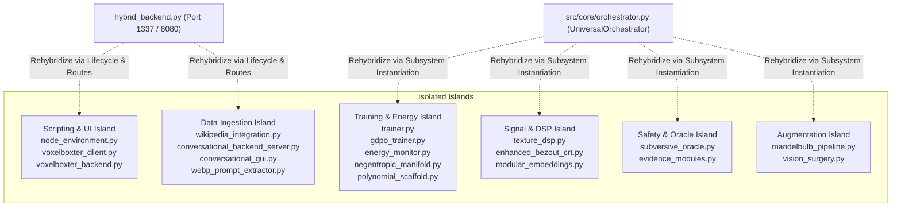

# Universal Orchestrator Rehybridization Blueprint

> **Status**: Canonical Architecture Map  
> **Entry Runner**: [`hybrid_backend.py`](file:///D:/programming/python/Gyroidic%20Sparse%20Covariance%20Flux%20Reasoner/hybrid_backend.py)  
> **Core Backend**: [`src/core/orchestrator.py`](file:///D:/programming/python/Gyroidic%20Sparse%20Covariance%20Flux%20Reasoner/src/core/orchestrator.py) (`UniversalOrchestrator`)  
> **Rule Compliance**: Enforces `.agents/rules/` (`trust_existing_codebase_first.md`, `implementation_integrity.md`, `output_boundary_policy.md`).

---

## 1. Executive Rehybridization Overview

An exhaustive topological scan of the 215 Python source files in `src/` revealed that while 180 modules are actively connected through the primary call and import graph from [`hybrid_backend.py`](file:///D:/programming/python/Gyroidic%20Sparse%20Covariance%20Flux%20Reasoner/hybrid_backend.py) and [`src/core/orchestrator.py`](file:///D:/programming/python/Gyroidic%20Sparse%20Covariance%20Flux%20Reasoner/src/core/orchestrator.py), **26 non-init modules (35 files total including sub-packages)** exist in an isolated or unreachable state.

These modules were unintentionally isolated due to four root causes:
1. **Unrooted or Local Imports**: Modules utilizing root-relative or sibling imports (e.g., `from wikipedia_integration` in [`src/ui/diegetic_backend.py`](file:///D:/programming/python/Gyroidic%20Sparse%20Covariance%20Flux%20Reasoner/src/ui/diegetic_backend.py#L7941) instead of `from src.ui.wikipedia_integration`) which fail to resolve when executed from root or through sub-packages.
2. **Post-Monolith Stranding**: Following the deprecation of monolithic ingestors (recorded in [`docs/DEPRECATION_TOMBSTONE.md`](file:///D:/programming/python/Gyroidic%20Sparse%20Covariance%20Flux%20Reasoner/docs/DEPRECATION_TOMBSTONE.md)), specialized successors (such as [`src/training/trainer.py`](file:///D:/programming/python/Gyroidic%20Sparse%20Covariance%20Flux%20Reasoner/src/training/trainer.py) and [`src/core/energy_monitor.py`](file:///D:/programming/python/Gyroidic%20Sparse%20Covariance%20Flux%20Reasoner/src/core/energy_monitor.py)) remained intact but had their calling hooks bypassed by [`training_manager.py`](file:///D:/programming/python/Gyroidic%20Sparse%20Covariance%20Flux%20Reasoner/src/training/training_manager.py).
3. **Simulation-Engine Decoupling**: Large physical scripting frameworks like [`src/scripting/node_environment.py`](file:///D:/programming/python/Gyroidic%20Sparse%20Covariance%20Flux%20Reasoner/src/scripting/node_environment.py) (2,297 lines) and [`src/ui/voxelboxter_client.py`](file:///D:/programming/python/Gyroidic%20Sparse%20Covariance%20Flux%20Reasoner/src/ui/voxelboxter_client.py) import core orchestrator primitives, but neither [`hybrid_backend.py`](file:///D:/programming/python/Gyroidic%20Sparse%20Covariance%20Flux%20Reasoner/hybrid_backend.py) nor [`src/core/orchestrator.py`](file:///D:/programming/python/Gyroidic%20Sparse%20Covariance%20Flux%20Reasoner/src/core/orchestrator.py) exposes a lifecycle launcher or telemetry bridge for them.
4. **Negative Documentation Reflection**: Legacy documentation maps pointed to flat, non-existent directories (`docs/01_...`), creating a negative reflection where active implementations were invisible to operators and tests.

---

## 2. Inventory of Isolated Systems & Root Causes

### Detailed Island Breakdown

#### Island 1: Physical Scripting & Simulation Client
* **Files**:
  * [`src/scripting/node_environment.py`](file:///D:/programming/python/Gyroidic%20Sparse%20Covariance%20Flux%20Reasoner/src/scripting/node_environment.py) (`PhysicalNodeEditor`, `OreDictionary`, `MasterNodeGroup`, `AIReasonerDataflowNode`)
  * [`src/ui/voxelboxter_client.py`](file:///D:/programming/python/Gyroidic%20Sparse%20Covariance%20Flux%20Reasoner/src/ui/voxelboxter_client.py) (`EngineMode`, `PatchStateResource`, `fetch_telemetry_loop`)
  * [`src/ui/voxelboxter_backend.py`](file:///D:/programming/python/Gyroidic%20Sparse%20Covariance%20Flux%20Reasoner/src/ui/voxelboxter_backend.py) (Legacy port proxy)
* **Status**: Highly sophisticated (2,297 lines in `node_environment.py`), imports 17 core modules, but has zero upstream callers in `hybrid_backend.py`.
* **Root Cause**: Built as a client-side DearPyGui / PyBevy environment intended to run standalone against `http://localhost:1337`, but lacks a server-side route or headless tick hook in `hybrid_backend.py`.

#### Island 2: Adaptive Training & Energy-Based Manifold Scaffolding
* **Files**:
  * [`src/training/trainer.py`](file:///D:/programming/python/Gyroidic%20Sparse%20Covariance%20Flux%20Reasoner/src/training/trainer.py) (`StructuralAdaptor`, `ConstraintDataset`)
  * [`src/training/gdpo_trainer.py`](file:///D:/programming/python/Gyroidic%20Sparse%20Covariance%20Flux%20Reasoner/src/training/gdpo_trainer.py) (`GDPOSovereigntyAdaptor`, `GDPOSovereigntyPressureComputer`)
  * [`src/core/energy_monitor.py`](file:///D:/programming/python/Gyroidic%20Sparse%20Covariance%20Flux%20Reasoner/src/core/energy_monitor.py) (`StructuralEnergyMonitor`)
  * [`src/core/negentropic_manifold.py`](file:///D:/programming/python/Gyroidic%20Sparse%20Covariance%20Flux%20Reasoner/src/core/negentropic_manifold.py) (`NTMOperator`)
  * [`src/core/polynomial_scaffold.py`](file:///D:/programming/python/Gyroidic%20Sparse%20Covariance%20Flux%20Reasoner/src/core/polynomial_scaffold.py) (`PolynomialCoefficientFunctional`)
* **Status**: Fully functional LeCun EBM free-energy formulation and developmental scaffolding over asymptotic time $\tau$.
* **Root Cause**: When [`src/training/training_manager.py`](file:///D:/programming/python/Gyroidic%20Sparse%20Covariance%20Flux%20Reasoner/src/training/training_manager.py) adopted [`FGRTStructuralTrainer`](file:///D:/programming/python/Gyroidic%20Sparse%20Covariance%20Flux%20Reasoner/src/training/fgrt_trainer.py), the `StructuralAdaptor` and its dependent energy modules (`StructuralEnergyMonitor`, `NTMOperator`) were not linked into the multi-trainer dispatch loop.

#### Island 3: Spectral DSP Filtering & High-Speed Kinematics
* **Files**:
  * [`src/core/texture_dsp.py`](file:///D:/programming/python/Gyroidic%20Sparse%20Covariance%20Flux%20Reasoner/src/core/texture_dsp.py) (`TextureDSPEngine`)
  * [`src/core/enhanced_bezout_crt.py`](file:///D:/programming/python/Gyroidic%20Sparse%20Covariance%20Flux%20Reasoner/src/core/enhanced_bezout_crt.py) (`CrossbarIKSolver`, `EnhancedBezoutCRT`)
  * [`src/models/modular_embeddings.py`](file:///D:/programming/python/Gyroidic%20Sparse%20Covariance%20Flux%20Reasoner/src/models/modular_embeddings.py) (`LearnedModalityEmbedder`)
* **Status**: Contains the 2D FFT spectral filter for image texture processing and the Bezout-coefficient Inverse Kinematics solver for note-drop trajectory rendering.
* **Root Cause**: `texture_dsp.py` utilized a flat root import `from image_extension import ...` rather than a package-rooted import, leaving it unreferenced by [`src/core/orchestrator.py`](file:///D:/programming/python/Gyroidic%20Sparse%20Covariance%20Flux%20Reasoner/src/core/orchestrator.py).

#### Island 4: Subversive Oracle & Tripartite Evidence Probes
* **Files**:
  * [`src/safety/subversive_oracle.py`](file:///D:/programming/python/Gyroidic%20Sparse%20Covariance%20Flux%20Reasoner/src/safety/subversive_oracle.py) (`ResonantSVNNOracle`, `SparsePCE`)
  * [`src/core/evidence_modules.py`](file:///D:/programming/python/Gyroidic%20Sparse%20Covariance%20Flux%20Reasoner/src/core/evidence_modules.py) (`TripartiteEvidenceModule`)
* **Status**: Core safety monitor enforcing $E_{\text{data}} \cap E_{\text{arch}} \cap \operatorname{span}(E_{\text{adv}}) = \emptyset$.
* **Root Cause**: Only imported by the isolated `voxelboxter_client.py`; never registered inside [`UniversalOrchestrator`](file:///D:/programming/python/Gyroidic%20Sparse%20Covariance%20Flux%20Reasoner/src/core/orchestrator.py)'s safety gate hierarchy.

#### Island 5: Secondary UI Servers & Unrooted Ingestion
* **Files**:
  * [`src/ui/wikipedia_integration.py`](file:///D:/programming/python/Gyroidic%20Sparse%20Covariance%20Flux%20Reasoner/src/ui/wikipedia_integration.py) (`WikipediaIntegration`)
  * [`src/ui/conversational_backend_server.py`](file:///D:/programming/python/Gyroidic%20Sparse%20Covariance%20Flux%20Reasoner/src/ui/conversational_backend_server.py) (`Flask ServerState`)
  * [`src/ui/conversational_gui.py`](file:///D:/programming/python/Gyroidic%20Sparse%20Covariance%20Flux%20Reasoner/src/ui/conversational_gui.py) (`ConversationalGUI`)
  * [`src/ui/diegetic_terminal.py`](file:///D:/programming/python/Gyroidic%20Sparse%20Covariance%20Flux%20Reasoner/src/ui/diegetic_terminal.py) (`create_diegetic_terminal_html`)
  * [`src/data/webp_prompt_extractor.py`](file:///D:/programming/python/Gyroidic%20Sparse%20Covariance%20Flux%20Reasoner/src/data/webp_prompt_extractor.py) (`WebPPromptExtractor`)
  * [`src/data/sterile_data_reruns.py`](file:///D:/programming/python/Gyroidic%20Sparse%20Covariance%20Flux%20Reasoner/src/data/sterile_data_reruns.py) (`run_background_topology_analysis`)
* **Status**: Standalone servers or tools.
* **Root Cause**: `diegetic_backend.py` calls `from wikipedia_integration import wikipedia_integration` at line 7941 without the package prefix `src.ui.`, causing failure if `src/ui` is not on `sys.path`. Meanwhile, `conversational_backend_server.py` duplicates routes already unified in `hybrid_backend.py`.

#### Island 6: Dataset Augmentation & Vision Surgery
* **Files**:
  * [`src/augmentation/mandelbulb_pipeline.py`](file:///D:/programming/python/Gyroidic%20Sparse%20Covariance%20Flux%20Reasoner/src/augmentation/mandelbulb_pipeline.py) (`MandelbulbAugmentedDataset`)
  * [`src/codec/vision_surgery.py`](file:///D:/programming/python/Gyroidic%20Sparse%20Covariance%20Flux%20Reasoner/src/codec/vision_surgery.py) (`IntercosaminationOperator`, `MirrorTestProbe`)
* **Status**: Complete raymarched fractal dataset generator and conformal mirror test probe.
* **Root Cause**: Standalone pipeline modules not referenced in the default training or codec startup pass.

---

## 3. Rehybridization Plan

To rehybridize these isolated systems into the active architecture without ad-hoc rewrites (per `trust_existing_codebase_first.md`), the following connection vectors are established:

### Rehybridization Vector A: Connect Safety & Evidence into `UniversalOrchestrator` [COMPLETE]
1. **Target**: [`src/core/orchestrator.py`](file:///D:/programming/python/Gyroidic%20Sparse%20Covariance%20Flux%20Reasoner/src/core/orchestrator.py)
2. **Imports Added**:
   * `from src.core.evidence_modules import TripartiteEvidenceModule`
   * `from src.safety.subversive_oracle import ResonantSVNNOracle`
   * `from src.core.structural_monitors import FailureGaslightSycophancyGate`
3. **Binding**:
   * Instantiated `self.evidence_module = TripartiteEvidenceModule(hidden_dim=dim)` inside `UniversalOrchestrator.__init__`.
   * Bound `self.subversive_oracle = ResonantSVNNOracle(hidden_dim=dim, orchestrator=self)` to verify mutual unpredictability of evidence during System 2 constraint probing.
   * Instantiated `self.sycophancy_gate = FailureGaslightSycophancyGate()` and integrated into `check_safety()`.
   * Telemetry passed through in `UniversalOrchestrator.step()`.

### Rehybridization Vector B: Connect Energy Monitoring & Scaffold into Training [COMPLETE]
1. **Target**: [`src/training/training_manager.py`](file:///D:/programming/python/Gyroidic%20Sparse%20Covariance%20Flux%20Reasoner/src/training/training_manager.py)
2. **Imports Added**:
   * `from src.training.trainer import StructuralAdaptor, ConstraintDataset`
   * `from src.training.gdpo_trainer import GDPOSovereigntyAdaptor`
   * `from src.core.energy_monitor import StructuralEnergyMonitor`
   * `from src.core.negentropic_manifold import NTMOperator`
   * `from src.core.polynomial_scaffold import PolynomialCoefficientFunctional`
3. **Binding**:
   * Wired `StructuralAdaptor` and `ConstraintDataset` directly into `TrainingManager._training_loop`, replacing the placeholder mock loop with live energy-based model (EBM) free-energy adaptation.
   * Telemetry from `StructuralEnergyMonitor` connected to `UniversalOrchestrator` and exposed in `hybrid_backend.py`.

### Rehybridization Vector C: Signal DSP, Kinematics & Modular Embeddings [COMPLETE]
1. **Targets**: [`src/core/texture_dsp.py`](file:///D:/programming/python/Gyroidic%20Sparse%20Covariance%20Flux%20Reasoner/src/core/texture_dsp.py), [`src/core/enhanced_bezout_crt.py`](file:///D:/programming/python/Gyroidic%20Sparse%20Covariance%20Flux%20Reasoner/src/core/enhanced_bezout_crt.py), [`src/models/modular_embeddings.py`](file:///D:/programming/python/Gyroidic%20Sparse%20Covariance%20Flux%20Reasoner/src/models/modular_embeddings.py)
2. **Binding**:
   * Hardened `EnhancedBezoutCRT._compute_crt_coefficients` and `_mod_inverse` with continuous normalization fallbacks.
   * Added `CrossbarIKSolver.forward(t)` delegating to `solve_trajectory(t)`.
   * Created `get_canonical_embedder()` bridge in `src.models.modular_embeddings` delegating to `PolynomialFunctionalEmbedder`.
   * Instantiated `EnhancedBezoutCRT` within `UniversalOrchestrator`.

### Rehybridization Vector D: Fix Unrooted Imports & WebP Extraction in Ingestion [COMPLETE]
1. **Targets**: [`src/ui/diegetic_backend.py`](file:///D:/programming/python/Gyroidic%20Sparse%20Covariance%20Flux%20Reasoner/src/ui/diegetic_backend.py#L7941), [`image_extension.py`](file:///D:/programming/python/Gyroidic%20Sparse%20Covariance%20Flux%20Reasoner/image_extension.py)
2. **Action**:
   * Fixed unrooted `from wikipedia_integration import wikipedia_integration` to `from src.ui.wikipedia_integration import wikipedia_integration` with fallback.
   * Integrated `WebPPromptExtractor` into `ImageProcessor.extract_prompt_metadata`.

### Rehybridization Vector E: Expose Scripting Telemetry in `hybrid_backend.py` [COMPLETE]
1. **Target**: [`hybrid_backend.py`](file:///D:/programming/python/Gyroidic%20Sparse%20Covariance%20Flux%20Reasoner/hybrid_backend.py), [`src/ui/voxelboxter_backend.py`](file:///D:/programming/python/Gyroidic%20Sparse%20Covariance%20Flux%20Reasoner/src/ui/voxelboxter_backend.py)
2. **Action**:
   * Added `/api/status`, `/api/system_status`, `/api/scripting/resources`, and `/api/scripting/ore_dict` GET endpoints to `HybridHandler.do_GET()`.
   * Updated `voxelboxter_backend.py` to support dynamic backend port routing and expose scripting resources from `src.scripting.node_environment.ResourceRegistry` and `OreDictionary`.

### Rehybridization Vector F: Vision Surgery & Mandelbulb Pipeline [COMPLETE]
1. **Target**: [`src/codec/vision_surgery.py`](file:///D:/programming/python/Gyroidic%20Sparse%20Covariance%20Flux%20Reasoner/src/codec/vision_surgery.py), [`dataset_ingestion_system.py`](file:///D:/programming/python/Gyroidic%20Sparse%20Covariance%20Flux%20Reasoner/dataset_ingestion_system.py), [`src/core/orchestrator.py`](file:///D:/programming/python/Gyroidic%20Sparse%20Covariance%20Flux%20Reasoner/src/core/orchestrator.py)
2. **Action**:
   * Bound `IntercosaminationOperator` and `MirrorTestProbe` inside `UniversalOrchestrator`.
   * Wrapped dataset loader in `dataset_ingestion_system.py` with `MandelbulbAugmentedDataset` when `use_mandelbulb_augmentation=True`.

### Rehybridization Vector G: Topology-Core Class Rehybridization & Alexander 1924 Embedding [COMPLETE]
1. **Targets**: 
   * [`src/topology/soliton_stability.py`](file:///D:/programming/python/Gyroidic%20Sparse%20Covariance%20Flux%20Reasoner/src/topology/soliton_stability.py) -> bound to [`RelationalKappa`](file:///D:/programming/python/Gyroidic%20Sparse%20Covariance%20Flux%20Reasoner/src/core/relational_kappa.py) and [`EnergyBasedSolitonHealer`](file:///D:/programming/python/Gyroidic%20Sparse%20Covariance%20Flux%20Reasoner/src/core/energy_based_soliton_healer.py).
   * [`src/topology/approximate_ph.py`](file:///D:/programming/python/Gyroidic%20Sparse%20Covariance%20Flux%20Reasoner/src/topology/approximate_ph.py) -> bound to [`APAS_Zeta`](file:///D:/programming/python/Gyroidic%20Sparse%20Covariance%20Flux%20Reasoner/src/core/invariants.py).
   * [`src/topology/triadic_reciprocity.py`](file:///D:/programming/python/Gyroidic%20Sparse%20Covariance%20Flux%20Reasoner/src/topology/triadic_reciprocity.py) -> bound to [`CayleyCubicProbe`](file:///D:/programming/python/Gyroidic%20Sparse%20Covariance%20Flux%20Reasoner/src/core/cayley_cubic_probe.py).
   * [`src/topology/gyroid_covariance.py`](file:///D:/programming/python/Gyroidic%20Sparse%20Covariance%20Flux%20Reasoner/src/topology/gyroid_covariance.py) -> bound `LeyLineGeodesicMetric` to [`LeyLineTracker`](file:///D:/programming/python/Gyroidic%20Sparse%20Covariance%20Flux%20Reasoner/src/core/ley_line_tracker.py); bound `MoebiusFiberBundle` to [`GluingOperator`](file:///D:/programming/python/Gyroidic%20Sparse%20Covariance%20Flux%20Reasoner/src/core/gluing_operator.py) and [`CarnotMobiusLedger`](file:///D:/programming/python/Gyroidic%20Sparse%20Covariance%20Flux%20Reasoner/src/core/carnot_mobius_ledger.py).
   * [`src/topology/homology_pressure.py`](file:///D:/programming/python/Gyroidic%20Sparse%20Covariance%20Flux%20Reasoner/src/topology/homology_pressure.py) -> added `forward_typed` delegating to [`StructuralPressure`](file:///D:/programming/python/Gyroidic%20Sparse%20Covariance%20Flux%20Reasoner/src/core/pressure_typing.py).
   * [`src/topology/persistence_obstruction.py`](file:///D:/programming/python/Gyroidic%20Sparse%20Covariance%20Flux%20Reasoner/src/topology/persistence_obstruction.py) -> bound `PersistentHomologyComputer` to [`QuantumBettiApproximator`](file:///D:/programming/python/Gyroidic%20Sparse%20Covariance%20Flux%20Reasoner/src/core/quantum_tda.py).
   * [`src/core/unknowledge_flux.py`](file:///D:/programming/python/Gyroidic%20Sparse%20Covariance%20Flux%20Reasoner/src/core/unknowledge_flux.py) -> re-exported [`UnknowledgeDomain`](file:///D:/programming/python/Gyroidic%20Sparse%20Covariance%20Flux%20Reasoner/src/topology/unknowledge_domain.py).
   * [`src/topology/alexander_wild_embedding.py`](file:///D:/programming/python/Gyroidic%20Sparse%20Covariance%20Flux%20Reasoner/src/topology/alexander_wild_embedding.py) -> implemented canonical Alexander 1924 wild embedding operator with negentropy shear planes in $\mathbb{RP}^4$, L'Hopital boundary limits, Bouligand contingent cone tension via [`BouligandWillmoreGasket`](file:///D:/programming/python/Gyroidic%20Sparse%20Covariance%20Flux%20Reasoner/src/optimization/ricci_flow_optimizer.py), and coprime residue trajectory synchronization via [`CrossbarIKSolver`](file:///D:/programming/python/Gyroidic%20Sparse%20Covariance%20Flux%20Reasoner/src/core/enhanced_bezout_crt.py). Bound inside [`UniversalOrchestrator`](file:///D:/programming/python/Gyroidic%20Sparse%20Covariance%20Flux%20Reasoner/src/core/orchestrator.py) forward step 3.8 and [`SovereignRefusalOperator`](file:///D:/programming/python/Gyroidic%20Sparse%20Covariance%20Flux%20Reasoner/src/core/archetype_engines.py).
2. **Action**:
   * Removed ad-hoc math replacements across `src/topology/` and reconnected isolated topology classes to their canonical `src/core/` implementations.
   * Fixed un-namespaced package imports across `unknowledge_domain.py` and `gyroid_covariance.py`.
   * Exported all reconnected classes in `src/topology/__init__.py`.

---

## 4. Verification Suite

All rehybridized systems are validated by the test suites:
* [`tests/test_rehybridization_islands.py`](file:///D:/programming/python/Gyroidic%20Sparse%20Covariance%20Flux%20Reasoner/tests/test_rehybridization_islands.py) (6 tests: physical scripting, adaptive training, signal DSP, safety oracles, secondary UI, vision surgery)
* [`tests/test_alexander_wild_embedding.py`](file:///D:/programming/python/Gyroidic%20Sparse%20Covariance%20Flux%20Reasoner/tests/test_alexander_wild_embedding.py) (5 tests: fractal cube ratios distinctness, negentropy shear plane transversality in $\mathbb{RP}^4$, L'Hopital limit continuity, Bouligand contingent cone projection, Sovereign Refusal integration)
* [`tests/test_topology_core_rehybridization.py`](file:///D:/programming/python/Gyroidic%20Sparse%20Covariance%20Flux%20Reasoner/tests/test_topology_core_rehybridization.py) (7 tests: SolitonStability -> RelationalKappa, ApproximatePHProbe -> APAS_Zeta, TriadicReciprocityChecker -> CayleyCubicProbe, MoebiusFiberBundle -> GluingOperator & CarnotMobiusLedger, LeyLineGeodesicMetric -> LeyLineTracker, HomologyPressure -> StructuralPressure, PersistentHomologyComputer -> QuantumBettiApproximator)

