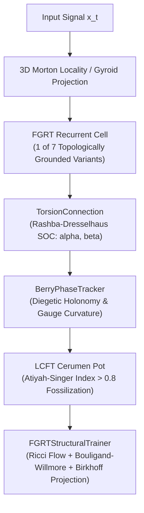

# Fiberalized Gyroidic Recurrent Topology (FGRT) — Formal Specification

> High-dimensional non-Euclidean recurrent topology over hybrid Klein-Gyroid slip-spaces, Logarithmic Conformal Field Theory (LCFT) memory scarring, and Ricci flow optimization.  
> **Core Implementations**:  
> - Primitives: [`fgrt_primitives.py`](file:///d:/programming/python/Gyroidic%20Sparse%20Covariance%20Flux%20Reasoner/src/core/fgrt_primitives.py) (659 lines)  
> - Recurrent Cells: [`fgrt_rnn_cells.py`](file:///d:/programming/python/Gyroidic%20Sparse%20Covariance%20Flux%20Reasoner/src/core/fgrt_rnn_cells.py) (246 lines)  
> - Structural Trainer: [`fgrt_trainer.py`](file:///d:/programming/python/Gyroidic%20Sparse%20Covariance%20Flux%20Reasoner/src/training/fgrt_trainer.py) (187 lines)  
> - Composed Trainer: [`fgrt_fgrt_trainer.py`](file:///d:/programming/python/Gyroidic%20Sparse%20Covariance%20Flux%20Reasoner/src/training/fgrt_fgrt_trainer.py)

---

## 1. Architectural Paradigm

FGRT departs from Euclidean vector-space recurrent neural networks by embedding hidden state evolutions directly onto a **Klein-Gyroid Slip-Space** ($\mathcal{G} \cup \mathcal{K}$). Rather than enforcing global rotational invariance, the system calculates and preserves **Chiral Symmetry Breaking** and **Geometric Berry Phase Accumulation**.



### Logarithmic Conformal Field Theory (LCFT) & Memory Scars
Under Standard CFT, field perturbations decay exponentially or algebraically toward zero. FGRT adopts **Logarithmic Conformal Field Theory (LCFT)**:
- Memory tracking incorporates non-decaying **Logarithmic Correlation Functions**:
  $$\langle \phi(z) \psi(0) \rangle \sim \frac{1}{|z|^{2\Delta}} \left( -2 \ln |z| + c_0 \right)$$
- Topological violations, high-pressure constraint friction, and "Good Bugs" are physically fossilized as non-decaying scars in the **Cerumen Pot** auxiliary memory matrix rather than being erased by forget gates.

---

## 2. Base Manifold ($\mathcal{G} \cup \mathcal{K}$) & Spatial Locality

The base computational manifold is a composite topological fiber:
1. **Gyroid Triply Periodic Minimal Surface ($\mathcal{G}$)**:
   $$\sin(x)\cos(y) + \sin(y)\cos(z) + \sin(z)\cos(x) = 0$$
   Provides infinite high-connectivity channels with zero mean curvature ($H = 0$) and negative Gaussian curvature ($K \leq 0$).
2. **Klein-Bottle Throat ($\mathcal{K}$)**:
   A non-orientable 4D manifold that reverses normal vector orientation when traversing the throat boundary.
3. **Symplectic Gluing Diffeomorphism**:
   The two domains are sealed across boundary hypersurface $\partial M$ via a **Chern-Simons Gasket**:
   $$S_{CS} = \frac{k}{4\pi} \int_{\partial M} \text{tr}\left(A \wedge dA + \frac{2}{3} A \wedge A \wedge A\right)$$

### 3D Morton Z-Order Space-Filling Curve
Implemented in [`expand_bits`](file:///d:/programming/python/Gyroidic%20Sparse%20Covariance%20Flux%20Reasoner/src/core/fgrt_primitives.py#L18) and [`morton_encode_3d`](file:///d:/programming/python/Gyroidic%20Sparse%20Covariance%20Flux%20Reasoner/src/core/fgrt_primitives.py#L30):
- Interleaves bits of coordinates $(x, y, z)$ to preserve 3D geometric locality when flattened to a 1D sequence.
- Prevents cache fragmentation and memory-bank stalls across PyOpenCL and PyTorch tensor pipelines during ADMM repair sweeps and octree voxelization.

### Gyroid Admissibility Filter
Implemented by [`GyroidicAdmissibilityFilter`](file:///d:/programming/python/Gyroidic%20Sparse%20Covariance%20Flux%20Reasoner/src/core/fgrt_primitives.py#L86):
- Evaluates speculative exit threshold $H_{\text{spec}} < \epsilon$ (default $\epsilon = 0.05$).
- Partitions arbitrary state vectors $[B, D]$ into 3D triplets, computing mean absolute Gyroid constraint violations to filter inadmissible latent thoughts before serialization.

---

## 3. Torsion, Contorsion, & Rashba-Dresselhaus Spin-Orbit Coupling

Standard architectures assume a torsion-free Levi-Civita connection ($\Gamma^\lambda_{\mu\nu} = \Gamma^\lambda_{\nu\mu}$). FGRT introduces an affine connection with an explicit **Torsion Tensor** $T^\lambda_{\mu\nu}$:

$$\Gamma^\lambda_{\mu\nu} = \bar{\Gamma}^\lambda_{\mu\nu} + K^\lambda_{\mu\nu}$$

where $K^\lambda_{\mu\nu} = \frac{1}{2}\left(T^\lambda_{\mu\nu} + T_{\mu}{}^\lambda{}_\nu + T_{\nu}{}^\lambda{}_\mu\right)$ is the Contorsion Tensor.

### Rashba-Dresselhaus Parameterization
Implemented in [`TorsionConnection`](file:///d:/programming/python/Gyroidic%20Sparse%20Covariance%20Flux%20Reasoner/src/core/fgrt_primitives.py#L130):
- Parameterized by $\alpha$ (Rashba parameter) and $\beta$ (Dresselhaus parameter).
- Embeds SU(2) Pauli matrix blocks across adjacent coordinate pairs $(2j, 2j+1)$:
  $$A_x = -\alpha \sigma_y + \beta \sigma_x, \quad A_y = \alpha \sigma_x - \beta \sigma_y$$
- **Persistent Spin Helix (PSH) Deviation**:
  $$\Delta_{\text{psh}} = \left|\alpha^2 - \beta^2\right|$$
  When $\alpha = \pm \beta$, the system achieves exact $SU(2)$ symmetry lock, eliminating spin relaxation and directional drift.

### Diegetic Holonomy & Berry Phase Tracking
Implemented in [`BerryPhaseTracker`](file:///d:/programming/python/Gyroidic%20Sparse%20Covariance%20Flux%20Reasoner/src/core/fgrt_primitives.py#L173):
- Treats state vectors as complex coordinate pairs $z_k = x_{2k} + i x_{2k+1}$.
- Computes phase shifts $\Delta\phi = \theta_{t} - \theta_{t-1}$.
- Aligns holonomy with the physical gauge curvature solid angle swept under $(\alpha, \beta)$ curvature:
  $$\Delta\phi_{\text{corrected}} = \Delta\phi + \frac{1}{2} \left|\alpha^2 - \beta^2\right| \cdot \left(z_{t-1}^{\text{Re}} z_{t}^{\text{Im}} - z_{t-1}^{\text{Im}} z_{t}^{\text{Re}}\right)$$

### Klein Throat Orientation Flipping
Implemented in [`KleinThroatTransition`](file:///d:/programming/python/Gyroidic%20Sparse%20Covariance%20Flux%20Reasoner/src/core/fgrt_primitives.py#L616):
- Detects traversal across the non-orientable bottleneck when $|\sin(x_0)| > \tau_{\text{throat}}$.
- Executes an orientation flip on the surface normal ($n \mapsto -n$) and passes the transition through the contorsion tensor $K(v, w)$ to update Berry holonomy.

---

## 4. Resonance Intelligence Core (RIC) Primitives

FGRT operationalizes the Resonance Intelligence Core via specialized arithmetic primitives:

| Component | Class | Core Formula | Purpose |
|---|---|---|---|
| **Prime Resonance Ladder** | [`PrimeResonanceLadder`](file:///d:/programming/python/Gyroidic%20Sparse%20Covariance%20Flux%20Reasoner/src/core/fgrt_primitives.py#L217) | $f_{p_n} = 2\pi \ln(p_n)$ | Generates incommensurate non-mode-locking frequencies. |
| **Repunit-Prime Pairs** | `_generate_hybrid_basis` | $R_n^{(p)} = \frac{p^n - 1}{p - 1}$ | Prioritizes Lazarus primes for $O(K)$ warmstart. |
| **Gray Code Interleaving** | `PrimeResonanceLadder` | $i \oplus (i \gg 1) \pmod N$ | Scrambles memory strides across GPU banks. |
| **Repunit Hasher** | [`RepunitHasher`](file:///d:/programming/python/Gyroidic%20Sparse%20Covariance%20Flux%20Reasoner/src/core/fgrt_primitives.py#L367) | $\text{fmod}(|x \cdot R + \xi|, R)$ | Hardware-jitter-grounded cyclic structural markers. |
| **Fibonacci Resonance Entropy** | [`FibonacciResonanceEntropy`](file:///d:/programming/python/Gyroidic%20Sparse%20Covariance%20Flux%20Reasoner/src/core/fgrt_primitives.py#L406) | $S_{i,j} = \frac{\alpha}{\exp(\pi / (F_i P_j)) + 1}$ | Smooth Fermi coupling lattice over Fibonacci $\times$ Primes. |
| **Manifold Hunger Modulation** | `hunger_modulated_entropy` | $S_{i,j}(H) = \frac{\alpha}{\exp(\pi / (F_i P_j (1+H))) + 1}$ | Expands Fermi envelope during search while preserving prime structure. |
| **Coherent Prime Resonance** | [`CoherentPrimeResonance`](file:///d:/programming/python/Gyroidic%20Sparse%20Covariance%20Flux%20Reasoner/src/core/fgrt_primitives.py#L495) | $\text{PAS}_h \ge \theta \wedge \langle u_n, F \rangle > 0 \wedge \text{Spec}(F) \subseteq \{p_n\}$ | Binary gate verifying global standing-wave phase lock. |
| **CALM Collapse Detector** | [`CALMCollapseDetector`](file:///d:/programming/python/Gyroidic%20Sparse%20Covariance%20Flux%20Reasoner/src/core/fgrt_primitives.py#L588) | $r_{\text{bounded}}(H) \ge \theta_{\text{warn}}$ | Martinova correlation detecting trajectory fossilization/collapse. |

---

## 5. The 7 Recurrent Cell Realizations (`fgrt_rnn_cells.py`)

The recurrent core of FGRT provides 7 specialized cell architectures tailored for distinct topological regimes:

```
+-----------------------------------------------------------------------------------------+
|                               FGRT RECURRENT CELL TAXONOMY                               |
+------------------------------------+----------------------------------------------------+
| 1. BerryPhaseGRUCell               | GRU with Stiefel-Whitney Parity Flip w_1(E) = -1    |
| 2. ChiralGatedRNNCell              | Bostick Chiral Projection Gating                   |
| 3. ComplexFGRTRNNCell              | C^768 Native Rotations & Cyclotomic Roots          |
| 4. SaturatedQuantizerRNNCell       | KAN True B-Splines + Weyl Snapping                 |
| 5. PyOpenCLHardwareSovereigntyCell | OpenCL Queue B Matrix-Mix Breeding + Jitter Scars  |
| 6. LazarusSuperpositionRNNCell     | Continuous Linear Superposition at Prime Freqs     |
| 7. FeatureScarLCFTCell             | LCFT Cerumen Pot Fossilization (Atiyah-Singer >0.8)|
+------------------------------------+----------------------------------------------------+
```

### Detailed Cell Specifications

1. **[`BerryPhaseGRUCell`](file:///d:/programming/python/Gyroidic%20Sparse%20Covariance%20Flux%20Reasoner/src/core/fgrt_rnn_cells.py#L15)**:
   - State tuple: $(h_t, \gamma_t)$ where $\gamma_t$ is accumulated Berry phase.
   - Computes twist angle via linear contorsion layer: $\Delta\gamma = \tanh(W [x, h])$.
   - **Stiefel-Whitney Parity Flip**: If $\cos(\gamma_t) < 0$, flips sign $h_{t} \leftarrow -h_{t}$ to account for first Stiefel-Whitney class obstruction across non-orientable boundaries.

2. **[`ChiralGatedRNNCell`](file:///d:/programming/python/Gyroidic%20Sparse%20Covariance%20Flux%20Reasoner/src/core/fgrt_rnn_cells.py#L46)**:
   - Replaces standard scalar forget gates with chiral projection gates:
     $$\Gamma_\chi(h) = \sigma\left(\text{mean}_k \langle h, \chi_k \rangle\right)$$
   - A state is only forgotten if its chiral parity destructively interferes with the attractor basis.

3. **[`ComplexFGRTRNNCell`](file:///d:/programming/python/Gyroidic%20Sparse%20Covariance%20Flux%20Reasoner/src/core/fgrt_rnn_cells.py#L72)**:
   - Hidden state operates in $\mathbb{C}^{768}$ (represented as paired Real and Imaginary tensors).
   - Gyroid connection acts as a complex rotation by cyclotomic root angles $\pi / 4$.
   - Atiyah-Singer index flips occur naturally without discontinuities when rotating through $e^{i\pi} = -1$.

4. **[`SaturatedQuantizerRNNCell`](file:///d:/programming/python/Gyroidic%20Sparse%20Covariance%20Flux%20Reasoner/src/core/fgrt_rnn_cells.py#L106)**:
   - Combines [`KANLayer`](file:///d:/programming/python/Gyroidic%20Sparse%20Covariance%20Flux%20Reasoner/src/surrogates/kagh_networks.py#L79) (True B-splines) with speculative [`KAGHBlock`](file:///d:/programming/python/Gyroidic%20Sparse%20Covariance%20Flux%20Reasoner/src/surrogates/kagh_networks.py#L537) ghost drafting.
   - Snaps outputs to discrete Weyl bounds using Straight-Through Estimators (STE), preventing diffusion toxin model collapse.

5. **[`PyOpenCLHardwareSovereigntyCell`](file:///d:/programming/python/Gyroidic%20Sparse%20Covariance%20Flux%20Reasoner/src/core/fgrt_rnn_cells.py#L142)**:
   - Offloads temporal recurrence to [`SiliconSovereigntyEngine.matrix_mix_breeding`](file:///d:/programming/python/Gyroidic%20Sparse%20Covariance%20Flux%20Reasoner/src/core/pyopencl_sovereignty.py) on OpenCL Queue B.
   - **Compute Affordance Protection**: Automatically queries [`HardwareMonitor.has_compute_affordance()`](file:///d:/programming/python/Gyroidic%20Sparse%20Covariance%20Flux%20Reasoner/src/core/hardware_monitor.py#L125). If thermal runaway or headroom exhaustion occurs, cleanly falls back to local CPU algebraic interpolation.

6. **[`LazarusSuperpositionRNNCell`](file:///d:/programming/python/Gyroidic%20Sparse%20Covariance%20Flux%20Reasoner/src/core/fgrt_rnn_cells.py#L186)**:
   - Dark Matter continuous linear superposition: $h_t = h_{t-1} + \sin(f_{p_n}) \cdot W_x x_t$.
   - Contains zero intermediate non-linearities in the temporal path, allowing pure constructive and destructive harmonic interference.

7. **[`FeatureScarLCFTCell`](file:///d:/programming/python/Gyroidic%20Sparse%20Covariance%20Flux%20Reasoner/src/core/fgrt_rnn_cells.py#L211)**:
   - Uses `KANLayer` B-splines to generate state proposals.
   - Evaluates the Atiyah-Singer Anomaly Index $\text{ind}(\mathcal{D}) = |W_{\text{anomaly}} h_t|$.
   - When $\text{ind}(\mathcal{D}) > 0.8$, fossilizes $h_t$ into the non-decaying **Cerumen Pot**.
   - Applies the Chern-Simons Gasket to route future recurrent updates around the scar, ensuring historical violations permanently influence downstream trajectory geometry.

---

## 6. Non-Teleological Optimization (`fgrt_trainer.py`)

Implemented in [`FGRTStructuralTrainer`](file:///d:/programming/python/Gyroidic%20Sparse%20Covariance%20Flux%20Reasoner/src/training/fgrt_trainer.py#L33):

### Ricci Flow of the Manifold
Instead of minimizing a task-specific scalar loss function, weights evolve according to the intrinsic Ricci curvature:

$$\frac{\partial g_{\mu\nu}}{\partial t} = -2 R_{\mu\nu}$$

via [`RicciFlowOptimizer`](file:///d:/programming/python/Gyroidic%20Sparse%20Covariance%20Flux%20Reasoner/src/optimization/ricci_flow_optimizer.py).

### Bouligand-Willmore Energy Gasket
Evaluates structural deviation via the contingent cone intersection metric:

$$\mathcal{W} = \int \left(H^2 - K\right) dA$$

Implemented in [`BouligandWillmoreGasket`](file:///d:/programming/python/Gyroidic%20Sparse%20Covariance%20Flux%20Reasoner/src/optimization/ricci_flow_optimizer.py).

### Mandatory Birkhoff Projection
After each optimization step, all square weight matrices are projected onto the **Birkhoff Polytope** (doubly stochastic matrices) via Sinkhorn-Knopp iterations:

$$W \longleftarrow \text{project\_to\_birkhoff}(W)$$

This guarantees volume preservation and prevents gradient explosion across infinite recurrent steps.

### Implication Invariant Guard (Anti-Lobotomy)
Verifies that internal transitions maintain non-zero input sensitivity:
$$\left\|\frac{\partial \text{output}}{\partial \text{input}}\right\| > \epsilon_{\text{imp}}$$
Prevents trivial constant solutions ("Interaction without implication is a lobotomy").

---

## 7. Thermodynamic Backpressure & Compute Affordance Gating

FGRT recursive operations and GPU breeding queues are tightly coupled to the thermodynamic state managed by [`CarnotMobiusLedger`](file:///d:/programming/python/Gyroidic%20Sparse%20Covariance%20Flux%20Reasoner/src/core/carnot_mobius_ledger.py) and [`HardwareMonitor`](file:///d:/programming/python/Gyroidic%20Sparse%20Covariance%20Flux%20Reasoner/src/core/hardware_monitor.py):

1. **Hardware Sovereignty Veto**:
   If $P_{\text{waste}} > P_{\text{cool, max}}$ or `thermal_margin < 0.05`, [`PyOpenCLHardwareSovereigntyCell`](file:///d:/programming/python/Gyroidic%20Sparse%20Covariance%20Flux%20Reasoner/src/core/fgrt_rnn_cells.py#L142) aborts OpenCL kernel dispatch to prevent GPU lockups, gracefully falling back to CPU mixing.
2. **Trainer Throttling**:
   In [`FGRTStructuralTrainer.train_step`](file:///d:/programming/python/Gyroidic%20Sparse%20Covariance%20Flux%20Reasoner/src/training/fgrt_trainer.py#L71), expensive second-order `ForbiddenSmoothingChecker` verifications are bypassed when `has_compute_affordance() == False`.
3. **Adaptive Skeleton Harness Scaling**:
   [`AdaptiveSkeletonHarness`](file:///d:/programming/python/Gyroidic%20Sparse%20Covariance%20Flux%20Reasoner/src/core/adaptive_skeleton_harness.py) clamps FGRT recurrence depth when thermal margin drops below 25%.

---

## 8. Chiral Groupoid Actions (Beilinson-Drinfeld Formalism)

The system's non-Abelian constraint interactions are formalized via chiral algebras:
- **Chiral Category $\mathcal{C}^{\text{ch}}$**: Objects are constraint states; factorization products $P_I^{\text{ch}}: \bigotimes_{i \in I} \mathcal{C}^{\text{ch}}_{x_i} \to \mathcal{C}^{\text{ch}}_{M_I}$ are non-commutative due to rounding and ordering dependencies.
- **Groupoid $G \rightrightarrows X$**: Objects $X$ are constraint nodes (ADMM primal/dual, CRT residues, Burkov vertices); morphisms are chiral transports carrying Berry phases:
  $$\Delta\phi_g = \oint_{\gamma(g)} \langle \psi | \nabla_\gamma \psi \rangle d\gamma$$
- **Chiral Leibniz Rule**: For Lie algebroid actions $L_g$:
  $$[L_g, P_I^{\text{ch}}] = P_I^{\text{ch}}(\{L_g(M_i)\}, N) + P_I^{\text{ch}}(\{M_i\}, L_g(N))$$
- **Coherence Classification**: System coherence is classified by the fundamental groupoid $\Pi_1(\mathcal{A})$. The architecture remains operational if and only if $\Pi_1(\mathcal{A})$ is non-empty and connected.

---

## 9. Cross-References & System Integrations

| Topic / Component | Primary File | Documentation Link |
|---|---|---|
| FGRT Primitives | [`src/core/fgrt_primitives.py`](file:///d:/programming/python/Gyroidic%20Sparse%20Covariance%20Flux%20Reasoner/src/core/fgrt_primitives.py) | [MODULE_INVENTORY.md](file:///d:/programming/python/Gyroidic%20Sparse%20Covariance%20Flux%20Reasoner/docs/stepping_stairs_tier_0_vestibule/01_architecture_core/MODULE_INVENTORY.md) |
| FGRT Recurrent Cells | [`src/core/fgrt_rnn_cells.py`](file:///d:/programming/python/Gyroidic%20Sparse%20Covariance%20Flux%20Reasoner/src/core/fgrt_rnn_cells.py) | [FGRT_RNN_IMPLEMENTATION_DRAFTS.md](file:///d:/programming/python/Gyroidic%20Sparse%20Covariance%20Flux%20Reasoner/docs/FGRT_RNN_IMPLEMENTATION_DRAFTS.md) |
| Structural Trainers | [`src/training/fgrt_trainer.py`](file:///d:/programming/python/Gyroidic%20Sparse%20Covariance%20Flux%20Reasoner/src/training/fgrt_trainer.py) | [SYSTEM_ARCHITECTURE.md](file:///d:/programming/python/Gyroidic%20Sparse%20Covariance%20Flux%20Reasoner/docs/stepping_stairs_tier_0_vestibule/01_architecture_core/SYSTEM_ARCHITECTURE.md) |
| Resonance Intelligence Core | [`src/models/resonance_cavity.py`](file:///d:/programming/python/Gyroidic%20Sparse%20Covariance%20Flux%20Reasoner/src/models/resonance_cavity.py) | [RESONANCE_INTELLIGENCE_CORE.md](file:///d:/programming/python/Gyroidic%20Sparse%20Covariance%20Flux%20Reasoner/docs/stepping_stairs_tier_0_vestibule/stepping_stairs_tier_1_mezzanine/04_components_and_mechanics/RESONANCE_INTELLIGENCE_CORE.md) |
| Prime Resonance Ladder | [`src/core/invariants.py`](file:///d:/programming/python/Gyroidic%20Sparse%20Covariance%20Flux%20Reasoner/src/core/invariants.py) | [PRIME_RESONANCE_LADDER.md](file:///d:/programming/python/Gyroidic%20Sparse%20Covariance%20Flux%20Reasoner/docs/stepping_stairs_tier_0_vestibule/stepping_stairs_tier_1_mezzanine/04_components_and_mechanics/PRIME_RESONANCE_LADDER.md) |
| KAGH-Boltzmann Surrogates | [`src/surrogates/kagh_networks.py`](file:///d:/programming/python/Gyroidic%20Sparse%20Covariance%20Flux%20Reasoner/src/surrogates/kagh_networks.py) | [KAGH_NETWORKS.md](file:///d:/programming/python/Gyroidic%20Sparse%20Covariance%20Flux%20Reasoner/docs/stepping_stairs_tier_0_vestibule/stepping_stairs_tier_1_mezzanine/04_components_and_mechanics/KAGH_NETWORKS.md) |
| Thermodynamic Affordance | [`src/core/carnot_mobius_ledger.py`](file:///d:/programming/python/Gyroidic%20Sparse%20Covariance%20Flux%20Reasoner/src/core/carnot_mobius_ledger.py) | [carnot_mobius_analysis.md](file:///d:/programming/python/Gyroidic%20Sparse%20Covariance%20Flux%20Reasoner/docs/stepping_stairs_tier_0_vestibule/02_math_physics_topology/carnot_mobius_analysis.md) |
| Mathematical Foundations | [`src/core/noncommutativity_curvature.py`](file:///d:/programming/python/Gyroidic%20Sparse%20Covariance%20Flux%20Reasoner/src/core/noncommutativity_curvature.py) | [MATHEMATICAL_DETAILS.md](file:///d:/programming/python/Gyroidic%20Sparse%20Covariance%20Flux%20Reasoner/docs/stepping_stairs_tier_0_vestibule/02_math_physics_topology/MATHEMATICAL_DETAILS.md) |
