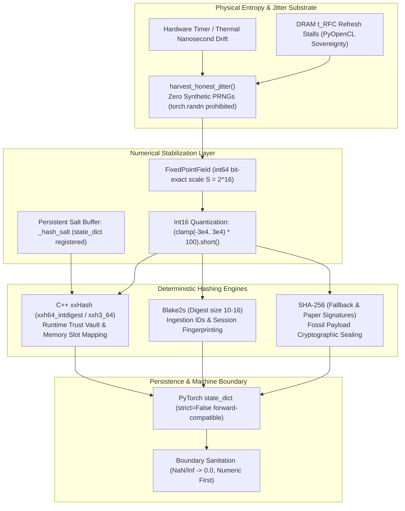

# Determinism, Hashing, and Persistence Policy

## Scope and Principles
This document defines the strict determinism, cryptographic/high-throughput hashing, state persistence, and interface-boundary policies governing data ingestion, memory retrieval, state loading, and result reporting across the Gyroidic Sparse Covariance Flux Reasoner.

The reasoner enforces **constructive determinism**: stochasticity is never simulated through unseeded pseudo-random number generators (`torch.randn`, Python `random`). Instead, non-ergodic entropy is grounded in physical hardware jitter (nanosecond timer drift, DRAM $t_{\text{RFC}}$ row-refresh stalls), while all internal memory addressing, trust tables, and ingestion identifiers are provably deterministic, cross-platform invariant, and persistent across process boundaries.

---

## 1. Determinism and Hashing Architecture



---

## 2. Ingestion and Identification Hashing (Blake2s)

### Policy
All ingestion-generated identifiers, dataset partition hashes, and conversation dyad keys must be bitwise reproducible across runs, processes, and different operating systems.

### Method
Identifiers are computed via a Blake2s digest over canonically sorted JSON:
```python
canonical_bytes = json.dumps(obj, sort_keys=True, ensure_ascii=False, default=str).encode('utf-8')
hexdigest = hashlib.blake2s(canonical_bytes, digest_size=10).hexdigest()
stable_id = f"{prefix}_{hexdigest}"
```

### Rationale
Python's built-in `hash()` is randomized per process via `PYTHONHASHSEED`. Using Blake2s with canonical serialization guarantees cross-host and cross-run key identity for caching, fossil retrieval, and dataset sharding.

---

## 3. High-Throughput Memory & Trust Vault Hashing (C++ xxHash)

### Policy
Runtime forward passes requiring table lookups, memory slot indexing, and LSB salt extraction (such as in [`HeritableTrustVault`](file:///d:/programming/python/Gyroidic%20Sparse%20Covariance%20Flux%20Reasoner/src/models/resonance_cavity.py#L84) and [`UniversalTopologyConverter`](file:///d:/programming/python/Gyroidic%20Sparse%20Covariance%20Flux%20Reasoner/src/data/universal_topology_converter.py#L165)) must utilize C-accelerated xxHash (`xxh64` or `xxh3_64`) rather than slow Python SHA-256 loops.

### Deterministic Salt Buffer
To ensure cross-run determinism independent of `PYTHONHASHSEED`, the hash salt is registered directly as a PyTorch buffer:
```python
self.register_buffer('_hash_salt', torch.tensor(list(_salt_bytes), dtype=torch.uint8))
```
Because the salt is stored in the module's `state_dict`, saving and reloading a model checkpoint guarantees that the identical residue pattern maps to the exact same table slot.

### Floating-Point Jitter Quantization
Floating-point arithmetic introduces microscopic coprocessor and compiler non-determinism ($a + (b+c) \neq (a+b) + c$). To eliminate this before hashing:
```python
# Quantise to int16 to stabilise floating-point jitter before hashing
row_ints = (row.float().clamp(-3e4, 3e4) * 100).short().numpy().tobytes()
if _HAS_XXHASH:
    slot = xxhash.xxh64_intdigest(salt_bytes + row_ints) % self.table_size
else:
    digest = hashlib.sha256(salt_bytes + row_ints).digest()
    slot = struct.unpack_from('<Q', digest)[0] % self.table_size
```

---

## 4. Honest Jitter vs Synthetic PRNGs

### Absolute Ban on Unseeded PRNGs
The usage of `torch.randn`, `torch.rand`, and standard pseudo-random functions for non-ergodic perturbation or stochastic rounding is forbidden. Synthetic PRNGs simulate false randomness that decouples the system from physical computation.

### Physical Entropy Harvesting
All stochasticity is derived from physical hardware execution friction:
- **CPU Timer Jitter**: Microsecond and nanosecond jitter in physical execution timing.
- **Thermal Memory Friction**: DRAM $t_{\text{RFC}}$ row-refresh timing variances.
- **PyOpenCL Dual-Queue Hedging**: Measuring queue race latency via `SiliconSovereigntyEngine.get_hardware_latency_anchor()`.

When hardware jitter is unavailable, the fallback must be a deterministic metallic-ratio Weyl sequence ($\phi = \frac{\sqrt{5}-1}{2}$), never an unseeded pseudo-random generator.

---

## 5. Non-Strict State Loading (Forward Compatibility)

### Policy
Engine checkpoints and fossil states are loaded with `strict=False` to preserve forward compatibility as polynomial degrees $K$, residue dimensions, and topological heads evolve.

### Behavior
```python
checkpoint = torch.load(fpath, map_location='cpu')
missing, unexpected = self.load_state_dict(checkpoint, strict=False)
if missing or unexpected:
    logger.info(f"Loaded checkpoint with {len(missing)} missing and {len(unexpected)} unexpected keys.")
```

---

## 6. Deterministic Non-Finite Repair & Boundary Sanitation

### Post-Load Tensor Scan
Immediately following `load_state_dict`, all tensors are scanned. Any NaN or Inf entries are deterministically repaired to `0.0`:
```python
for name, param in self.named_parameters():
    if not torch.isfinite(param).all():
        param.data = torch.nan_to_num(param.data, nan=0.0, posinf=0.0, neginf=0.0)
```

### Boundary Policy
Before returning telemetry, embeddings, or metrics to external UI consumers or disk:
1. Floats: `NaN` / `Inf` are clamped to `0.0`.
2. Tensors: Elementwise non-finite values are zeroed while preserving exact shape and dtype.
3. Booleans: Internal control flows must use continuous numeric metrics (`closure_score`, `margin`), projecting to boolean truth values only at the machine boundary display.

---

## 7. Verification Checklist

1. **State Persistence Test**:
   ```powershell
   .venv\scripts\python.exe -m pytest tests/test_deepinfer_biomimetic_rehybridizations.py
   ```
2. **Deterministic Hash Invariance**:
   Verify that repeated calls to `HeritableTrustVault._hash` produce identical slot indices for identical residue tensors.
3. **C++ Acceleration Audit**:
   Confirm that `xxhash`, `pyarrow`, and `pyopencl` load without fallback degradation in `.venv\scripts\python.exe`.
