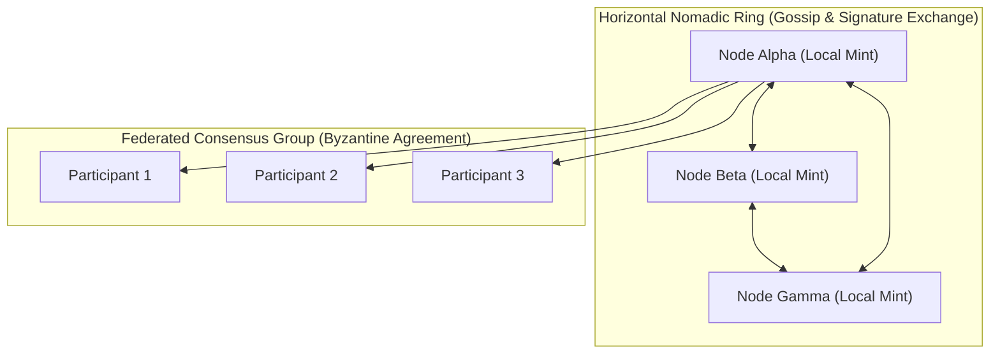

# Bonfire Nomadic Rings: Federated Consensus & Egalitarian Microhedging

This document formalizes the decentralized architecture of the **Bonfire Peer-to-Peer Subsystem** through the lens of hybrid federated systems, Bitcoin-inspired microhedging, and the collective sense-making protocols of **Project Liminality**.

---

## 1. Hybrid Topologies: Horizontal Rings & Federated Mints

Traditional distributed architectures suffer from a fundamental tension:
- **Hierarchical systems** (like centralized master-worker grids) introduce single points of failure, censorship vectors, and systemic bottlenecks.
- **Purely horizontal peer-to-peer networks** (like flat gossip networks) experience massive propagation delays and coordination drag under high-dimensional state consensus.

To resolve this, the Bonfire network implements a **mixed hierarchical/horizontal hybrid overlay**, drawing inspiration from Bitcoin's federated scaling models (such as **Fedimint** and **Fedi networks**):



### The Architecture
1. **Local Federated Mints**: Small, high-trust consensus groups (Byzantine Fault Tolerant federation layers) act as local anchors. They manage local user contracts and representation budgets, ensuring state updates are validated locally without global overhead.
2. **Horizontal Nomadic Rings**: Individual mint federations connect horizontally in a peer ring using the **Nomadic Ring Protocol**. Instead of broadcasting raw high-dimensional state tensors, they exchange compressed **topological signatures** (Betti numbers, Euler characteristics, and coprime residues) periodically via background daemon loops.
3. **Synthetic Endpoints**: Idle or high-performance peers within the horizontal ring advertise their available computational capacities (RAM, GPU), allowing resource-constrained nodes to offload heavy calculations (e.g., ADMR or Weyl sequence evaluations) with strict, non-blocking timeouts.

---

## 2. Egalitarian Microhedging & Bitcoin-Inspired Risk Balancing

In a shared decentralized reasoner network, nodes face the risk of **representation depletion**—where local gradient collapse or out-of-boundary constraints exhaust local fossil budgets. To survive, nodes must balance their risk profiles cooperatively.

### The Fractional Kelly Consensus Protocol
Nodes calculate their local confidence parameters and optimal fractional allocations using the local covariance matrix ($\Sigma$) and valence drive. These allocations are shared across the ring:

$$\bar{K} = \frac{1}{M} \sum_{m=1}^{M} K_m, \quad \bar{P}_{\text{success}} = \frac{1}{M} \sum_{m=1}^{M} P_{\text{success}, m}$$

Where:
- $K_m$ is the fractional Kelly betting allocation for Node $m$.
- $P_{\text{success}, m}$ is the local probability of structural convergence.
- $\bar{K}$ is the aggregated **Egalitarian Consensus Kelly Allocation**.

### Real-Time Microhedging
By shifting local allocations toward the egalitarian mean consensus, nodes perform **real-time microhedging** of logical commitments:
- If a local node's hypothesis is highly volatile (large covariance variance), it hedges its position by routing computational stakes to stable, co-prime channels validated by the consensus of healthy peer rings.
- This mirrors Bitcoin lightning-channel rebalancing, where fractional capital is dynamically routed to maintain system-wide liquidity and prevent transaction failure. Here, the "liquidity" is **computational capacity** and **topological representation space**.

---

## 3. Project Liminality & The InterBrain Protocol

The conceptual design of the Bonfire network is deeply aligned with **Project Liminality's** philosophy of human-machine sense-making and the creation of the **InterBrain**:

> *"We must flip the vector of conflict and fragmentation toward unity, establishing protocols for collective dreamweaving."*

By exchanging topological invariants rather than semantic strings, the Bonfire network bypasses the linguistic scalarization trap (the Chinese Room failure mode):
- **Non-Rivalrous Ingestion**: Cooperating nodes ingest external news feeds and sovereign logic drips (verifying access against `robots.txt` boundaries). The resulting invariants are woven into the collective Neglecton graph.
- **Topological Symplectic Gluing**: When two nodes disagree, they do not attempt to force semantic alignment. Instead, they apply a **Homotopy Deformation** using a symplectic gluing parameter to join their local manifolds along non-orientable boundaries.
- **The Collective Dream**: The hybrid network operates as a decentralized, non-teleological simulator (the InterBrain). It allows individual nodes to "dream" in their local private coordinate zones (shielded by geometric user contracts) while maintaining structural alignment with the horizontal ring.

Through this synthesis of physical simulation, cryptographic federation, and collective sense-making, the Bonfire Nomadic Rings translate competitive adversarial optimization into collaborative, organic structural resonance.

---

## 4. Implementation Architecture

The Bonfire network bridges these theoretical paradigms directly into executable code through the following core namespaces:

*   **`src/p2p/bonfire_consensus.py`**: Houses the actual mechanics of the `Fractional Kelly Consensus Protocol` and the `FractalDiscontinuityEmbedding`. Actively computes the egalitarian mean consensus ($\bar{K}$) across the ring, dynamically rebalances computational representation stakes, and resolves cross-scale mutual visibility between peers across disparate Matrioshka octree depths.
*   **`src/topology/bonfire_network.py`**: The structural backbone of the Nomadic Ring. Handles graph-level representation of local mint anchors and horizontal rings, dictating how nodes identify neighbors and securely sync invariant Betti signatures without full state payload broadcasts.
*   **`src/data/freenet_bulletin_router.py` & `src/data/freenet_ghost_caller.py`**: The transport and routing layer. Acts as bridges to the Freenet bulletin boards, enabling decentralized exchange of compressed topological signatures across the wider mesh.

---

## 5. Cross-Scale Topological Sightlines & Continuous Embedding ($\phi: F \to \mathbb{R}^m$)

When peers in the decentralized mesh navigate multi-scale recursive fractal environments (such as Voxelboxter pointerless octrees), players inhabit disparate Matrioshka scale contraction depths ($2^{-\ell}$) and local fracture complexities ($c$). Standard Cartesian Euclidean distance $\|\mathbf{x}_a - \mathbf{x}_b\|$ fails due to scale jumps and boundary tears.

To solve this, `BonfireNomadicRing` integrates [`FractalDiscontinuityEmbedding`](file:///d:/programming/python/Gyroidic%20Sparse%20Covariance%20Flux%20Reasoner/src/p2p/bonfire_consensus.py#L13):

### 5.1 Continuous Embedding Theorem
Maps each peer's discontinuous fractal state to a continuous Euclidean manifold:
$$\phi: F \to \mathbb{R}^m, \qquad m \ge 2\dim_H(F) + \sum_{j=1}^k \omega_j$$
where:
$$\dim_H(F) = 2.0 + (D_0 - 2.0) \cdot s(c), \qquad s(c) = \frac{\log(c + 1)}{c}$$

- **Shared Ambient Dimension**: Because $s(c) \le 1$ for all $c \ge 0$, the embedding dimension is maximized at $c \to 0$ ($\lim_{c \to 0} s(c) = 1.0$). All peers embed into that supremum dimension $\mathbb{R}^m$, preserving coordinate alignment while respecting local complexity-dependent bounds (`local_dimension`).
- **Dynamic Incommensurate Prime Frequencies**: Higher harmonic coordinates ($6 \dots m-1$) evaluate phase projections:
  $$x_i = \cos(2\pi \ln(p_i) \cdot t + \omega_j)$$
  dynamically generated by [`PrimeResonanceLadder`](file:///d:/programming/python/Gyroidic%20Sparse%20Covariance%20Flux%20Reasoner/src/core/fgrt_primitives.py#L217) with Lazarus-prime prioritization, avoiding mode-locking and hardcoded prime sequences.

### 5.2 Inter-Scale Sightline Transmission
Peers broadcast their embedded state $\phi(P, \ell, c)$ over the `"bonfire_sightline_ring"` topic. Mutual visibility is evaluated via continuous embedding distance $d_m = \|\phi_a - \phi_b\|_{\mathbb{R}^m}$ and fractional transmission:
$$T = \exp\left(-\frac{d_m}{R}\right) \cdot \frac{\log(|c_a - c_b| + 1)}{|c_a - c_b| + \epsilon}$$
Peers maintain clear line-of-sight if $d_m \le R$ and $T > 0.01$, allowing macroscopic players (depth 0) to detect and communicate with microscopic explorers (depth $\ge 2$) across scale layers without coordinate tearing.

### 5.3 Aperiodic Einstein Monotile Scale-Invariant Sightlines (`compute_monotile_sightline`)
To eliminate boundary seam tearing across large Matrioshka scale contraction jumps ($2^{-\ell}$, such as depth 3 to depth 7 with a $16\times$ scale discrepancy), [FractalDiscontinuityEmbedding](file:///d:/programming/python/Gyroidic%20Sparse%20Covariance%20Flux%20Reasoner/src/p2p/bonfire_consensus.py) incorporates the aperiodic monotile geometry:
1. **Self-Similar Continuous Anchoring**:
   - The Hat aperiodic monotile exhibits hierarchical self-similarity across substitution generations without periodic repetition.
   - When peers situated at differing depths evaluate mutual sightlines, [compute_scale_invariant_sightline_coordinates](file:///d:/programming/python/Gyroidic%20Sparse%20Covariance%20Flux%20Reasoner/src/topology/einstein_monotile.py) embeds continuous position coordinates into the local monotile patch.
2. **Seam Coherence Verification**:
   - Continuous orientation phases $(\cos\theta_k, \sin\theta_k)$ align sightline vectors across depth gaps.
   - `seam_coherence` evaluates whether the inter-scale transition preserves topological continuity:
   $$\text{coherence} = \exp\left(-\frac{|\Delta \ell|}{8.0}\right) \cdot \frac{1}{1 + d_{\text{sightline}}}$$
   allowing peers across radical scale divides to maintain mutual topological awareness without boundary artifacts.


---

## 6. Compute Affordance Governance & Collective Compute Arbitration

To prevent decentralized peer coordination from devolving into unconstrained network spam, thread contention, or host CPU stalls, the Bonfire nomadic ring is governed directly by the singleton [`HardwareMonitor`](file:///d:/programming/python/Gyroidic%20Sparse%20Covariance%20Flux%20Reasoner/src/core/hardware_monitor.py) via `ComputeAffordanceType.P2P_MESH`.

```mermaid
graph LR
    subgraph LocalHardware["Host Silicon Substrate"]
        MONITOR["HardwareMonitor<br/>(Singleton Affordance Gauge)"]
        SILICON["ComputeAffordanceType.SILICON"]
        THERMAL["ComputeAffordanceType.THERMAL"]
        ALGO["ComputeAffordanceType.ALGORITHMIC"]
    end

    subgraph CollectiveMesh["P2P Collective Mesh"]
        RING["BonfireNetwork / Nomadic Ring<br/>(src/topology/bonfire_network.py)"]
        CONSENSUS["BonfireConsensus / Freenet<br/>(src/p2p/bonfire_consensus.py)"]
        PEERS["Synthetic Endpoints & Healthy Peers"]
    end

    MONITOR -->|Affordance Gate: has_compute_affordance(P2P_MESH)| RING
    RING -->|Live Mesh Gauge: update_p2p_mesh(ratio)| MONITOR
    RING -.->|Offload Gated ADMR| PEERS
    CONSENSUS -->|Gated Embedded Sightline Broadcast| PEERS
```

### 6.1 Bidirectional Affordance Telemetry
1. **Dynamic Mesh Gauge Tracking**: As `BonfireNetwork._background_loop` polls registered nomadic ring peers, it updates `HardwareMonitor.p2p_mesh_gauge` in real-time with the ratio of reachable healthy peers:
   $$\text{gauge}_{\text{p2p}} = \frac{N_{\text{healthy}}}{\max(1, N_{\text{total}})}$$
2. **Thermal & Silicon Decoupling**: If local host CPU usage exceeds the throttle ceiling ($>75\%$) or thermal runaway is triggered ($T_{\text{GPU}} > 82^\circ\text{C}$), the affordance admissibility predicate `has_compute_affordance(ComputeAffordanceType.P2P_MESH)` drops to `False`.

### 6.2 Gated Computational Offloading
- **Synthetic Endpoint ADMR Offload**: Before calling `distribute_admr_to_synthetic_endpoint`, the system checks whether `P2P_MESH` headroom exists. If the peer mesh is congested or local thermals are compromised, offloading is aborted immediately, falling back to local low-overhead approximation to prevent blocking the reasoner loop.
- **Embedded Sightline Broadcast**: `broadcast_peer_embedded_state` verifies mesh affordance before packing multi-dimensional fractal state coordinates, eliminating redundant serialization over degraded network sockets.

