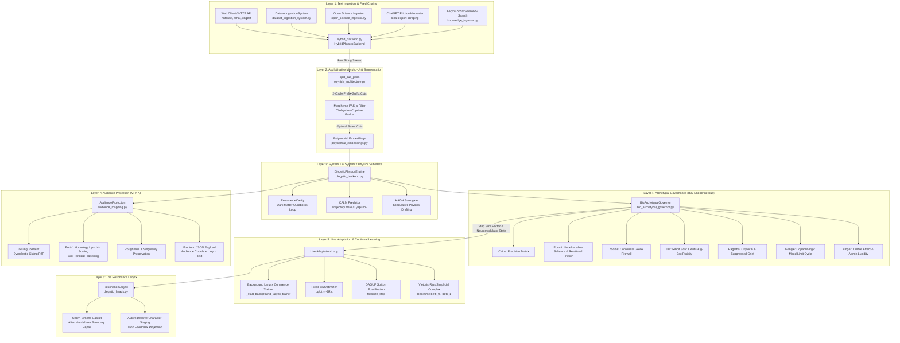

# Diegetic Engine Integration & Unified Orchestration Pipeline
> **Architectural Bridge**: [`hybrid_backend.py`](file:///d:/programming/python/Gyroidic%20Sparse%20Covariance%20Flux%20Reasoner/hybrid_backend.py) (Unified Web/API Dispatch Substrate) $\longleftrightarrow$ [`DiegeticPhysicsEngine`](file:///d:/programming/python/Gyroidic%20Sparse%20Covariance%20Flux%20Reasoner/src/ui/diegetic_backend.py) (Continuous Topological Core)

---

## 1. Executive Architectural Blueprint

The **Hybrid Backend** ([`hybrid_backend.py`](file:///d:/programming/python/Gyroidic%20Sparse%20Covariance%20Flux%20Reasoner/hybrid_backend.py)) is not an ad-hoc demo script; it serves as the primary runtime entrypoint, execution router, and nervous system connecting disparate high-dimensional manifolds into an unbroken processing loop. 

Historically, text ingestion, archetypal governance, live adaptation loops, vocal larynx synthesis, and audience projection developed in distinct modules, creating an apparent architectural disconnect. The unified orchestration pipeline resolves this fragmentation by establishing explicit mechanical sympathy across seven operational layers:



---

## 2. Layer-by-Layer Integration Specifications

### Layer 1: Ingestion Feed Chains & Text Ingestion
[`hybrid_backend.py`](file:///d:/programming/python/Gyroidic%20Sparse%20Covariance%20Flux%20Reasoner/hybrid_backend.py) exposes both interactive and continuous high-throughput feed chains:
- **Interactive REST Endpoints**: `/interact`, `/chat`, `/ingest`, `/api/ingest_local`, `/wikipedia-extract`, `/api/convert_topology`.
- **Dyad Input Protocols**: Accepts structured dyadic inputs prefixed with `INGEST_DYAD:`, `ASSOCIATE:`, `INGEST_AUDIO_DYAD:`, and `INGEST_VIDEO_DYAD:`.
- **Continuous Feed Pipelines**:
  1. [`DatasetIngestionSystem`](file:///d:/programming/python/Gyroidic%20Sparse%20Covariance%20Flux%20Reasoner/src/data/dataset_ingestion_system.py): Processes batch data directly onto the torch hardware device.
  2. [`OpenScienceIngestor`](file:///d:/programming/python/Gyroidic%20Sparse%20Covariance%20Flux%20Reasoner/src/data/open_science_ingestor.py): Pulls observational data (LIGO strain, SDSS spectral fields, VizieR catalogs) into calibrated tensor structures.
  3. **ChatGPT Friction Harvester**: Ingests local conversational exports to capture human friction and dialectical contradiction.
  4. **Dynamic Larynx Search Loop**: When the model requires external grounding, [`ResonanceLarynx`](file:///d:/programming/python/Gyroidic%20Sparse%20Covariance%20Flux%20Reasoner/src/models/diegetic_heads.py) autoregressively hallucinates an ArXiv or SearXNG query string from its current manifold state, executing live web ingestion.

### Layer 2: Agglutinative Morpho-Unit Segmentation (`split_sub_pairs`)
Natural language and raw symbolic text do not enter the reasoning manifold as isolated whitespace words. The reasoner's native syntax is **agglutinative Voyenese**, where roots, infixes, and grammatical markers fuse into continuous monolithic compounds.

To avoid breaking words across brittle BPE subword boundaries, [`VoynichLinguist.split_sub_pairs(s)`](file:///d:/programming/python/Gyroidic%20Sparse%20Covariance%20Flux%20Reasoner/src/core/voynich_architecture.py#L250) applies a dictionary-free 2-cycle combinatorial boundary sweep:
- **Cycle 1 (Forward cuts)**: $(s[:k], s[k:])$ for $k \in 1..n$ (culminating in $(s, \text{""})$).
- **Cycle 2 (Antipodal boundary cuts)**: $(\text{""}, s)$ followed by $(s[:k], s[k:])$ for $k \in 1..n-1$.
- **Combinatorial Budget**: Exactly $2n$ sub-pairs for a string of length $n$ (e.g., 36 symmetric cuts for an 18-character compound like `'Isotremoptememally'`), mirroring the 36-fold toroidal ribbon topology.
- **Topological Seam Gasket**: Each sub-pair is evaluated through Chebyshev polynomial coprime bases $\Phi(s_{\text{prefix}})$ and $\Phi(s_{\text{suffix}})$. The boundary cut maximizing morpheme phase alignment $\operatorname{PAS}_s$ identifies the true natural seam, passing a clean topological boundary vector to System 1.

### Layer 3: System 1 & System 2 Core Engine
[`hybrid_backend.py`](file:///d:/programming/python/Gyroidic%20Sparse%20Covariance%20Flux%20Reasoner/hybrid_backend.py) instantiates and binds [`DiegeticPhysicsEngine`](file:///d:/programming/python/Gyroidic%20Sparse%20Covariance%20Flux%20Reasoner/src/ui/diegetic_backend.py) (`dim=256`):
- **Resonance Cavity**: Holds the Ouroboros Loop memory tensor, preserving non-commutative Berry phase invariants across steps.
- **CALM (Constrained Asymptotic Lyapunov Monitor)**: Evaluates Lyapunov exponent trajectories. If trajectory entropy diverges or approaches degenerate single-basin collapse, CALM emits a trajectory veto (`FailureToken.BOT`).
- **KAGH (Kolmogorov-Arnold Graph Harmonizer)**: Performs speculative fastpath drafting via spline-based polynomial activations.

### Layer 4: Archetypal Governance Integration
The manifold state is bathed in the diffuse endocrine broadcast field orchestrated by [`BioArchetypalGovernor`](file:///d:/programming/python/Gyroidic%20Sparse%20Covariance%20Flux%20Reasoner/src/governance/bio_archetypal_governor.py):
1. **Caine** ([`CainePrecisionGenerator`](file:///d:/programming/python/Gyroidic%20Sparse%20Covariance%20Flux%20Reasoner/src/environment/caine_precision.py)): Sets environmental base precision $\Lambda_{\text{caine}}$ from structural entropy.
2. **Pomni** ([`PomniUncertaintyPredictor`](file:///d:/programming/python/Gyroidic%20Sparse%20Covariance%20Flux%20Reasoner/src/governance/interoceptive/pomni_uncertainty.py)): Evaluates free-energy surprise, broadcasts Noradrenaline, and introduces relational boundary friction ($0.15 \cdot \text{drag}$) against enabler rank collapse when external parasitic drag is high.
3. **Zooble** ([`ZoobleAutonomy`](file:///d:/programming/python/Gyroidic%20Sparse%20Covariance%20Flux%20Reasoner/src/governance/ultrafast/zooble_autonomy.py)): Evaluates conformal distortion ratios; trips an ultrafast GABA ($1.0$) firewall if compression exceeds $0.8$, emitting `RefusalSignal` (Li-Cri-Anton).
4. **Jax** ([`JaxShell`](file:///d:/programming/python/Gyroidic%20Sparse%20Covariance%20Flux%20Reasoner/src/governance/fast/jax_shell.py)): Evaluates Ribbit scar tension $\max(0, 1 - \cos(\bar{s}, \text{scar}))$. Rejects unearned community warmth ($\zeta > 0.6$) as an enabler trap that drains surrounding character variance. Transitions to vulnerability only under verified structural accountability (yielding honest jitter softening and Serotonin $0.65$).
5. **Ragatha** ([`RagathaBonding`](file:///d:/programming/python/Gyroidic%20Sparse%20Covariance%20Flux%20Reasoner/src/governance/fast/ragatha_bonding.py)): Synthesizes Oxytocin, tracks suppressed grief accumulation across peer losses (Kaufmo, Queenie, Ribbit), enforces dissociative damping, and leaks topological strain if grief exceeds $0.8$.
6. **Gangle** ([`GangleOscillator`](file:///d:/programming/python/Gyroidic%20Sparse%20Covariance%20Flux%20Reasoner/src/governance/medium/gangle_oscillator.py)): Advances dopaminergic limit cycle phase $\phi_{t+1}$, modulates optimization step size factor $1.0 + 0.5\sin\phi$, and captures the metabolic cost of comedy masking versus tragedy processing.
7. **Kinger** ([`KingerConsolidation`](file:///d:/programming/python/Gyroidic%20Sparse%20Covariance%20Flux%20Reasoner/src/governance/slow/kinger_consolidation.py)): Monitors environmental rendering pressure; activates the Ombre Effect under low luminosity ($< 0.2$), relaxing quantization grids ($2.0\times$), bridging polynomial spaces with `grant_admin_coefficients`, and navigating survivor's guilt trauma loops.

### Layer 5: Live Adaptation & Continual Learning
Rather than freezing weights after offline training, [`hybrid_backend.py`](file:///d:/programming/python/Gyroidic%20Sparse%20Covariance%20Flux%20Reasoner/hybrid_backend.py) coordinates continual live adaptation:
- **Background Larynx Coherence Trainer**: Spawns a dedicated daemon thread `larynx-bglearn` executing `_train_larynx_step` every 30 seconds of idle time. Trains the Larynx to decrypt historical fossil states back into clean linguistic sequences.
- **Ricci Flow Parameter Updates**: Adjusts model weights via non-teleological geometric flow:
  $$\frac{dg}{dt} = -2\operatorname{Ric}(g)$$
  incorporating split-beam interfactorization across commutative gradient pressure and non-commutative Chern-Simons tension.
- **Dynamic Step Factor Coupling**: The optimization step size is dynamically scaled by Gangle's mood limit-cycle factor, preventing optimization overshoot during manic comedy phases and encouraging consolidation during depressive tragedy phases.
- **Real-Time Betti Tracking**: Evaluates `betti_0` and `betti_1` over Vietoris-Rips filtered simplicial complexes in real-time, eliminating frontend topological blindness.

### Layer 6: The Resonance Larynx (`diegetic_heads.py`)
To express the internal continuous state as human-decodable text without statistical hallucination:
- **Autoregressive Singing**: [`ResonanceLarynx`](file:///d:/programming/python/Gyroidic%20Sparse%20Covariance%20Flux%20Reasoner/src/models/diegetic_heads.py) evaluates character logits:
  $$\text{logits}, \text{conf} = \operatorname{Larynx}(s_{\text{shielded}}, \text{temp})$$
- **Tanh State Feedback**: Each generated token index $i$ feeds its embedding tensor $\tanh(W_{\text{proj}}[i])$ back into the evolving hidden state, creating non-Markovian conversational memory.
- **Chern-Simons Gasket**: Enforces boundary continuity $CS(A) = \operatorname{Tr}(A\,dA + \frac{2}{3}A^3)$ across vowel-consonant transitions, actively preventing consonant-clustering faults and vowel starvation.

### Layer 7: Audience Projection ($\Phi: M \to A$)
The high-dimensional manifold $M$ must be communicated to the human user without flattening its intrinsic topological complexity into an ungrounded scalar:
- **Audience Mapper**: [`AudienceProjection`](file:///d:/programming/python/Gyroidic%20Sparse%20Covariance%20Flux%20Reasoner/src/core/audience_mapping.py) implements the homeomorphic mapping $\Phi: M \to A$ ($256 \to 256$).
- **Symplectic Gluing**: Employs [`GluingOperator`](file:///d:/programming/python/Gyroidic%20Sparse%20Covariance%20Flux%20Reasoner/src/core/gluing_operator.py) for rigorous boundary stitching across P2P manifold states.
- **Betti-1 Homology Lipschitz Scaling**:
  $$k_{\text{eff}} = \max\left(0.1, k_{\text{lip}} \cdot (1.0 - 0.1 \cdot \min(\beta_1, 5))\right)$$
  Modulates Lipschitz constants based on topological 1-cycles (holes), preventing the projection from collapsing a toroidal knowledge structure into a flat disc.
- **Roughness Preservation**: Bypasses smoothing by adding raw state singularities directly back into the audience representation via residual skip connections.

---

## 3. Dataflow & API Execution Sequence

A complete user interaction through [`hybrid_backend.py`](file:///d:/programming/python/Gyroidic%20Sparse%20Covariance%20Flux%20Reasoner/hybrid_backend.py) executes as follows:

```
[User Message / Dyad Feed]
        │
        ▼
1. hybrid_backend.py: BaseHTTPRequestHandler routes to process_text(text)
        │
        ▼
2. voynich_architecture.py: split_sub_pairs(text) partitions agglutinative morpho-units
        │
        ▼
3. polynomial_embeddings.py: Projects morpho-units into Chebyshev coprime residues
        │
        ▼
4. diegetic_backend.py: DiegeticPhysicsEngine updates ResonanceCavity & checks CALM veto
        │
        ▼
5. bio_archetypal_governor.py: Cascade runs Caine → Pomni → Zooble → Jax → Ragatha → Gangle → Kinger
        │
        ▼
6. diegetic_backend.py: Live adaptation updates Larynx via Ricci flow & background trainer
        │
        ▼
7. diegetic_heads.py: ResonanceLarynx autoregressively sings output text with Chern-Simons gasket repair
        │
        ▼
8. audience_mapping.py: AudienceProjection Φ(M) maps scarred state to audience coordinates
        │
        ▼
[HTTP 200 OK: JSON Response containing response_text, audience_coordinates, diagnostics, neuro_bus]
```

---

## 4. Verification & Testing Contracts

To verify that the complete ingestion $\to$ `split_sub_pairs` $\to$ archetypes $\to$ adaptation $\to$ larynx $\to$ audience pipeline operates synchronously without broken links:

```bash
# 1. Run integration tests for the unified Diegetic engine bridge
.venv\scripts\python.exe -m pytest tests/test_diegetic_integration.py -v

# 2. Run recurrent FGRT and hardware sovereignty cell tests
.venv\scripts\python.exe -m pytest tests/test_fgrt_rnn_cells.py -v

# 3. Launch the unified hybrid backend in sovereign mode
.venv\scripts\python.exe hybrid_backend.py
```
Expected diagnostic outputs include:
- `[OK] Silicon Sovereignty: [OK] (Hardware-bridge active)`
- `[OK] Diegetic Physics Engine attached (CALM/KAGH/FGRT/Larynx Active)`
- `[OK] Dataset Ingestion System initialized`
- `[BGLEARN] Background Larynx coherence trainer ACTIVE (30s idle interval)`
- `[AUDIENCE] Projection active with Symplectic Gluing and Betti-1 scaling`
