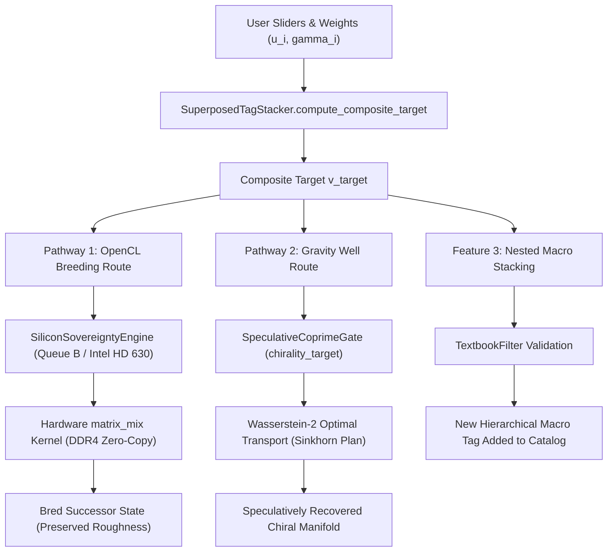

# Ganbreeder Vector Stacking: Non-Simplifying Coordinate Superposition

## 1. Core Hypothesis & Topological Foundations
The baseline reasoner historically utilized Caine's Conformal Archetype Compression (`PictureGalleryWarp`) to project infinite continuous nuance into a finite bit-depth library of discrete archetypal attractors. While effective as an $O(1)$ snapping mechanism (hard clustering via cosine similarity), hard snapping inherently **simplifies** system state, collapsing boundary roughness and discarding tail variance to prevent computational divergence.

To move beyond premature simplification while maintaining structural honesty, the system implements **continuous multi-scalar tag superposition inspired by Ganbreeder**.

Instead of snapping to the nearest discrete archetype, the system maintains an open, additive catalog of high-dimensional coordinates (resonance residue vectors), each mapped to a human-legible label (e.g., ImageNet classes, StackOverflow metadata tags, arXiv domain ontologies, or user-discovered coordinates). The user—or the autonomous diegetic orchestrator—stacks these variables continuously, manipulating unconstrained scalars to blend complex topological identities without flattening their intrinsic geometric roughness.

---

## 2. Existing Architectural Primitives & Anchors

The architecture binds directly to canonical reasoner primitives across `src/`:

1. **[pyopencl_sovereignty.py](file:///d:/programming/python/Gyroidic%20Sparse%20Covariance%20Flux%20Reasoner/src/core/pyopencl_sovereignty.py) (`SiliconSovereigntyEngine.matrix_mix_breeding`)**:
   - Hardware-accelerated OpenCL kernel (`matrix_mix`) executing on **Device B (Intel HD Graphics 630)** via `queue_b`.
   - Exploits zero-copy shared UMA access to the 16GB dual-channel DDR4 2400MHz system RAM via `CL_MEM_USE_HOST_PTR` / `CL_MEM_COPY_HOST_PTR`, eliminating PCIe bus contention with discrete GPU arithmetic on Device A (GTX 1050 Ti).
   - Injects hardware DRAM row-refresh stall jitter (`xorshift32` + `harvest_honest_jitter`) and rational rounding constraints ($\kappa_{\text{seal}}$) to preserve physical non-commutativity.

2. **[superposed_tag_stacker.py](file:///d:/programming/python/Gyroidic%20Sparse%20Covariance%20Flux%20Reasoner/src/core/superposed_tag_stacker.py) (`SuperposedTagStacker` & `FractionalQuotientTagStacker`)**:
   - The authoritative coordinate storage and soft mixing engine. Stores coordinates in a persistent `ParameterDict` and enforces textbook-quality semantic gating.

3. **[textbook_filter.py](file:///d:/programming/python/Gyroidic%20Sparse%20Covariance%20Flux%20Reasoner/src/data/textbook_filter.py) (`TextbookFilter`)**:
   - Five-dimensional non-scalar invariant gating ensuring that proposed coordinates exhibit genuine topological structure (soliton entropy, holonomic rank, cohomological bound, PAS phase alignment) prior to catalog entry.

4. **[speculative_coprime_gate.py](file:///d:/programming/python/Gyroidic%20Sparse%20Covariance%20Flux%20Reasoner/src/core/speculative_coprime_gate.py) (`SpeculativeCoprimeGate.speculative_recovery`)**:
   - Accepts the composite superposition as a `chirality_target`, constructing a gravitational well in the Wasserstein optimal transport cost matrix to steer collapsed or low-entropy states without rigid quantization.

5. **[orchestrator.py](file:///d:/programming/python/Gyroidic%20Sparse%20Covariance%20Flux%20Reasoner/src/core/orchestrator.py) (`UniversalOrchestrator.step_micro`)**:
   - Hosts `self.tag_stacker` and computes dynamic composite primer targets during each micro-step of the reasoner evolution loop.

---

## 3. Mathematical Mechanics of Superposed Stacking

### A. Coordinate Harvesting & Invariant Admission
The system populates a persistent coordinate catalog:
$$\mathcal{C} = \{ (\text{Tag}_i, \vec{v}_i, \mathcal{Q}_i) \mid \vec{v}_i \in \mathbb{R}^D, \|\vec{v}_i\|_2 = 1 \}$$
where $D$ is the manifold state dimension (typically $D \in \{32, 64, 96, 512\}$), and $\mathcal{Q}_i$ is the Phi-1 `QualityReport`.

Before any coordinate $\vec{v}$ is admitted under semantic key $\text{Tag}_i$, the contextual documentation or derivation text is evaluated by the `TextbookFilter`:
1. **Structural Honesty**: Soliton entropy $S_{\text{soliton}} > \tau_S$.
2. **Self-Contained Holonomy**: Matrix rank ratio $\operatorname{rank}(M) / D \ge 0.3$.
3. **Cohomological Instruction**: Betti bound $\dim H^1 < K/2$ (excluding the Lazarus Void).
4. **Algorithmic Resonance**: Phase Alignment Score $\operatorname{PAS}_h \ge \frac{3}{11}$.
5. **Rational Stability**: Deterministic invariant preservation under rational modular snaps.

If any invariant fails, admission is vetoed, preventing semantic drift and topological degradation.

### B. Hyperbolic Sine Quotient Superposition
In Euclidean space, linear superposition is expressed as $\vec{v}_{\text{target}} = \sum_{i=1}^k w_i \vec{v}_i$. However, because the gyroidic covariance reasoner operates on **non-Euclidean Riemannian manifolds with negative sectional curvature**, standard linear scaling causes premature saturation and scalarization collapse.

The `FractionalQuotientTagStacker` evaluates multi-scalar blending via the **Hyperbolic Sine Quotient**:
$$\alpha_i(u_i, \gamma_i) = \operatorname{sgn}(u_i) \cdot \frac{\sinh(\gamma_i \cdot |u_i|)}{\sinh(\gamma_i) + \epsilon}$$
where:
- $u_i \in \mathbb{R}$ is the unconstrained slider weight ($u_i < 0$ enables feature subtraction; $u_i > 1$ enables hyper-emphasis).
- $\gamma_i \in \mathbb{R}^+$ is the user-selectable quotient of hyperbolicity.
- As $\gamma_i \to 0^+$, $\alpha_i \to u_i$, smoothly recovering Euclidean linear superposition.
- As $\gamma_i > 0$, negative curvature geodesic amplification expands the dynamic range along hyperbolic horospheres.

The composite stacked target coordinate is then:
$$\vec{v}_{\text{target}} = \sum_{i=1}^k \alpha_i(u_i, \gamma_i) \, \vec{v}_i$$

When no explicit weights are provided, tag weights are dynamically harvested by projecting the active state $\mathbf{S}_{\text{active}}$ against the entire catalog:
$$w_i = \langle \hat{\mathbf{S}}_{\text{active}}, \hat{\vec{v}}_i \rangle = \frac{\mathbf{S}_{\text{active}} \cdot \vec{v}_i}{\|\mathbf{S}_{\text{active}}\|_2 \|\vec{v}_i\|_2}$$

---

## 4. State Injection Pathways

Once the composite stacked target $\vec{v}_{\text{target}}$ is synthesized, it is injected into the reasoner through two complementary pathways:



### Pathway 1: The OpenCL Breeding Route (`breed_into_state`)
- The active system state $\mathbf{S}_{\text{active}}$ and composite target $\vec{v}_{\text{target}}$ are dispatched to `SiliconSovereigntyEngine.matrix_mix_breeding`.
- The OpenCL `matrix_mix` kernel executes on **Queue B (Intel HD Graphics 630)**:
  - Global memory buffers are mapped with `CL_MEM_COPY_HOST_PTR` directly across the 16GB dual-channel DDR4 2400MHz system RAM.
  - Device-side `xorshift32` stochastic perturbation preserves microscopic roughness.
  - Hyperbolic shear $\xi$ and rational bounding $\kappa_{\text{seal}}$ prevent numerical overflow.
- Straight-through gradient estimation preserves PyTorch autograd connectivity:
  $$\mathbf{S}_{\text{out}} = \mathbf{S}_{\text{active}} + (\mathbf{S}_{\text{mixed}} - \mathbf{S}_{\text{active}})_{\text{detached}}$$

### Pathway 2: The Gravity Well Route (`route_to_speculative_gate`)
- When the system detects stagnation, collapse, or near-zero variance, `SpeculativeCoprimeGate.speculative_recovery` is invoked.
- $\vec{v}_{\text{target}}$ is routed directly as the `chirality_target`.
- In the Wasserstein-2 optimal transport problem:
  $$W_2^2(P, Q) = \inf_{\gamma \in \Pi(P, Q)} \int_{\mathcal{M} \times \mathcal{M}} c(x, y) \, d\gamma(x, y)$$
  the cost matrix $c(x, y) = \|x - y\|_2^2$ is augmented with four high-weight attractor rows ($w_{\text{target}} = 2.0$) corresponding to $\vec{v}_{\text{target}}$.
- Entropic Sinkhorn iterations bias the transport plan toward the stacked target's gravity well without forcing a discontinuous hard snap.

---

## 5. Subsequent Stacking & Nested Coordinate Hierarchies

To support compound abstractions, the stacker supports recursive **macro stacking** (`save_macro_coordinate`):
1. A user or agent defines a combination: e.g., $70\%$ "Noncommutative Geometry" $+ 40\%$ "Voynich Botany" $- 20\%$ "Scalar Collapse".
2. The composite vector is calculated: $\vec{v}_{\text{macro}} = \sum w_i \vec{v}_i$.
3. The composite is submitted to `TextbookFilter` with descriptive provenance metadata.
4. Upon passing invariant validation, the macro coordinate is registered under a new tag name: e.g., `macro_botanical_noncommutativity`.
5. This new macro tag can itself be assigned weights in subsequent stacking sessions, creating arbitrary-depth hierarchical coordinate trees.

---

## 6. Diegetic Terminal & REST API Integration

The stacker is natively integrated into the primary interactive pipeline in [`src/ui/diegetic_backend.py`](file:///d:/programming/python/Gyroidic%20Sparse%20Covariance%20Flux%20Reasoner/src/ui/diegetic_backend.py):
- `GET /api/tags`: Returns the complete catalog summary with norm, admissibility, and metadata.
- `POST /` / `POST /api/process`: Ingests `tag_weights` directly alongside user text, audio/visual dyads, and commutativity controls:
  ```json
  {
    "text": "Analyze the topological boundary transition",
    "tag_weights": {
      "quantum_gravity": 0.8,
      "birkhoff_cone": 0.5,
      "leylines_flux": -0.3
    },
    "commutativity": "symmetric"
  }
  ```
- In `ENGINE.process_input`, `tag_weights` are passed directly to `self.archetypal_governor.compute_stacked_target(tag_weights)`, synthesizing the composite stacked vector and routing it as `chirality_target` into `SpeculativeCoprimeGate` for structure recovery.

---

## 7. Architectural Guarantees

- **Non-Simplification**: Continuous linear and hyperbolic superposition replaces $O(1)$ conformal snapping, preserving topological tail variance and boundary roughness.
- **Hardware Sovereignty**: Zero-copy execution on Queue B decouples memory-heavy matrix mixing from discrete GPU GEMM workloads, eliminating PCIe bottlenecks on DDR4 2400MHz platforms.
- **Physical Non-Commutativity**: Hardware DRAM latency jitter prevents deterministic cyclic collapse into dead logic repunit attractors.
- **Invariant Honesty**: Every admitted coordinate is validated against topological invariants via the Phi-1 `TextbookFilter`, prohibiting semantic hallucination.
