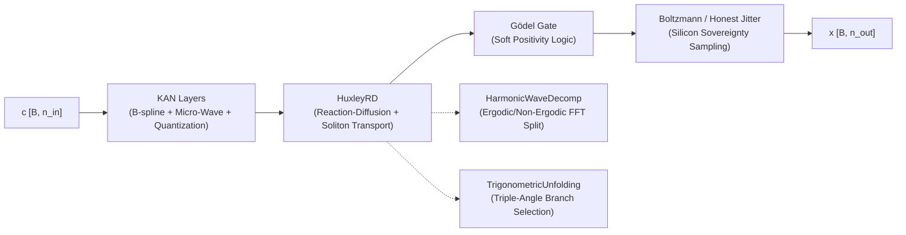
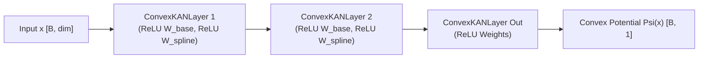
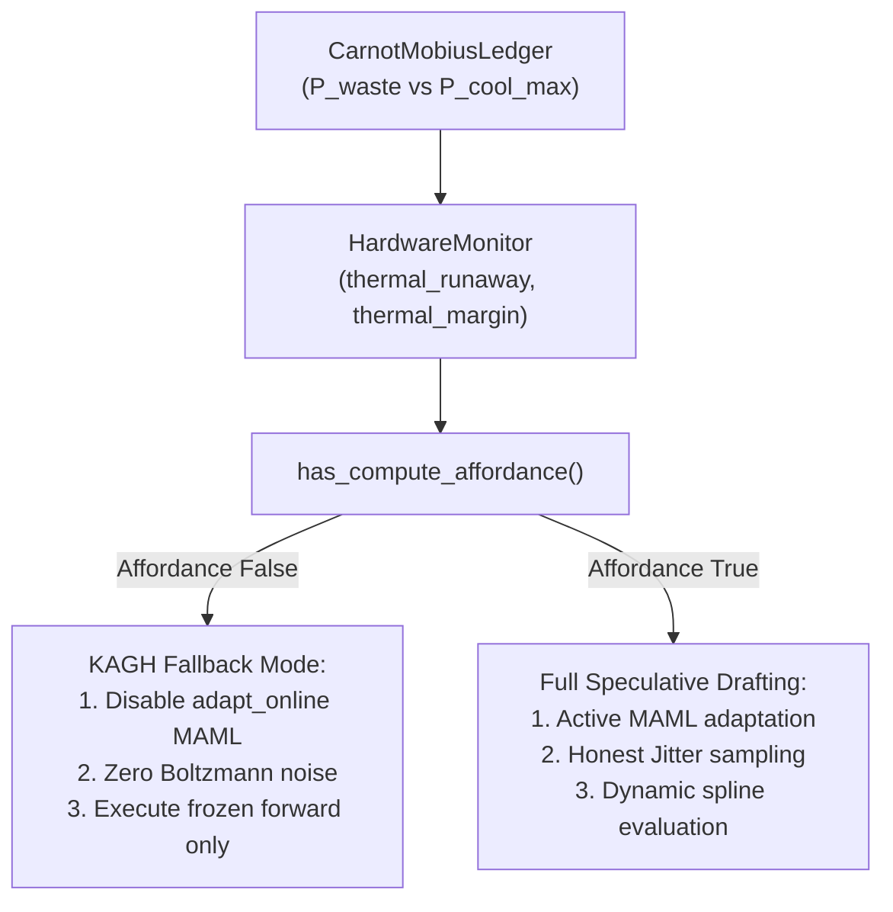

# KAGH-Boltzmann Networks

> Hybrid geometric architecture for Physics-ADMM surrogates.  
> **Source**: [`kagh_networks.py`](file:///d:/programming/python/Gyroidic%20Sparse%20Covariance%20Flux%20Reasoner/src/surrogates/kagh_networks.py) (696 lines)

---

## 1. Overview

**KAGH** = **K**olmogorov-**A**rnold + **G**ödel + **H**uxley + **B**oltzmann — a four-part hybrid architecture bridging continuous physics manifolds (ADMM, B-spline potential fields) and discrete symbolic constraints (CRT residues, Matrioshka polytopes, soft logic gates).



**Consumers**:
- [`gyroid_reasoner.py`](file:///d:/programming/python/Gyroidic%20Sparse%20Covariance%20Flux%20Reasoner/src/models/gyroid_reasoner.py): Primary surrogate for Physics-ADMM constraint evaluation.
- [`sic_fa_admm.py`](file:///d:/programming/python/Gyroidic%20Sparse%20Covariance%20Flux%20Reasoner/src/optimization/sic_fa_admm.py): CALM predictor uses KAGH for speculative exit confidence and forward operator.
- [`operational_admm.py`](file:///d:/programming/python/Gyroidic%20Sparse%20Covariance%20Flux%20Reasoner/src/optimization/operational_admm.py): System 2 iterative constraint refinement probe.
- [`admr_solver.py`](file:///d:/programming/python/Gyroidic%20Sparse%20Covariance%20Flux%20Reasoner/src/core/admr_solver.py): Continuous-to-discrete Matrioshka bridging.
- [`diegetic_backend.py`](file:///d:/programming/python/Gyroidic%20Sparse%20Covariance%20Flux%20Reasoner/src/ui/diegetic_backend.py): Generation pipeline embedding.
- [`voxelboxter_simulation.py`](file:///d:/programming/python/Gyroidic%20Sparse%20Covariance%20Flux%20Reasoner/src/ui/voxelboxter_simulation.py): Maps KAGH polynomial residues into `PointerlessOctree`.
- [`polynomial_coprime.py`](file:///d:/programming/python/Gyroidic%20Sparse%20Covariance%20Flux%20Reasoner/src/core/polynomial_coprime.py): Canonical `PolynomialBasis` supports `basis_type='bspline'`, executing vectorized Cox-de Boor recursion.
- [`polynomial_embeddings.py`](file:///d:/programming/python/Gyroidic%20Sparse%20Covariance%20Flux%20Reasoner/src/models/polynomial_embeddings.py): `PolynomialFunctionalEmbedder` routes functional structure predictors through `KANLayer` when `basis_type='bspline'` or `use_kan_heads=True`.
- [`pyopencl_sovereignty.py`](file:///d:/programming/python/Gyroidic%20Sparse%20Covariance%20Flux%20Reasoner/src/core/pyopencl_sovereignty.py): `SiliconSovereigntyEngine` evaluates continuous B-splines via OpenCL kernel on Queue A hedging against DRAM stalls.

---

## 2. SaturatedQuantizer (Hybrid Quantization with Topological Kerning)

**Role**: Inter-domain bridge between continuous (physics) and discrete (symbolic) regimes, specifically tasked with **Continuous-to-Discrete Matrioshka Bridging**. It ensures that continuous polynomial projections computed by [`PolynomialADMRSolver`](file:///d:/programming/python/Gyroidic%20Sparse%20Covariance%20Flux%20Reasoner/src/core/admr_solver.py) snap rigidly into the hierarchical CRT geometric boundaries of nested polytopes before arriving at the `ZeitgeistRouter`.

| Mode / Feature | Operation | Mathematical Form |
|---|---|---|
| **Base Quantization** | Snap to `levels` discrete steps | $x_{\text{snap}} = \frac{\text{round}(x \cdot L/2)}{L/2}$ |
| **Backward Pass** | Straight-Through Estimator (STE) | $\frac{\partial \mathcal{L}}{\partial x} = \frac{\partial \mathcal{L}}{\partial x_{\text{snap}}}$ |
| **Topological Protective Sheath** | High-frequency micro-wave modulation | $\Phi(x) = x_{\text{snap}} + A_{\text{micro}} \cdot \left\|\frac{dx_{\text{snap}}}{dx}\right\| \cdot \sin(\omega_{\text{micro}} \cdot x)$ |
| **Dyslexic Mode (Kerning)** | Repulsive nudge avoiding latent crowding | $\Delta_{\text{kern}} = \text{sgn}(d_{\text{grid}}) \cdot \frac{0.2}{L/2} \quad \text{if } \|d_{\text{grid}}\| < 0.1$ |

### Topological Protective Sheath
- Default parameters: $A_{\text{micro}} = 0.05, \omega_{\text{micro}} = 50.0$.
- Derivative magnitude $\left\|\frac{dx_{\text{snap}}}{dx}\right\|$ is computed either using the exact B-spline derivative tensor $d_{\text{basis}}$ from the Cox-de Boor recurrence or approximated via the distance to the grid snap boundary:
  $$\text{grad\_proxy} = 2.0 \cdot \text{clamp}\left(\min\left(\text{frac}, 1 - \text{frac}\right), 0.0, 0.5\right)$$

### Dyslexic Mode (Topological Kerning)
Latent token crowding creates representational artifacts (the "muddy blot" collapse where separate residues merge into a single ill-defined representation). Dyslexic mode enforces a minimum distance between residues:
- Computes normalized grid distance: $d_{\text{grid}} = (x \cdot \frac{L}{2}) - \text{round}(x \cdot \frac{L}{2})$.
- If $|d_{\text{grid}}| < 0.1$, applies a directional nudge $0.2 / (L/2)$ away from the boundary, keeping residues distinct.

---

## 3. KANLayer (Kolmogorov-Arnold Network Layer)

True B-spline implementation with:
- **Vectorized Cox-de Boor recursion** for basis functions (spline order $k=3$ default).
- **Exact derivative injection**: Derives $(k-1)$-order B-splines to evaluate exact high-frequency micro-waves.
- **Hybrid-quantized weights** via [`SaturatedQuantizer`](#2-saturatedquantizer-hybrid-quantization-with-topological-kerning).
- **Fixed structural grids** (non-revisability principle: immutable topological coordinates $[-1, 1]$).
- **Stateless functional forward**: Enables zero-leak parameter substitution for MAML meta-learning.

### Forward Pass

$$y = \underbrace{W_{\text{base}} \cdot x}_{\text{linear structural residual}} + \underbrace{\sum_{i, c} B_{i, c}(x) \cdot \hat{W}_{\text{spline}}^{o, i, c}}_{\text{B-spline activation}}$$

where $\hat{W}_{\text{spline}} = \text{SaturatedQuantizer}(W_{\text{spline}}, \text{levels}, \text{dyslexic\_mode}, d_{\text{basis}})$.

### Exact B-Spline Derivative Injection

To inject high-frequency micro-waves into the spline activations without breaking numerical stability, the exact derivative of order $k$ is computed from $(k-1)$-order bases:

$$\frac{d}{dx} B_{i, k}(x) = k \left[ \frac{B_{i, k-1}(x)}{t_{i+k} - t_i} - \frac{B_{i+1, k-1}(x)}{t_{i+k+1} - t_{i+1}} \right]$$

$$B_{\text{micro}}(x) = B(x) + A_{\text{micro}} \cdot \left|\frac{d B}{dx}\right| \odot \sin(\omega_{\text{micro}} \cdot x)$$

### Tensor Layout

| Tensor | Shape | Role |
|---|---|---|
| Input `x` | `[B, n_in]` | Bounded input in $[-1, 1]$ |
| `base_weight` | `[n_out, n_in]` | Linear residual path (Kaiming init) |
| `spline_weight` | `[n_out, n_in, G + k]` | Spline control coefficients (Normal init, quantized in forward) |
| `grid` | `[n_in, G + 2k + 1]` | Frozen coordinate buffer (step $h = 2/G$) |
| Output `y` | `[B, n_out]` | Combined linear + spline output |

### Stateless Meta-Evaluation
[`KANLayer.functional_forward`](file:///d:/programming/python/Gyroidic%20Sparse%20Covariance%20Flux%20Reasoner/src/surrogates/kagh_networks.py#L279) accepts an optional `params` dictionary. It temporarily injects trial weights, executes the forward pass, and restores original parameters inside a `finally` block, ensuring clean gradients during inner-loop meta-adaptation.

### 3.1 Acceleration via Existing Dependencies (`requirements.txt`)
The True B-spline learning system leverages multiple pre-installed libraries in `requirements.txt`:
- **SciPy (`scipy.interpolate`)**: `scipy.interpolate.BSpline` and `scipy.interpolate.make_interp_spline` are used for baseline verification, clamped knot sequence computation, and C-accelerated CPU evaluations.
- **PyTorch (`torch`)**: Vectorized autograd tensor recursion in `KANLayer.b_splines` enables direct backpropagation through spline control weights without manual loops.
- **PyOpenCL (`pyopencl`)**: The `bspline_basis_eval` kernel runs on Queue A in `SiliconSovereigntyEngine`, enabling on-chip parallel execution on constrained hardware (e.g. GTX 1050 Ti) to hedge against DRAM stalls.
- **Affordance Gating**: High-order spline computations check `HardwareMonitor.has_compute_affordance(ComputeAffordanceType.ALGORITHMIC)` before execution, throttling knot density under thermal pressure.

---

## 4. Convex KAN & Input Convex Neural Network (ICNN)

Implemented by [`ConvexKANLayer`](file:///d:/programming/python/Gyroidic%20Sparse%20Covariance%20Flux%20Reasoner/src/surrogates/kagh_networks.py#L301) and [`InputConvexNeuralNetwork`](file:///d:/programming/python/Gyroidic%20Sparse%20Covariance%20Flux%20Reasoner/src/surrogates/kagh_networks.py#L323):



### Role in Monge-Ampère Conjugate Factorization
- **Purpose**: Learns the convex potential $\Psi(x)$ in Conjugate Moment Measure Factorization (Monge-Ampère dynamics) for non-ergodic optimal transport.
- **Strict Convexity Preservation**: In standard neural networks, enforcing convexity often flattens representations. `ConvexKANLayer` clamps both `base_weight` and `spline_weight` to non-negative values via `F.relu()` during forward execution while keeping underlying optimization parameters unconstrained.
- **Hessian Admissibility**: Guarantees $\nabla^2 \Psi \succeq 0$ everywhere on the coordinate manifold without restricting expressive spline curvature.
- **Functional Interface**: Exposes [`InputConvexNeuralNetwork.functional_forward`](file:///d:/programming/python/Gyroidic%20Sparse%20Covariance%20Flux%20Reasoner/src/surrogates/kagh_networks.py#L351) for MAML inner-loop potential tuning.

---

## 5. HarmonicWaveDecomposition

Spectral separation of signals into **ergodic** (mixing, diffusive) and **non-ergodic** (solitonic, persistent) components via real Fast Fourier Transform (RFFT).

```
                     +--> [RFFT] * sigma(g)       --> [IRFFT] --> Ergodic Component (u_e)
Input x [B, dim] ---|
                     +--> [RFFT] * (1 - sigma(g)) --> [IRFFT] --> Non-Ergodic Component (u_ne)
```

$$\hat{x}(\omega) = \text{RFFT}(x)$$
$$x_{\text{ergodic}} = \text{IRFFT}\left(\hat{x}(\omega) \odot \sigma(g)\right), \quad x_{\text{non-ergodic}} = \text{IRFFT}\left(\hat{x}(\omega) \odot (1 - \sigma(g))\right)$$

where $g \in \mathbb{R}^{\lfloor \text{dim}/2 \rfloor + 1}$ is a learnable spectral gate vector.

---

## 6. TrigonometricUnfolding (Triple-Angle Branch Selection)

**Role**: Handles mathematical degeneracies (casus irreducibilis) when polynomial bases encounter severe topological deformation or high Gyroid Constraint Violation Energy (`gcve_pressure`).

### Algorithm

1. **Local Covariance Trace & Spectral Determinant**:
   $$\text{tr}(C) = \sum_{j} u_{h, j}^2, \quad \det(\text{PAS}) = \text{Var}\left(|\text{RFFT}(u_h)|\right) + 10^{-6}$$

2. **Phase Angle Extraction**:
   $$\cos(3\phi) = \text{clamp}\left(\frac{3 \cdot \text{gcve\_pressure} - \text{tr}(C)/\tau_{\text{decay}}}{2 \cdot \left(\sqrt{\det(\text{PAS})}\right)^3 + 10^{-8}}, -0.999, 0.999\right), \quad \phi = \frac{1}{3} \arccos(\cos(3\phi))$$

3. **Branch Projections ($k \in \{0, 1, 2\}$)**:
   $$u_h^{(k)} = 2 \sqrt{\frac{\lambda_{\min}}{3}} \cdot \cos\left(\phi + \frac{2\pi k}{3}\right) \cdot u_h \cdot e^{-|\chi| k}$$
   where $\lambda_{\min} = \min |\text{RFFT}(u_h)|$ and $\chi$ is the global chirality index.

4. **Negentropic Branch Selection**:
   $$k^* = \arg\max_{k \in \{0, 1, 2\}} \|u_h^{(k)}\|_2$$
   Selects the branch containing maximum coherent structural energy, restoring degenerate polynomial manifolds without numeric collapse.

---

## 7. HuxleyRD (Reaction-Diffusion Dynamics & Soliton Transport)

Unifies biological excitability with solitary wave mechanics:

### Ergodic Channel (Huxley Reaction-Diffusion)
$$\frac{\partial u}{\partial t} = \underbrace{u(u - a)(1 - u)}_{\text{Huxley cubic reaction}} + \gamma \underbrace{(K * u)}_{\text{1D convolution diffusion}}$$

where $K = [0.1, -0.2, 0.1]$ is a learnable 3-tap Laplacian stencil, $a$ is the excitation threshold, and update steps use Euler integration $u_e^{(t+1)} = u_e^{(t)} + \tau \frac{\partial u}{\partial t}$.

### Non-Ergodic Channel (Soliton Phase Transport)
Propagates coherent energy packets along feature space without dispersion:

$$\hat{u}_{\text{ne}}(\omega) \mapsto \hat{u}_{\text{ne}}(\omega) \cdot e^{-j 2\pi \omega v / N}$$

where $v$ is a learnable soliton velocity. The phase-shifted signal is then passed to [`TrigonometricUnfolding`](#6-trigonometricunfolding-triple-angle-branch-selection) when `gcve_pressure` is detected.

### Ergodic Soliton Fusion Gate
Recombines both regimes via a speculative gating primitive:

$$\text{output} = \sigma\left(u_e + u_{\text{ne}}\right) \odot \left(u_e + u_{\text{ne}}\right)$$

---

## 8. Gödel Logic Gate

Defined by `goedel_positivity(x, epsilon=1e-6, active=True)`:

$$x \longleftarrow x \cdot \sigma\left(100 \cdot (x - \epsilon)\right)$$

- **Training (Clean Regime)**: Enforces smooth, differentiable positivity ($x \ge 0$).
- **Inference & Repair (`gcve_pressure is not None`)**: Automatically deactivated (`active = False`), yielding an exact no-op. This preserves signed error residues necessary for ADMM lagrangian correction.

---

## 9. KAGHBlock (Full Admissibility Pipeline)

Assembles KAN skeletal layers, HuxleyRD dynamics, Gödel logic, and Boltzmann sampling into a unified surrogate pipeline.

### Architectural Parameters

| Parameter | Default | Purpose |
|---|---|---|
| `n_in` | Required | Input dimension |
| `n_out` | Required | Output dimension |
| `width` | 64 | Hidden KAN layer width |
| `depth` | 3 | Number of KAN skeletal layers |
| `alpha` | 0.7 | Anisotropic operator mixing coefficient |
| `dyslexic_mode` | `False` | Enables topological kerning against token crowding |

### Mohr-Coulomb Fossilization
`block.fossilize(structural_pressure=1.0) -> bool` locks the structural topology:
- Subjected to [`MohrCoulombProjection`](file:///d:/programming/python/Gyroidic%20Sparse%20Covariance%20Flux%20Reasoner/src/core/yield_criteria.py) with friction angle $\phi = 30^\circ$ and cohesion barrier $c = 0.8$.
- **Yield Check**: If yielded pressure $\le 0.8$, fossilization is rejected (`return False`). This prevents premature facet lock-in before genuine structural load is applied.
- Upon rupture, `self.is_fossilized = True` and all KAN parameters have `requires_grad = False` set permanently.

### Silicon Sovereignty Boltzmann Sampling
In place of pseudo-random Gaussian generators, training stochasticity harvests true hardware micro-timing jitter via [`harvest_honest_jitter`](file:///d:/programming/python/Gyroidic%20Sparse%20Covariance%20Flux%20Reasoner/src/core/honest_jitter.py):

$$\text{noise} = \text{harvest\_honest\_jitter}(\text{shape}, \text{device}) \cdot \sqrt{\exp(\log T)}$$

### Online Inner-Loop Adaptation (MAML `adapt_online`)
Allows `KAGHBlock` to act as a fast-adapting speculative drafter during live reasoning:

```python
adapted_block = kagh.adapt_online(
    support_states, support_targets, steps=1, lr=0.01, entropy=entropy, psh_delta=psh_delta
)
```

1. **Cloning Substrate**: Clones module parameters, buffers, and submodules without modifying original base weights.
2. **Entropy-Scaled Learning Rate**:
   $$\eta_{\text{eff}} = \eta \cdot (1.0 + |\bar{H}|) \quad \text{where } \bar{H} = \text{entropy.mean}()$$
3. **PSH Proximity Modulation (Rashba-Dresselhaus Protection)**:
   Modulates step size by Persistent Spin Helix proximity $\Delta_{\text{psh}} = \alpha^2 - \beta^2$:
   $$s_{\text{psh}} = \text{clamp}\left(\exp(-|\Delta_{\text{psh}}|), 0.1, 1.0\right)$$
   $$\eta_{\text{eff}} \longleftarrow \eta_{\text{eff}} \cdot s_{\text{psh}}$$
   Guarantees that high topological curvature or spin-orbit mismatch does not freeze gradient adaptation or trigger runaway parameter divergence.
4. **SGD Optimization**: Computes MSE loss on support pairs and takes inner-loop gradient steps.

---

## 10. Thermodynamic Gating & Compute Affordance Integration

`KAGHBlock` operations—especially high-order B-spline recursions and multi-step online MAML adaptation (`adapt_online`)—are active consumers of computational power. They are directly governed by the central compute affordance chain:



### Affordance Enforcement Rules
- **Thermal Runaway Veto**: When [`CarnotMobiusLedger`](file:///d:/programming/python/Gyroidic%20Sparse%20Covariance%20Flux%20Reasoner/src/core/carnot_mobius_ledger.py) detects $P_{\text{waste}} > P_{\text{cool, max}}$, [`HardwareMonitor.has_compute_affordance()`](file:///d:/programming/python/Gyroidic%20Sparse%20Covariance%20Flux%20Reasoner/src/core/hardware_monitor.py) immediately returns `False`.
- **MAML Throttling**: If `has_compute_affordance()` is `False`, downstream callers (such as `AdaptiveSkeletonHarness` or `GyroidReasoner`) bypass `adapt_online()` and use cached, fossilized weights.
- **Thermal Margin Modulation**: When thermal margin $\mu_{\text{th}} = \max\left(0, \frac{P_{\text{cool, max}} - P_{\text{waste}}}{P_{\text{cool, max}}}\right) < 0.25$, inner-loop steps are restricted to `steps=1` and learning rates are clamped to preserve thermal stability.

---

## 11. SoftSaturatedGates Integration

Defined in [`love_invariant_protector.py`](file:///d:/programming/python/Gyroidic%20Sparse%20Covariance%20Flux%20Reasoner/src/core/love_invariant_protector.py), `SoftSaturatedGates` operates directly on the residue distributions produced by `KAGHBlock`:

```
KAGHBlock output [B, K, D]
    |
    v
SoftSaturatedGates.apply_soft_saturation(signal, pas_h)
    |-- lattice_adaptive_shrinkage()   --> Tri-state LAS (True / False / Silence)
    |-- asymptotic_hardening(pas_h)    --> Temperature-controlled gate sharpness
    +-- update_fossilization()         --> Freezes high-persistence functionals
    |
    v
Soft-saturated residues --> Downstream CRT / DAQUF
```

Replacing hard binary $\text{sgn}()$ cuts at the KAGH output boundary prevents **Linguistic Scalarization** failure modes (consonant-only output, vowel starvation) documented in [GARBLED_OUTPUT_REPAIR.md](file:///d:/programming/python/Gyroidic Sparse Covariance Flux Reasoner/docs/stepping_stairs_tier_0_vestibule/stepping_stairs_tier_1_mezzanine/04_components_and_mechanics/GARBLED_OUTPUT_REPAIR.md).

---

## 12. Cross-Module Reference & Consumer Matrix

| Consumer / Module | Location | Usage of KAGH Components |
|---|---|---|
| `GyroidReasoner` | [`src/models/gyroid_reasoner.py`](file:///d:/programming/python/Gyroidic%20Sparse%20Covariance%20Flux%20Reasoner/src/models/gyroid_reasoner.py) | Uses `KAGHBlock` as primary forward surrogate for Physics-ADMM. |
| `OperationalAdmm` | [`src/optimization/operational_admm.py`](file:///d:/programming/python/Gyroidic%20Sparse%20Covariance%20Flux%20Reasoner/src/optimization/operational_admm.py) | Iteratively queries `forward_op(c)` to balance continuous residues. |
| `SICFAADMM` | [`src/optimization/sic_fa_admm.py`](file:///d:/programming/python/Gyroidic%20Sparse%20Covariance%20Flux%20Reasoner/src/optimization/sic_fa_admm.py) | Evaluates speculative drafting confidence via `sic_fa_admm_kagh_calm_gpu`. |
| `PolynomialADMRSolver` | [`src/core/admr_solver.py`](file:///d:/programming/python/Gyroidic%20Sparse%20Covariance%20Flux%20Reasoner/src/core/admr_solver.py) | Bridges continuous Chebyshev polynomials into discrete Matrioshka polytopes. |
| `VoxelboxterSimulation` | [`src/ui/voxelboxter_simulation.py`](file:///d:/programming/python/Gyroidic%20Sparse%20Covariance%20Flux%20Reasoner/src/ui/voxelboxter_simulation.py) | Morton-encodes KAGH polynomial residues for octree raymarching. |
| `HardwareMonitor` | [`src/core/hardware_monitor.py`](file:///d:/programming/python/Gyroidic%20Sparse%20Covariance%20Flux%20Reasoner/src/core/hardware_monitor.py) | Evaluates compute affordance and thermal backpressure over KAGH MAML adaptation. |

### Related Specifications
- [`PHYSICS_ADMM.md`](file:///d:/programming/python/Gyroidic%20Sparse%20Covariance%20Flux%20Reasoner/docs/stepping_stairs_tier_0_vestibule/02_math_physics_topology/PHYSICS_ADMM.md): ADMM constraint optimization framework approximated by KAGH.
- [`carnot_mobius_analysis.md`](file:///d:/programming/python/Gyroidic%20Sparse%20Covariance%20Flux%20Reasoner/docs/stepping_stairs_tier_0_vestibule/02_math_physics_topology/carnot_mobius_analysis.md): Thermodynamic waste heat and compute affordance gating.
- [`MATHEMATICAL_DETAILS.md`](file:///d:/programming/python/Gyroidic%20Sparse%20Covariance%20Flux%20Reasoner/docs/stepping_stairs_tier_0_vestibule/02_math_physics_topology/MATHEMATICAL_DETAILS.md): Section 14 (EBM Topological Equivalence) and Section 73 (Topological Gyrocompass).
- [`INVARIANT_OPTIMIZATION.md`](file:///d:/programming/python/Gyroidic%20Sparse%20Covariance%20Flux%20Reasoner/docs/stepping_stairs_tier_0_vestibule/02_math_physics_topology/INVARIANT_OPTIMIZATION.md): Meta-invariant enforcement, frozen topology, and ergodic soliton fusion.
