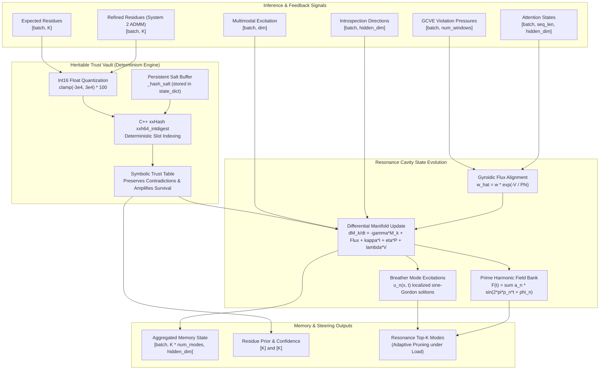

# Resonance Cavity: Dark Matter Memory and Heritable Trust

**Module**: [`src/models/resonance_cavity.py`](file:///d:/programming/python/Gyroidic%20Sparse%20Covariance%20Flux%20Reasoner/src/models/resonance_cavity.py)

The **Resonance Cavity** is the specialized memory module that stores the Self-Model and Dark Matter configurations of the reasoner. Unlike standard Transformer KV-caches which store sequential historical tokens at quadratic $O(N^2)$ memory cost, the Resonance Cavity stores meta-cognition, topological invariants, and heritable residue priors at fixed $O(K)$ complexity across $K$ co-prime functional fields.

---

## 1. Architecture and Dataflow



---

## 2. Core Mathematical Formalism

### 2.1 Differential Manifold Evolution
The cavity maintains a persistent memory state $M_k \in \mathbb{R}^{\text{num\_modes} \times \text{hidden\_dim}}$ for each polynomial functional field $k \in \{0, \dots, K-1\}$, evolving via:

$$
\frac{dM_k}{dt} = \underbrace{-\gamma M_k}_{\text{Decay}} + \underbrace{\sum A^H R}_{\text{Symbolic Flux}} + \underbrace{\kappa I}_{\text{Introspection}} + \underbrace{\eta P}_{\text{Heritable Patterns}} + \underbrace{\lambda V}_{\text{Topological Violation}}
$$

Where:
- **Symbolic Flux ($A^H R$)**: Primary reasoning flow from System 1, warped by `GyroidicFluxAlignment`.
- **Introspection ($\kappa I$)**: Validated meta-cognitive steering directions (moral, non-teleological, creative).
- **Heritable Patterns ($\eta P$)**: Surviving residue combinations reinforced through the `HeritableTrustVault`.
- **Topological Violation ($\lambda V$)**: Structural feedback from the GCVE (Gyroid Covariance Volume Element) probe.

### 2.2 Gyroidic Flux Alignment
Warps attention weights away from manifold tears and singular boundaries:

$$
\hat{w} = w \cdot \exp\left( -\frac{V}{\Phi + \epsilon} \right)
$$

Where $V$ is the local Gyroid violation score and $\Phi$ is the integrated manifold flux.

### 2.3 Prime-Anchored Harmonic Field Superposition
The global field is a deterministic superposition of prime-indexed frequencies:

$$
F(t) = \sum_{n=1}^{N} a_n \sin(2\pi p_n t + \phi_n)
$$

Where:
- $p_n$: The $n$-th prime from the canonical prime ladder.
- $a_n$: Resonator amplitude evolved from structural reinforcement.
- $\phi_n$: Non-commutative Berry phase offset accumulated monotonically over time (Arrow of Time).

---

## 3. Determinism and the Heritable Trust Vault

### 3.1 The Determinism Vulnerability in Legacy Hashing
Standard Python hashing relies on `hash()`, which is randomized per process via `PYTHONHASHSEED`. If a model relies on runtime hashing to index memory slots or trust scores:
1. Re-running the same model checkpoint yields completely different slot mappings.
2. Cross-host and distributed workers lose synchronization.
3. Floating-point roundoff differences across BLAS backends (MKL, OpenBLAS, CUDA) cause adjacent floats to jump hash buckets.

### 3.2 The Determinism Architecture in HeritableTrustVault
The [`HeritableTrustVault`](file:///d:/programming/python/Gyroidic%20Sparse%20Covariance%20Flux%20Reasoner/src/models/resonance_cavity.py#L84) eliminates all sources of non-determinism via a four-tier architecture:

1. **Persistent Salt Buffer**:
   - The salt is not generated from a volatile random seed.
   - It is instantiated once and registered as a PyTorch buffer (`self.register_buffer('_hash_salt', ...)`).
   - The salt is preserved verbatim inside `state_dict` checkpoints, ensuring bit-for-bit replay determinism across restarts, machines, and execution environments.
2. **Float Stabilization via Int16 Quantization**:
   - Continuous residue floats are clamped to $[-30000, 30000]$ and scaled by 100 before conversion to short integers (`.short().numpy().tobytes()`).
   - This eliminates floating-point coprocessor jitter before the byte payload reaches the hash engine.
3. **C++ Accelerated xxHash Engine**:
   - Uses `xxhash.xxh64_intdigest(salt_bytes + row_ints)` directly in C.
   - Operates 10-50x faster than standard Python `hashlib.sha256`.
   - Includes automatic transparent fallback to `hashlib.sha256` if `xxhash` is unavailable:
   ```python
   if _HAS_XXHASH:
       slot = xxhash.xxh64_intdigest(salt_bytes + row_ints) % self.table_size
   else:
       digest = hashlib.sha256(salt_bytes + row_ints).digest()
       slot = struct.unpack_from('<Q', digest)[0] % self.table_size
   ```
4. **Modulo Slot Mapping**:
   - The resulting 64-bit integer digest is reduced modulo `self.table_size`, mapping each residue configuration to an exact table index.

### 3.3 Contradictory Coexistence & Survivorship Amplification
- **Contradiction Preservation**: Competing hypotheses for the same symbolic domain are permitted to coexist in separate slots without premature forced collapse.
- **Survivorship Amplification**: Validated patterns from System 2 ADMM consensus amplify their slot's survivorship score $S \in [0, 1]$.
- **Evolutionary Mutation Bias**: High-trust patterns damp mutation rate during neuro-evolution:
  $$
  \eta = \eta_0 \cdot (1 - \text{Trust})
  $$
  Features with high trust become "fossilized" into the structural memory, guarding against catastrophic forgetting.

---

## 4. Breather Mode Solitons & O(K) Memory Footprint

Concept packets are stored as sine-Gordon breather solitons:

$$
u_n(x, t) = 4 \arctan\left[ \frac{\sqrt{1 - \omega_n^2}}{\omega_n} \cdot \frac{\sin(\omega_n t)}{\cosh\left(\sqrt{1 - \omega_n^2}\,(x - x_n)\right)} \right]
$$

- **Stability Guarantee**: Breather frequencies strictly satisfy $\omega_n = 1 / p_n < 1$, preventing radiation loss.
- **Feature Scar Preservation**: While architectures like Mamba smooth historical context into a single running summary, Breather Modes preserve the topological scar (exact CRT residue tuple and curvature at the time of fossilization) in one of $K$ fixed slots.
- **Adaptive Pruning**: Under system load $\text{load} > 0.5$, candidate retrieval modes are dynamically pruned:
  $$
  \text{top\_k} \leftarrow \max\left(1, \left\lfloor \text{top\_k} \cdot \left(1.0 - (\text{load} - 0.5) \cdot 1.5\right) \right\rfloor\right)
  $$

---

## 5. Verification and Usage

```python
import torch
from src.models.resonance_cavity import ResonanceCavity

# Initialize cavity with 5 prime fields and hidden dimension 256
cavity = ResonanceCavity(dim=256, K=5, num_modes=16)

# Inputs from System 1 and System 2
attention_states = torch.randn(2, 32, 256)
refined_residues = torch.randn(2, 5)

# Forward pass
outputs = cavity(
    attention_states=attention_states,
    refined_residues=refined_residues,
    dt=0.1
)

# Deterministic memory state and residue prior
memory_state = outputs['memory_state']  # [2, 80, 256]
prior = outputs['residue_prior']        # [5]
confidence = outputs['prior_confidence'] # [5]
```
