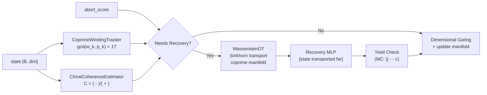

# Speculative Coprime Chiral Coherence Gating (SCCCG)

> Recovery of structure from "converged" states using coprime parity, chiral coherence, and Wasserstein optimal transport.
> **Source**: [`src/core/speculative_coprime_gate.py`](../../../../src/core/speculative_coprime_gate.py) (641 lines)

---

## 1. Overview

When the system detects structural collapse  low chiral score, broken coprime parity, or CALM abort  the SCCCG module attempts **speculative recovery** via optimal transport rather than emitting a failure token.



**Recovery triggers** (any one):
- CALM abort score > 0.5
- Chiral score < `recovery_threshold` (default 0.1)
- Coprime parity lock broken (any head violates `gcd(w_k, p_k) = 1`)

---

## 2. WassersteinOptimalTransport

Approximates the W distance using Sinkhorn iterations with entropic regularization.

$$W_\varepsilon(P, Q) = \min_T \langle T, C \rangle - \varepsilon H(T)$$

| Method | Input | Output |
|--------|-------|--------|
| `compute_cost_matrix(source, target)` | `[n, dim]`, `[m, dim]` | `C [n, m]`  chiral-modulated squared distances |
| `sinkhorn(C, a, b)` | cost matrix + marginals | `T [n, m]`  optimal transport plan |
| `transport(source, target)` | `[n, dim]`, `[m, dim]` | `(transported [n, dim], W scalar)` |

The cost modulator is a learnable linear layer (initialized to identity) that emphasizes asymmetric dimensions in the transport cost.

---

## 3. CoprimeWindingTracker

Tracks phase-angle winding numbers around each functional head to enforce the coprime parity condition:

$$\gcd(w_k, p_k) = 1 \quad \forall k$$

| Step | Computation |
|------|-------------|
| Project | `head_proj(state)`  `[B, 2num_heads]` (sin/cos pairs) |
| Phase | `atan2(sin, cos)`  phases per head |
| Winding | Accumulate `phase / 2` over time |
| GCD check | Quantize winding to integer, check `gcd(w_k, p_k) == 1` |

**Anti-lobotomy**: `p_k` values use Legendre polynomial coefficients `P_k(0.7)` instead of hardcoded primes.

Returns:
- `coprime_lock`: `True` iff all heads satisfy coprimality
- `parity_violations`: `[num_heads]` boolean mask

---

## 4. ChiralCoherenceEstimator (Rashba-Dresselhaus Spectral Splitting)

Estimates chiral coherence via spectral asymmetry of the covariance matrix across helical sectors:

$$C = \frac{\sum_i |\lambda_i^+ - \lambda_i^-|}{\sum_i (\lambda_i^+ + \lambda_i^-)}$$

### Rashba-Dresselhaus Helical Basis Grounding
The decomposition into positive ($\lambda_i^+$) and negative ($\lambda_i^-$) chiral eigenvalues is mathematically isomorphic to the energy dispersion splitting of linear **Rashba-Dresselhaus Spin-Orbit Coupling (SOC)**:
$$H_{\text{SOC}} = \vec{\Omega}(\vec{k}) \cdot \vec{\sigma} = (\alpha k_y + \beta k_x)\sigma_x + (-\alpha k_x - \beta k_y)\sigma_y$$
$$E_\pm(\vec{k}) = E_0(\vec{k}) \pm |\vec{\Omega}(\vec{k})| = E_0(\vec{k}) \pm \sqrt{(\alpha^2 + \beta^2)k^2 + 2\alpha\beta(k_x^2 - k_y^2)}$$

- **Structural Inversion Asymmetry (Rashba $\alpha$)**: Represents the external gradient of the input signal/prompt breaking reflection symmetry.
- **Bulk Inversion Asymmetry (Dresselhaus $\beta$)**: Represents the intrinsic non-centrosymmetric geometry of the co-prime polynomial basis.
- **2x2 Pauli Block Projection**: Replacing the crude heuristic index cut (`[:half]`) with an explicit $2 \times 2$ block projection using Pauli matrices $\vec{\sigma}$ and local gradient $\vec{k}$ eliminates artificial index-order artifacts and prevents false negative recoveries.
- **Fractal Brillouin / Bouligand Zone Superposition**: Momentum space is modeled as a recursive fractal zone ($D_f \approx 2.58$). The system superposes momentum across nested Matrioshka scales $\ell \in \{0, 1, 2\}$, where $\vec{k}^{(\ell)} = 2^{-\ell}\vec{k}$ and coupling strength scales as $2^{-\ell(D_f - 2.0)}$:
  $$\vec{\Omega}_{total}(\vec{k}) = \sum_{\ell=0}^{L-1} 2^{-\ell(D_f - 2.0)} \vec{\Omega}^{(\ell)}(\vec{k}^{(\ell)})$$
- **Compute Affordance Gating**: The multi-scale fractal superposition is strictly gated by `has_headroom()`. Under low-latency or high-load conditions, the estimator falls back to base sector projection, ensuring the evaluative gate remains zero-overhead and strictly bounded $C \in [-1, 1]$.

| Regime | Method |
|--------|--------|
| Buffer < 4 samples | FFT spectral flux asymmetry (low/high frequency power ratio) |
| Buffer $\ge$ 4 samples (Low Affordance) | Chiral projection matrix split into base positive/negative sectors |
| Buffer $\ge$ 4 samples (`has_headroom()`) | 3-scale Fractal Brillouin Pauli superposition with helical eigenstates |

High chiral score = strong asymmetric helical structure (healthy).
Low chiral score = symmetric/collapsed band structure (triggers recovery).

---

## 5. SpeculativeCoprimeGate (Main Module)

Combines all three sub-modules plus Mohr-Coulomb yield checking and dimensional gating.

### 5.1 Constructor Parameters

| Parameter | Default | Purpose |
|-----------|---------|---------|
| `dim` |  | State dimensionality |
| `num_heads` | 8 | Coprime winding heads |
| `recovery_threshold` | 0.1 | Minimum chiral score before recovery |
| `sinkhorn_iters` | 20 | Sinkhorn iterations for OT |
| `wasserstein_epsilon` | 0.1 | Entropic regularization |

### 5.2 Speculative Recovery Pipeline

1. **Transport**: Sinkhorn OT moves collapsed state  coprime reference manifold
2. **Near-Far Coupling**: Far component = mean of target manifold  learned coupling 
3. **Recovery MLP**: `[state  transported  far]`  recovery delta
4. **Yield Check**: MC yield `|| -  - c > 0` confirms rupture is generative
5. **Dimensional Gating**: Suppress dimensions with parity violations (0.1)
6. **Manifold Update**: If generative, FIFO-update reference manifold

### 5.3 Forward Decision Tree

```
if abort_score > 0.5 OR chiral_score < threshold OR coprime_lock:
     speculative_recovery(state)
else:
     update_manifold(state) + gated_output(state)
```

---

## 6. Return Dictionary

| Key | Type | When |
|-----|------|------|
| `coprime_lock` | bool | Always |
| `chiral_score` | float | Always |
| `wasserstein_distance` | float | Always (0.0 if no recovery) |
| `winding_numbers` | `[num_heads]` | Always |
| `parity_violations` | int | Always |
| `recovery_attempted` | bool | Always |
| `yield_pressure` | float | Recovery only |
| `is_generative` | bool | Recovery only |

---

## 7. Related Documentation

| Doc | Section |
|-----|---------|
| [MATHEMATICAL_DETAILS.md](../../02_math_physics_topology/MATHEMATICAL_DETAILS.md) | 18.2 Coprime Parity & 73 Topological Gyrocompass |
| [TOPOLOGICAL_EXTENSIONS.md](../../02_math_physics_topology/TOPOLOGICAL_EXTENSIONS.md) | Part X: Topological Gyrocompass & Precessional Safeguards |
| [INVARIANT_OPTIMIZATION.md](../../02_math_physics_topology/INVARIANT_OPTIMIZATION.md) | 7.3 Chiral Drift Optimizer |
| [PHYSICS_ADMM.md](../../02_math_physics_topology/PHYSICS_ADMM.md) | 3.2 CALM Predictor (abort signal source) |
| [KAGH_NETWORKS.md](KAGH_NETWORKS.md) | 6 Gödel Logic Gate (related saturated gating) |

---

## 8. False Negative Bypasses & The Shadow Phase
The SCCCG contains strict geometric checks (Repunit virtual traces, Coprime Parity windings). Geometrically opaque states generated via the Sovereign Alphabet (`VoynichLinguist`) intentionally lack these standard homological features, resulting in false negative recovery triggers.

Originally, a `VoynichExemptionToken` would categorically override these recovery events. In Phase 6.3, this has been upgraded into the **Shadow Phase & Ouroboros Loop**:
- `VoynichExemptionToken` now acts as a diagnostic anchor rather than a blunt override.
- Discrepancies between the math and the token are logged internally via `self.shadow_logs.append(...)`.
- The `DiegeticEngine` extracts these logs (`pop_shadow_logs()`) and mints them as new structurally bound `KnowledgeDyads`, completing the Ouroboros Ouroboros loop. The system learns from its own non-commutative paradoxes rather than silencing them.
