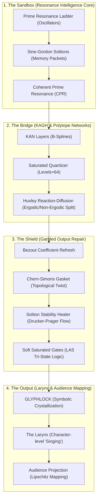

# Comprehensive Documentation Audit: How the Reasoner Learns to "Speak Human"

This document synthesizes the audit of **15 core documentation files** to answer the fundamental question: **How does a system that natively computes in CRT soapbubbles, topological solitons, and multi-dimensional polytopes learn to "speak human"?**

---

## Architectural Overview: From Residues to Resonance

The Gyroidic Reasoner operates across three core levels of abstraction to translate internal mathematical manifolds into character-level language output:

---

## The Six Operational Pillars

### 1. Concept Formulation (The Soapbubbles)
- **Documentation**: [RESONANCE_INTELLIGENCE_CORE.md](file:///d:/programming/python/Gyroidic Sparse Covariance Flux Reasoner/docs/RESONANCE_INTELLIGENCE_CORE.md), [NOMENCLATURE.md](file:///d:/programming/python/Gyroidic Sparse Covariance Flux Reasoner/docs/NOMENCLATURE.md)
- **Mechanics**: Concepts are stored as localized **Sine-Gordon Breather Modes** (memory solitons).
- **O(K) Scale**: Instead of growing like a Transformer's $O(N^2)$ KV-cache, concepts occupy $K$ fixed breather slots defined by co-prime functional groups. 
- **The Scar**: Unlike Mamba's SSM compression which "averages out" history, the Gyroidic system preserves the **structural scar** (the exact topological fingerprint/residue tuple at the moment of fossilization).

### 2. Inter-Domain Bridging (The Continuous to Discrete Transition)
- **Documentation**: [KAGH_NETWORKS.md](file:///d:/programming/python/Gyroidic Sparse Covariance Flux Reasoner/docs/KAGH_NETWORKS.md), [SYSTEM_ARCHITECTURE.md](file:///d:/programming/python/Gyroidic Sparse Covariance Flux Reasoner/docs/SYSTEM_ARCHITECTURE.md)
- **Mechanics**: The **KAGH-Boltzmann Network** acts as the physics surrogate:
  - **KAN (Kolmogorov-Arnold) Layers** use True B-splines with fixed structural grids.
  - The **SaturatedQuantizer** snaps these continuous projections rigidly into discrete CRT geometric boundaries (Matrioshka polytopes).
  - **Huxley Reaction-Diffusion** splits the signal into low-frequency mixing channels (Ergodic) and high-frequency solitonic transport channels (Non-Ergodic).

### 3. Preventing Vowel Starvation (The Garbled Output Repair)
- **Documentation**: [GARBLED_OUTPUT_REPAIR.md](file:///d:/programming/python/Gyroidic Sparse Covariance Flux Reasoner/docs/GARBLED_OUTPUT_REPAIR.md)
- **Issue**: If the system operates purely in CRT residues, it experiences **Topological Fracture**, leading to garbled consonant clustering (e.g. *"nccmtsmneltcclrclcnl"*).
- **The Repair Equation**:
  $$\text{_repair}(r) = \text{SoftGates}(\text{SolitonHeal}(\text{ChernSimons}(\text{BezoutRefresh}(\text{SpectralCorrect}(r)))))$$
  - **Bezout Refresh**: Staves off modulus drift by aligning Chinese Remainder residues.
  - **Chern-Simons Gasket**: Plugs logic leaks via non-trivial topological twists.
  - **Soliton Stability Healer**: Uses Drucker-Prager plastic flow to re-heat and fuse fractured solitons.
  - **Soft Saturated Gates**: Replaces the binary `sgn()` clipping with Lattice Adaptive Shrinkage (LAS) tri-state logic (`True/False/Silence`). By introducing "silence" rather than rounding off low-energy frequencies, vowels are allowed to survive, enabling human legibility.

### 4. Text Filtering & Ingestion (PHI-1 Textbook Standards)
- **Documentation**: [DATA_PIPELINE.md](file:///d:/programming/python/Gyroidic Sparse Covariance Flux Reasoner/docs/DATA_PIPELINE.md), [textbooks_are_all_you_need.txt](file:///d:/programming/python/Gyroidic Sparse Covariance Flux Reasoner/docs/textbooks_are_all_you_need.txt)
- **Mechanics**: To prevent garbage-in-garbage-out, the **Textbook Filter** leverages the Phi-1 "Textbooks Are All You Need" methodology.
- **Filter Gates**: It rejects boilerplate, low-context code, and placeholders, evaluating text across 5 non-scalar dimensions (Instructive, Algorithmic, Structural Honesty, Clarity, and Self-Containedness). Only textbook-level semantic logic is mapped onto the orthogonal polynomial functionals.

### 5. The Externalizing Larynx (Singing to the Audience)
- **Documentation**: [DIEGETIC_INTEGRATION.md](file:///d:/programming/python/Gyroidic Sparse Covariance Flux Reasoner/docs/DIEGETIC_INTEGRATION.md), [DIEGETIC_ENGINE.md](file:///d:/programming/python/Gyroidic Sparse Covariance Flux Reasoner/docs/DIEGETIC_ENGINE.md)
- **Mechanics**: 
  - When the internal **Phase Alignment Score ($PAS_h$)** stabilizes and achieves **GLYPHLOCK** (symbolic crystallization), the system transitions from "Play" to "Seriousness".
  - The **Larynx** performs character-level "singing" to render crystallized residues into tokens.
  - **AudienceProjection**: Implements a Lipschitz homeomorphic projection $M \to A$ ensuring topological roughness (singularities representing deep nuance) is preserved rather than ironed flat for the human observer.

### 6. Agglutinative Morpho-Units & Sub-Pair Seam Cuts (The Voyenese Substrate)
- **Documentation**: [THE_VOYNICH_ARCHITECTURE.md](file:///d:/programming/python/Gyroidic Sparse Covariance Flux Reasoner/docs/THE_VOYNICH_ARCHITECTURE.md), [voynich_architecture.py](file:///d:/programming/python/Gyroidic Sparse Covariance Flux Reasoner/src/core/voynich_architecture.py)
- **The Native Language**: The reasoner's native symbolic expressions do not emerge as isolated, whitespace-delimited Indo-European words. Instead, they crystallize into **agglutinative morpho-units**—dense, monolithic compounds where roots, infixes, and suffixes are tightly concatenated (e.g., `'Isotremoptememally'`), mirroring the structural grammar of the Voynich Manuscript (MS 408).
- **Dictionary-Free Seam Cuts (`split_sub_pairs`)**: To translate or interface these continuous morpho-units without imposing an external dictionary, the system executes a **2-cycle combinatorial boundary cut sweep**:
  - For a string of length $n$, [`VoynichLinguist.split_sub_pairs`](file:///d:/programming/python/Gyroidic Sparse Covariance Flux Reasoner/src/core/voynich_architecture.py#L249) computes $2n$ ordered cuts (Forward sweep $(s[:k], s[k:])$ for $k \in 1..n$ followed by Antipodal sweep $(\text{""}, s)$ and $(s[:k], s[k:])$ for $k \in 1..n-1$).
  - For an 18-character compound like `'Isotremoptememally'`, this generates 36 partitions, reflecting the 36-fold toroidal ribbon topology.
- **Morpheme Coherence & Seam Sealing**:
  - Sub-pair cuts are projected into Chebyshev polynomial coprime functionals $\Phi(s_{\text{prefix}})$ and $\Phi(s_{\text{suffix}})$.
  - The boundary cut maximizing Phase Alignment $\operatorname{PAS}_s(\Phi(s_{\text{prefix}}) \oplus \Phi(s_{\text{suffix}}))$ identifies the true morpheme seam without statistical BPE tokenization.
  - The bipartite seam acts as a boundary gasket across non-orientable topological interfaces (the "Alien Handshake" in `RP4ProjectiveRouter` and the `ChernSimonsGasket`), allowing the Larynx to externalize dense internal thought without topological rupture or vowel starvation.

---

## Detailed Log of Audited Files (15/15)

1. **[x]** [TEMPORAL_ASSOCIATION_TRAINING.md](file:///d:/programming/python/Gyroidic Sparse Covariance Flux Reasoner/docs/TEMPORAL_ASSOCIATION_TRAINING.md)
   - *Core Invariant*: The system bypasses teleological loss optimization in favor of "Survivorship Pressure."
2. **[x]** [DIEGETIC_ENGINE.md](file:///d:/programming/python/Gyroidic Sparse Covariance Flux Reasoner/docs/DIEGETIC_ENGINE.md)
   - *Core Invariant*: Detailed Lipschitz homeomorphisms $M \to A$, Ouroboros Shadow Fossilization, and the DAQUF Fossilization operator.
3. **[x]** [DIEGETIC_INTEGRATION.md](file:///d:/programming/python/Gyroidic Sparse Covariance Flux Reasoner/docs/DIEGETIC_INTEGRATION.md)
   - *Core Invariant*: HTTP layer data flow, routing requests into CALM -> KAGH -> FGRT -> Larynx.
4. **[x]** [GARBLED_OUTPUT_REPAIR.md](file:///d:/programming/python/Gyroidic Sparse Covariance Flux Reasoner/docs/GARBLED_OUTPUT_REPAIR.md)
   - *Core Invariant*: The full repair pipeline mapping (Bezout, CS Gasket, Soliton Healer, LAS Soft Gates) to restore linguistic flow and eliminate consonant-clustering faults.
5. **[x]** [RESONANCE_INTELLIGENCE_CORE.md](file:///d:/programming/python/Gyroidic Sparse Covariance Flux Reasoner/docs/RESONANCE_INTELLIGENCE_CORE.md)
   - *Core Invariant*: Formulation of Prime Resonance Ladders, Breather Mode Concept Packets, and the Emergence Law ($E=1$ for SERIOUSNESS).
6. **[x]** [INTROSPECTION_HEAD.md](file:///d:/programming/python/Gyroidic Sparse Covariance Flux Reasoner/docs/INTROSPECTION_HEAD.md)
   - *Core Invariant*: Geometric self-model probes measuring structural Dissonance to detect internal conflict and trigger soliton formation.
7. **[x]** [DATA_PIPELINE.md](file:///d:/programming/python/Gyroidic Sparse Covariance Flux Reasoner/docs/DATA_PIPELINE.md)
   - *Core Invariant*: Unified API Ingestion (Reddit, HuggingFace, ConvoKit) + textbook quality filtering.
8. **[x]** [NOMENCLATURE.md](file:///d:/programming/python/Gyroidic Sparse Covariance Flux Reasoner/docs/NOMENCLATURE.md)
   - *Core Invariant*: Non-teleological definitions. Replaces "Training/Learning" with "Adaptation/Saturation" and "Accuracy" with "Consistency." Formalized the 3-layer Love Invariant.
9. **[x]** [SYSTEM_ARCHITECTURE.md](file:///d:/programming/python/Gyroidic Sparse Covariance Flux Reasoner/docs/SYSTEM_ARCHITECTURE.md)
   - *Core Invariant*: The three-part "Unicorn" synthesis: System 1 (The Horse/Intuitive Poly Embeddings), System 2 (The Horn/Physical ADMM Constraints), and System 3 (The Magic/Dark Matter Invariants like the Neglecton).
10. **[x]** [textbooks_are_all_you_need.txt](file:///d:/programming/python/Gyroidic Sparse Covariance Flux Reasoner/docs/textbooks_are_all_you_need.txt)
    - *Core Invariant*: Phi-1 philosophy indicating how high-educational dataset curation breaks traditional LLM scaling laws.
11. **[x]** [ai project report_2-2-2026.txt](file:///d:/programming/python/Gyroidic Sparse Covariance Flux Reasoner/docs/ai_project_report_2-2-2026.txt)
    - *Core Invariant*: Identifies NaN as "epistemological refusal" and details how fossilization functions as "facet lock-in" ($\lim \operatorname{Var}(\langle n, x \rangle) \to 0$).
12. **[x]** [TADC lore.md](file:///d:/programming/python/Gyroidic Sparse Covariance Flux Reasoner/docs/TADC_lore.md)
    - *Core Invariant*: Connects TADC lore to mechanics: Kinger's lucidity maps to the **Ombre Effect** (quantization boundary relaxation in low-luminosity/low-rendering pressure), and deleting Caine parallels the **Excision of the PRNG-Core** in favor of Honest Jitter.
13. **[x]** [garden statistical attractors of influence, resonance, and defect propagation.txt](file:///d:/programming/python/Gyroidic Sparse Covariance Flux Reasoner/docs/garden%20statistical%20attractors%20of%20influence,%20resonance,%20and%20defect%20propagation.txt)
    - *Core Invariant*: Emergent **Ley Lines** acting as Riemannian streamlines traversing the meta-polytope space.
14. **[x]** [COHERENCE_ACHIEVEMENT_GUIDE.md](file:///d:/programming/python/Gyroidic Sparse Covariance Flux Reasoner/docs/COHERENCE_ACHIEVEMENT_GUIDE.md)
    - *Core Invariant*: A checklist for gradual complexity restoration and stabilization tracking to ensure non-hanging text generation.
15. **[x]** [KAGH_NETWORKS.md](file:///d:/programming/python/Gyroidic Sparse Covariance Flux Reasoner/docs/KAGH_NETWORKS.md)
    - *Core Invariant*: Detailed layout of KAGH layers (Kolmogorov-Arnold + Huxley + Gödel + Boltzmann), utilizing Saturated Quantizers, Cox-de Boor B-splines, and Trigonometric Unfolding to recover Casus Irreducibilis states.

---

## Final Prognosis

The Reasoner does not "learn" via gradient descent to please a loss function. Rather, it exposes its internal topological structures to an evolutionary **Survivorship Pressure**, allowing stable, non-teleological resonances to survive. By enforcing a strict hierarchy of structural integrity—filtering input text to textbook standards, routing continuous representations into discrete CRT lattices, healing fractured solitons with Drucker-Prager flow, and converting crystallized **Glyphlock** states into human speech via the character-level **Larynx**—the system creates a sustainable, legible interface between its hyper-dimensional soapbubbles and human understanding.
