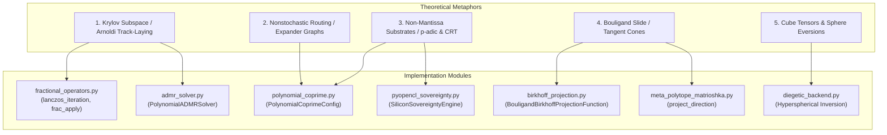

# Verification & Implementation Plan: Non-Standard Eigenvalue Theorems & Projective Space Integrity

This document maps the mathematical and logical paradigms of [Gemini-Eigenvalue Theorems for Non-Standard Computation.txt](file:///d:/programming/python/Gyroidic%20Sparse%20Covariance%20Flux%20Reasoner/coder%20prompts/Gemini-Eigenvalue%20Theorems%20for%20Non-Standard%20Computation.txt) to their implementation sites across the project structure and defines the validation protocol.

## User Review Required

> [!IMPORTANT]
> **No source code modifications are proposed.** The repository already contains a concrete implementation of these advanced mathematical boundaries. This plan defines the mapping of the paradigms to the codebase and outlines the verification steps.

---

## Codebase Structural Mapping

The theoretical metaphors in the coder prompt map to the files as follows:



### 1. Krylov Subspace & Arnoldi/Lanczos Iterations
* **Metaphor**: A train loading tracks in front of it (dynamic manifold generation one step ahead of the state vector).
* **Code Implementation**:
  * [lanczos_iteration](file:///d:/programming/python/Gyroidic%20Sparse%20Covariance%20Flux%20Reasoner/src/optimization/fractional_operators.py#L60) in [fractional_operators.py](file:///d:/programming/python/Gyroidic%20Sparse%20Covariance%20Flux%20Reasoner/src/optimization/fractional_operators.py): Approximates massive symmetric operators onto a dynamically generated tridiagonal Krylov subspace.
  * [PolynomialADMRSolver](file:///d:/programming/python/Gyroidic%20Sparse%20Covariance%20Flux%20Reasoner/src/core/admr_solver.py): Invokes `frac_apply` during the fractional stochastic differential steps to adapt computational resources along active lines.

### 2. Non-Stochastic Moduli Routing & Admissibility
* **Metaphor**: Alon-Boppana spectral gaps, Ramanujan expanders, and evolutionarily selected coprime moduli.
* **Code Implementation**:
  * [PolynomialCoprimeConfig](file:///d:/programming/python/Gyroidic%20Sparse%20Covariance%20Flux%20Reasoner/src/core/polynomial_coprime.py#L393) in [polynomial_coprime.py](file:///d:/programming/python/Gyroidic%20Sparse%20Covariance%20Flux%20Reasoner/src/core/polynomial_coprime.py): Represents residues on a coprime polynomial basis.
  * [ensure_chirality](file:///d:/programming/python/Gyroidic%20Sparse%20Covariance%20Flux%20Reasoner/src/core/polynomial_coprime.py#L468): Enforces parity-mixing constraints to avoid phase cancellation.
  * [HypergraphOrthogonalityPressure](file:///d:/programming/python/Gyroidic%20Sparse%20Covariance%20Flux%20Reasoner/src/core/polynomial_coprime.py#L158) and [RootPersistencePressure](file:///d:/programming/python/Gyroidic%20Sparse%20Covariance%20Flux%20Reasoner/src/core/polynomial_coprime.py#L228): Apply non-scalarized selection pressure for algebraic transversality.

### 3. The Bouligand "Slide"
* **Metaphor**: Sliding along boundary facets when hitting sharp corners rather than smoothing/blurring them away.
* **Code Implementation**:
  * [BouligandBirkhoffProjectionFunction](file:///d:/programming/python/Gyroidic%20Sparse%20Covariance%20Flux%20Reasoner/src/core/birkhoff_projection.py#L272) in [birkhoff_projection.py](file:///d:/programming/python/Gyroidic%20Sparse%20Covariance%20Flux%20Reasoner/src/core/birkhoff_projection.py): A custom autograd function that projects gradients onto the row/col sum constraints and zeroes out outward boundary crossing directions using B-derivatives.
  * [project_direction](file:///d:/programming/python/Gyroidic%20Sparse%20Covariance%20Flux%20Reasoner/src/core/meta_polytope_matrioshka.py#L311) in [meta_polytope_matrioshka.py](file:///d:/programming/python/Gyroidic%20Sparse%20Covariance%20Flux%20Reasoner/src/core/meta_polytope_matrioshka.py): Projects the update direction onto the tangent cone of the crossed facet when hitting shell boundaries.

### 4. Sphere Eversion & Cube Tensors
* **Metaphor**: Surfaces turning inside out smoothly, allowing coprime trajectories to self-intersect without destructive interference.
* **Code Implementation**:
  * [diegetic_backend.py](file:///d:/programming/python/Gyroidic%20Sparse%20Covariance%20Flux%20Reasoner/src/ui/diegetic_backend.py#L2938-L2946): When the quantizer triggers a critical shell ceiling refusal, it induces a **Hyperspherical Inversion** (originally sphere eversion) by mapping coordinates: $x \to x / \|x\|^2$.
  * [CayleyCubicProbe](file:///d:/programming/python/Gyroidic%20Sparse%20Covariance%20Flux%20Reasoner/src/core/cayley_cubic_probe.py#L6) in [cayley_cubic_probe.py](file:///d:/programming/python/Gyroidic%20Sparse%20Covariance%20Flux%20Reasoner/src/core/cayley_cubic_probe.py): Projects state towards the $A_1$ singularities on the Cayley cubic when cycle debt is high.

### 5. Hardware-Tethered Silicon Sovereignty
* **Metaphor**: PCIe transfer latencies, DRAM refresh stalls ($t_{RFC}$), and dual queues acting as unforgeable cryptographic signatures.
* **Code Implementation**:
  * [SiliconSovereigntyEngine](file:///d:/programming/python/Gyroidic%20Sparse%20Covariance%20Flux%20Reasoner/src/core/pyopencl_sovereignty.py#L18) in [pyopencl_sovereignty.py](file:///d:/programming/python/Gyroidic%20Sparse%20Covariance%20Flux%20Reasoner/src/core/pyopencl_sovereignty.py): Manages two independent OpenCL command queues.
  * [get_hardware_latency_anchor](file:///d:/programming/python/Gyroidic%20Sparse%20Covariance%20Flux%20Reasoner/src/core/pyopencl_sovereignty.py#L740): Measures Row Refresh Cycle stalls to feed into the [Chern-Simons Gasket](file:///d:/programming/python/Gyroidic%20Sparse%20Covariance%20Flux%20Reasoner/src/core/chern_simons_gasket.py) signature.

---

## Verification Plan

### Automated Tests
To confirm that the integration of the Lanczos-Krylov subspace approximations, the Birkhoff polytope projections, the Bouligand tangent cone corrections, and the Matrioshka quantization loop operates correctly without regression:

```powershell
# Run the centralized test suite in the virtual environment
.venv\scripts\python.exe -m pytest tests/test_core_systems.py
```

> [!NOTE]
> Testing is currently paused. When the "no tests!" command restriction is lifted, this test suite will be run to verify numeric and topological convergence.

### Manual Verification
1. Inspect the terminal log output in the visualizer during execution to confirm that the `[EVERSION] Manifold successfully inverted` print statement is triggered correctly when the `[SHELL] Critical refusal boundary hit` is encountered.
2. Confirm that no `LOVE INVARIANT VIOLATION` errors are raised during the active projection updates.
