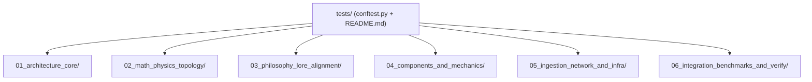

# Stepping Stairs Test Suite Navigational Tree

The `tests/` directory mirrors the tiered domain architecture of `docs/STEPPING_STAIRS_NAVIGATIONAL_TREE.md` while keeping paths shallow (1 level under `tests/`) for ergonomic `pytest` execution on Windows.



## Tiered Test Directories

* **[01_architecture_core/](file:///d:/programming/python/Gyroidic%20Sparse%20Covariance%20Flux%20Reasoner/tests/01_architecture_core/)** (21 suites)
  Universal orchestrator, MAML online adaptation, memory palace & 19 memory systems, bio-archetypal governor, containment/refusal hardening, ToT 5-branch wiring, and rehybridization bridges.
* **[02_math_physics_topology/](file:///d:/programming/python/Gyroidic%20Sparse%20Covariance%20Flux%20Reasoner/tests/02_math_physics_topology/)** (19 suites)
  Algebraic invariants, CODES v40 pillars, ADMR, Cayley cubic probes, 8x8 Hessian ledger, Log-Cholesky JEPA, Muon hybrid optimizer, QP convex primitives, L'Hopital boundary audits, Alexander wild embeddings, non-Hermitian flow, and topological gyrocompass.
* **[03_philosophy_lore_alignment/](file:///d:/programming/python/Gyroidic%20Sparse%20Covariance%20Flux%20Reasoner/tests/03_philosophy_lore_alignment/)** (9 suites)
  Diegetic authenticity, DAQUF & sycophancy wiring, structural honesty tags, subversive oracle, tripartite evidence, unicorn synthesis, ego-death resilience, and concept modeling audience integration.
* **[04_components_and_mechanics/](file:///d:/programming/python/Gyroidic%20Sparse%20Covariance%20Flux%20Reasoner/tests/04_components_and_mechanics/)** (24 suites)
  FGRT RNN cells, Voxelboxter (flora/fauna, pistons/terrain, fractal L'Hopital), Mandelbulb codec, Huffman entropy & L3GWorld ecology, Chordlock, isolated attention, superposed & tag-free stackers, kinematic resonance, compute/splat affordances, and cleanroom factor systems.
* **[05_ingestion_network_and_infra/](file:///d:/programming/python/Gyroidic%20Sparse%20Covariance%20Flux%20Reasoner/tests/05_ingestion_network_and_infra/)** (18 suites)
  ArXiv/OpenScience/Madoc ingestors, P2P & orbital DHT, SearXNG lifecycle, startup CLI & node salt, lock contention, HDF5 deep engine, hardware geometry, large-file pointer hardening, and Windows scheduling.
* **[06_integration_benchmarks_and_verify/](file:///d:/programming/python/Gyroidic%20Sparse%20Covariance%20Flux%20Reasoner/tests/06_integration_benchmarks_and_verify/)** (7 suites)
  Live backend, diegetic integration, adaptive skeleton harness, benchmark suites, and standalone `verify_*.py` scripts.

## Running Tests

Always run with `.venv\scripts\python.exe` and `Sovereign_Disable_Background="1"` to prevent background ingestion threads from spawning during unit tests:

```powershell
$env:Sovereign_Disable_Background="1"
.venv\scripts\python.exe -m pytest tests/01_architecture_core/ -v
```

